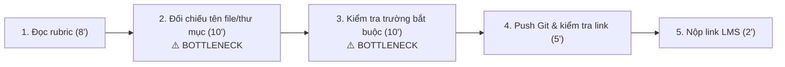
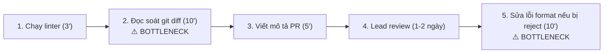
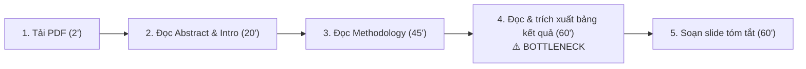

# Báo cáo cá nhân — MSSV_HoTen

> Đổi tên file theo quy tắc `MSSV_HoTen.md`, ví dụ `20241234_NguyenVanAn.md` (MSSV trước, dấu `_`, họ tên viết liền không dấu). Sửa cả dòng tiêu đề phía trên cho khớp.
> Template chi tiết và prompt mẫu cho từng mục: [docs/01-worksheet.md](../../docs/01-worksheet.md).
> Mỗi thành viên một file trong `report/individual/` trên repo nhóm: copy template này thành file mới, điền, rồi commit bằng tài khoản GitHub của bạn. Không viết hộ người khác.

## 1. Thông tin học viên

- Họ tên:
- MSSV:
- Email trường (không bắt buộc, repo có thể để public):
- Tên nhóm:
- Link repo nhóm:

---

## 2. Scan problem (CP1)

Lăng kính: **Lặp lại** · **Tốn thời gian** · **Cần đọc, tổng hợp nhiều thông tin** · **Pain từ người khác**.

| # | Lăng kính | Job Story: Khi… tôi muốn… để… | Ai chịu ảnh hưởng? | Dấu hiệu thật (thời gian, tần suất, số người, bằng chứng) |
|---:|---|---|---|---|
| 1 | Lặp lại | Khi chuẩn bị nộp bài tập lớn/bài lab môn học trước 23h59, tôi muốn tự động đối chiếu cấu trúc thư mục, quy tắc đặt tên file và các trường bắt buộc với tài liệu rubric, để không bị trừ điểm oan vì sai format nộp bài. | Sinh viên trong lớp (bản thân và các nhóm) | Mất 25–30 phút dò tay từng file trước hạn nộp; ở bài lab Day 01 vừa rồi có ít nhất 6 bạn trong lớp bị trừ điểm vì nhầm tên repo hoặc file con. |
| 2 | Lặp lại | Khi đến hạn hoàn thành sprint mỗi tuần, tôi muốn tự động kiểm tra nhanh định dạng docstring, commit message và chuẩn style code, để không bị tech lead reject pull request vì các lỗi định dạng vụn vặt. | Thành viên dev, Tech lead | Trung bình mất 15–20 phút/PR để tự rà soát; nhóm 4 người tạo khoảng 6–8 PR/tuần; 30% PR bị comment nhắc sửa format. |
| 3 | Tốn thời gian | Khi nhận một tài liệu đặc tả kỹ thuật/API spec từ đối tác dài hơn 25 trang, tôi muốn trích xuất nhanh các endpoint xác thực và payload dữ liệu bắt buộc, để lên kế hoạch tích hợp trong ngày mà không phải đọc thủ công từng trang. | Kỹ sư phần mềm / Backend dev | Mất 1.5–2 tiếng đọc lướt và lọc thông tin; tần suất 2–3 lần/tháng khi tích hợp hệ thống ngoài. |
| 4 | Tốn thời gian | Khi chuẩn bị slide cho buổi seminar hàng tuần tại phòng lab, tôi muốn trích xuất nhanh các đóng góp chính và bảng số liệu so sánh từ bài báo khoa học 10–12 trang, để hoàn thành dàn ý trình bày trong vòng 30 phút. | Sinh viên nghiên cứu, Báo cáo viên | Mất trung bình 3–4 tiếng đọc và ghi chép; 2 tuần làm 1 lần; thường xuyên bị sót các phân tích thử nghiệm (ablation study). |
| 5 | Cần đọc, tổng hợp | Khi debug một lỗi runtime lạ từ thư viện mã nguồn mở, tôi muốn tổng hợp các giải pháp khả thi từ nhiều luồng thảo luận trên GitHub Issues và Stack Overflow, để sửa lỗi nhanh mà không phải mở hàng chục tab trình duyệt. | Kỹ sư phần mềm, AI Engineer | Mất 1–2 tiếng mỗi lần gặp lỗi lạ; tần suất 1–2 lần/tuần; thường phải đọc qua 3–5 thread dài với nhiều ý kiến trái chiều. |
| 6 | Cần đọc, tổng hợp | Khi chuẩn bị bước vào tuần thi giữa kỳ từ 8–10 slide bài giảng rời rạc, tôi muốn tổng hợp bảng đối chiếu các khái niệm cốt lõi và công thức quan trọng theo từng chủ đề, để ôn tập trọng tâm mà không bị sót kiến thức. | Bản thân, sinh viên cùng lớp | Mất 4–5 tiếng tổng hợp tài liệu trước mỗi kỳ thi; các bạn trong lớp liên tục hỏi xin tài liệu tóm tắt trong nhóm chat. |
| 7 | Pain từ người khác | Khi thành viên mới gia nhập nhóm dự án, họ muốn có danh sách các bước cài đặt môi trường và cách xử lý lỗi môi trường phổ biến, để có thể chạy được mã nguồn ngay trong ngày đầu mà không phải hỏi từng người trong team. | Thành viên mới, Mentor/Leader | Quá trình onboarding mất 1–2 ngày; trong tháng qua có 4 lần thành viên mới hỏi lặp lại cùng một lỗi cấu hình biến môi trường trên Slack. |
| 8 | Pain từ người khác | Khi người dùng báo lỗi phần mềm qua kênh chat cộng đồng bằng văn bản tự do, nhân viên trực muốn phân loại mức độ khẩn cấp và chuyển đúng lập trình viên phụ trách module đó, để xử lý kịp cam kết hỗ trợ (SLA). | Nhân viên hỗ trợ, Lập trình viên | 15–20 phản ánh/ngày; mất trung bình 5 phút để đọc hiểu và phân loại thủ công; khoảng 10% trường hợp bị chuyển nhầm module. |
| 9 | Lặp lại | Khi kết thúc tuần làm việc vào chiều thứ Sáu, tôi muốn tổng hợp các task đã hoàn thành và danh sách blocker từ nhật ký commit thành 1 bản cập nhật ngắn, để gửi trưởng nhóm đúng hạn 17h mà không phải nhớ lại từng việc. | Bản thân, Trưởng nhóm | Tốn 35–45 phút mỗi chiều thứ Sáu; 2/4 tuần gần nhất bị nhắc gửi trễ vì phải lục lại lịch sử chat và commit Git. |
| 10 | Tốn thời gian | Khi đi thực tế dự án hoặc tổ chức sự kiện nhóm về, tôi muốn trích xuất số tiền, ngày tháng và mã số thuế từ ảnh chụp hóa đơn vào file Google Sheets kê khai chi phí, để hoàn ứng tài chính mà không cần nhập tay từng dòng. | Thủ quỹ nhóm, Ban hậu cần | Mất 45–60 phút nhập tay mỗi đợt 15–20 hóa đơn; thường xuyên bị phòng tài vụ trả về do sai sót số lẻ hoặc ngày tháng. |

**Nếu có dùng AI để gợi ý thêm:** 
- *Ý giữ lại:* Sau khi tự scan được 8 ý thực tế, tôi nhờ AI gợi ý thêm góc nhìn cho lăng kính "Lặp lại" và "Tốn thời gian". Tôi đã giữ lại ý #9 (Tổng hợp update tuần từ Git) và #10 (Trích xuất hóa đơn hoàn ứng) vì đây là hai việc tôi và bạn bè từng gặp khi làm dự án thực tế, có thể bấm giờ và đo lường được.
- *Ý bỏ qua:* Tôi đã loại bỏ ý tưởng do AI gợi ý là *"Trợ lý AI tự động quản lý toàn diện lịch trình học tập"* vì ý tưởng này quá mơ hồ, phạm vi quá rộng và không chỉ ra được điểm nghẽn cụ thể trong một quy trình làm việc thực tế.

---

## 3. Top 3 Problem Cards + quy trình nháp (CP2)

### Bảng chọn top 3

| Rank | Problem | Vì sao chọn | Điều còn chưa chắc |
|---:|---|---|---|
| 1 | Rà soát quy cách bài nộp theo rubric (#1) | Quy trình lặp lại rõ ràng, nỗi đau có thật và cấp bách trước mỗi deadline, baseline thời gian đo lường được bằng phút, impact lớn (tránh bị trừ điểm oan). | Có cần dùng AI hay chỉ cần một shell script/rule-based kiểm tra file là đủ? |
| 2 | Kiểm tra định dạng code & PR checklist (#2) | Actor cụ thể (Dev), quy trình rõ ràng trong Git workflow, có thể đo được số phút và tỷ lệ reject PR. | Tiêu chí đánh giá code review của mỗi tech lead có thể khác nhau, khó chuẩn hóa 100%. |
| 3 | Trích xuất thông tin từ bài báo khoa học (#4) | Pain rất lớn của sinh viên nghiên cứu, tốn nhiều thời gian đọc tài liệu học thuật dài và dễ sót số liệu thực nghiệm. | Định dạng bảng biểu và bố cục các bài báo rất đa dạng (PDF 1 cột, 2 cột), dễ bị lỗi trích xuất. |

### Problem Card #1

| Trường | Nội dung |
|---|---|
| Job Story | Khi chuẩn bị nộp bài tập lớn/bài lab môn học trước 23h59, tôi muốn tự động đối chiếu cấu trúc thư mục, quy tắc đặt tên file và các trường bắt buộc với tài liệu rubric, để không bị trừ điểm oan vì sai format nộp bài. |
| Actor | Sinh viên, học viên tham gia các khóa học thực hành công nghệ/AI. |
| Thời điểm / bối cảnh | 1–2 tiếng trước hạn chót nộp bài (thường vào đêm muộn, người làm dễ mất tập trung). |
| Quy trình hiện tại (3–7 bước) | 1. Mở file hướng dẫn/rubric đọc lại danh sách yêu cầu cấu trúc (8 phút) · 2. Mở file explorer đối chiếu từng tên thư mục và tên file xem có sai ký tự không (10 phút) · 3. Mở các file báo cáo kiểm tra tiêu đề và các trường thông tin bắt buộc (10 phút) · 4. Tạo commit, push lên GitHub và kiểm tra lại repo online (5 phút) · 5. Copy link nộp lên hệ thống trường LMS (2 phút). |
| Bottleneck (bước nào, mất bao nhiêu phút) | Bước 2 và 3 (mất 20 phút): Việc dò tay từng file và từng trường thông tin trong tình trạng mệt mỏi sát deadline rất dễ sót lỗi chính tả nhỏ (như nhầm `_` thành `-`, quên sửa template MSSV). |
| Impact (nếu không giải thì sao) | Bị trừ 5–10% tổng số điểm môn học dù nội dung làm tốt; gây tâm lý ức chế và tốn thời gian khiếu nại điểm sau đó. |
| Success metric (baseline → target) | - Baseline: Mất 20 phút kiểm tra thủ công; tỷ lệ sót lỗi format khoảng 15%. - Target: Giảm thời gian kiểm tra xuống dưới 3 phút; tỷ lệ sai sót format = 0%. - Cách đo: Bấm giờ từ lúc bắt đầu kiểm tra đến khi nộp bài; kiểm tra chéo với kết quả chấm điểm thực tế. |
| Phương án không dùng AI | Viết một shell script / checklist file Excel cố định để so khớp tên file và kiểm tra sự tồn tại của file. |
| Giả thuyết về AI (nếu có) | AI đọc file hướng dẫn Markdown tự sinh ra bộ kiểm tra và quét nội dung các file báo cáo xem đã trả lời đủ các câu hỏi bắt buộc chưa. |
| Cảm nhận nhanh | Rule (hoặc Workflow bán tự động) |

Quy trình nháp hiện tại:

### Problem Card #2

| Trường | Nội dung |
|---|---|
| Job Story | Khi đến hạn hoàn thành sprint mỗi tuần, tôi muốn tự động kiểm tra nhanh định dạng docstring, commit message và chuẩn style code, để không bị tech lead reject pull request vì các lỗi định dạng vụn vặt. |
| Actor | Lập trình viên trong nhóm phát triển dự án. |
| Thời điểm / bối cảnh | Trước khi tạo Pull Request trên GitHub/GitLab vào cuối mỗi tính năng. |
| Quy trình hiện tại (3–7 bước) | 1. Tự chạy linter/formatter cục bộ (3 phút) · 2. Đọc lại git diff từng file để kiểm tra comment và docstring (10 phút) · 3. Viết mô tả PR theo template của dự án (5 phút) · 4. Tạo PR và chờ Lead review (1–2 ngày) · 5. Nhận comment yêu cầu sửa format và commit lại (10 phút). |
| Bottleneck (bước nào, mất bao nhiêu phút) | Bước 2 (mất 10 phút tự đọc diff) và bước 5 (mất 10 phút sửa lại khi bị reject): Tốn thời gian lặp lại cho những lỗi quy ước không liên quan đến logic code. |
| Impact (nếu không giải thì sao) | Kéo dài chu kỳ review code, làm chậm tiến độ sprint, gây phiền hà cho người review. |
| Success metric (baseline → target) | - Baseline: 30% PR bị reject vì lỗi format/docstring; mất trung bình 20 phút xử lý. - Target: Tỷ lệ reject vì lỗi format giảm xuống dưới 5%; thời gian rà soát trước khi tạo PR dưới 5 phút. - Cách đo: Đếm số comment liên quan đến định dạng trên GitHub PR của sprint. |
| Phương án không dùng AI | Cài đặt Git pre-commit hooks (Flake8, Black, ESLint) để chặn commit nếu sai định dạng. |
| Giả thuyết về AI (nếu có) | LLM phân tích git diff và tự động sinh bản nháp mô tả PR kèm cảnh báo các hàm thiếu tài liệu giải thích logic. |
| Cảm nhận nhanh | Rule (pre-commit hooks) kết hợp Workflow |

Quy trình nháp hiện tại:

### Problem Card #3

| Trường | Nội dung |
|---|---|
| Job Story | Khi chuẩn bị slide cho buổi seminar hàng tuần tại phòng lab, tôi muốn trích xuất nhanh các đóng góp chính và bảng số liệu so sánh từ bài báo khoa học 10–12 trang, để hoàn thành dàn ý trình bày trong vòng 30 phút. |
| Actor | Sinh viên nghiên cứu / Học viên cao học. |
| Thời điểm / bối cảnh | Thứ Năm hàng tuần, trước buổi báo cáo học thuật định kỳ sáng thứ Sáu. |
| Quy trình hiện tại (3–7 bước) | 1. Tải file PDF bài báo về máy (2 phút) · 2. Đọc Abstract và Introduction để nắm bài toán (20 phút) · 3. Lướt phần Methodology để hiểu mô hình (45 phút) · 4. Đọc bảng Experiments và ghi chép lại kết quả số liệu (60 phút) · 5. Soạn các slide tóm tắt trên PowerPoint/Canva (60 phút). |
| Bottleneck (bước nào, mất bao nhiêu phút) | Bước 4 (mất 60 phút): Các bảng kết quả thực nghiệm rất dài, có nhiều ablation study và baselines, rất dễ nhầm lẫn giữa các cấu hình thử nghiệm. |
| Impact (nếu không giải thì sao) | Mất cả buổi tối chỉ để làm slide cho một bài báo; nếu hiểu sai số liệu thực nghiệm sẽ bị giáo sư chỉnh sửa trong buổi seminar. |
| Success metric (baseline → target) | - Baseline: Tốn 180 phút để đọc và chuẩn bị slide; thỉnh thoảng trích xuất sai thông số baseline. - Target: Giảm tổng thời gian xuống còn 60 phút; độ chính xác số liệu đối chiếu đạt 100%. - Cách đo: Bấm giờ hoàn thành bài thuyết trình; đối chiếu lại các số liệu trên slide với paper gốc. |
| Phương án không dùng AI | Đọc theo template ghi chú nghiên cứu có sẵn (Literature Review Matrix trên Notion/Excel). |
| Giả thuyết về AI (nếu có) | AI OCR trích xuất bảng biểu từ PDF và tạo bản tóm tắt đối chiếu điểm mạnh/yếu của phương pháp đề xuất so với baseline. |
| Cảm nhận nhanh | Workflow |

Quy trình nháp hiện tại:

### Card muốn pitch nhất

- Card số: Card #1 (Rà soát quy cách bài nộp theo rubric).
- Vì sao: Nỗi đau rất thực tế, ai trong lớp cũng từng trải qua hoặc lo lắng mỗi khi đến hạn nộp bài; quy trình có các bước rất rõ ràng, thời gian đo được cụ thể và đặc biệt là bài toán này giúp nhóm dễ dàng so sánh giữa phương án No AI / Rule (dùng script) với Workflow AI.
- Câu hỏi muốn nhóm phản biện: *"Nếu bài toán này chỉ cần một script Python/Bash kiểm tra tên file là giải quyết được 80% vấn đề, thì việc tích hợp AI vào có thực sự mang lại thêm giá trị hay chỉ làm phức tạp hóa hệ thống?"*

### AI đã phản biện card thế nào

| Điểm yếu AI chỉ ra | Đồng ý? | Đã sửa gì |
|---|---|---|
| AI chỉ ra rằng Success Metric ban đầu của tôi ghi là 'nộp bài nhanh hơn và an tâm hơn' — đây là cảm giác chủ quan, không đo lường được và sẽ bị trừ điểm theo rubric C9. | Đồng ý hoàn toàn | Tôi đã sửa lại Success Metric thành các con số định lượng cụ thể: Baseline từ 20 phút giảm xuống Target dưới 3 phút, tỷ lệ sai sót giảm từ 15% về 0%, kèm phương pháp đo lường rõ ràng. |
| AI chất vấn rằng bước 'đọc file hướng dẫn' không phải là bottleneck thực sự, vì đằng nào sinh viên cũng phải đọc đề. | Đồng ý | Tôi đã điều chỉnh lại bottleneck: Tập trung chính xác vào Bước 2 & Bước 3 (Mất 20 phút dò thủ công từng file và kiểm tra từng trường trong file báo cáo vào lúc đêm muộn, đây mới là nơi phát sinh lỗi sai nhiều nhất). |
| AI hoài nghi rằng bài toán này hoàn toàn giải được bằng Rule (viết script kiểm tra file), chưa thấy lý do bắt buộc phải dùng AI. | Đồng ý | Tôi đã bổ sung rõ ở phần Giả thuyết AI: Script thông thường chỉ kiểm tra được sự tồn tại của file và tên file, còn AI sẽ giúp đọc hiểu nội dung xem học viên có thực sự trả lời đúng yêu cầu của từng mục trong báo cáo hay chỉ để template trống. |

---

## 4. Tôi đã tham gia phần nào (CP3 → CP7)

| Hoạt động | Tôi đã làm gì? | Kết quả / ảnh hưởng tới bài nhóm |
|---|---|---|
| Pitch Problem Card | | |
| Phản biện bài của bạn khác | Câu hỏi tôi đã đặt: | |
| Nhận phản biện | Câu hỏi tôi nhận được: | Tôi đã sửa gì: |
| Gom cluster / cây OST | | |
| Chọn candidate problem | | |
| Kiểm chứng / research | | |
| Quy trình nhóm | | |
| Problem Statement | | |
| Mức can thiệp AI | | |
| Quyết định | | |

---

## 5. Dùng AI

| Checkpoint | Tôi dùng AI để làm gì? | AI hữu ích ở đâu? | AI sai hoặc hời hợt ở đâu? | Tôi sửa gì bằng nhận định của mình? |
|---|---|---|---|---|
| CP1 Scan | | | | |
| CP2 Problem Card | | | | |
| CP4 Research | | | | |
| CP5 Quy trình | | | | |
| CP5–6 Problem Statement | | | | |
| CP6 Mức can thiệp / quyết định | | | | |

---

## 6. Reflection (CP7)

Trả lời bằng trải nghiệm thật của bạn, tối thiểu 200 từ cho các câu 6.1–6.6 (không tính 6.7, câu này được chấm riêng ở tiêu chí C5). **Không dùng AI để viết thay.**

**6.1. Tôi học được gì khi nghe top 3 problems của các bạn khác?**

**6.2. Nhóm có lúc nào bị "solution-first" (nghĩ giải pháp trước khi hiểu vấn đề) không? Lúc đó nhóm nhận ra và xử lý thế nào?**

**6.3. Tôi có đổi ý sau khi bị phản biện không? Kể một lần cụ thể.**

**6.4. Kết quả kiểm chứng (phỏng vấn/survey/research) có làm tôi bất ngờ không? Điều gì?**

**6.5. Điều khó nhất khi viết Problem Statement là gì?**

**6.6. Nếu làm lại, tôi sẽ đổi gì? Tôi sẽ phản biện nhóm mạnh hơn ở điểm nào?**

**6.7. Hiểu bài:** giải thích bằng 5–8 câu, không nhìn tài liệu, chuỗi *problem → quy trình → metric → boundary → mức can thiệp AI → quyết định* của bài nhóm mình.

---

## 7. Tài liệu tham khảo

-
