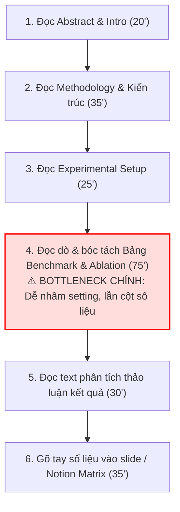
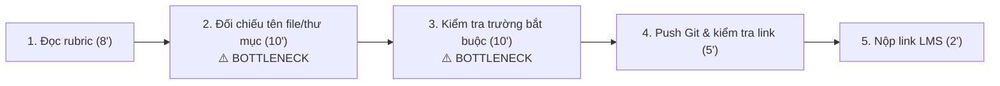
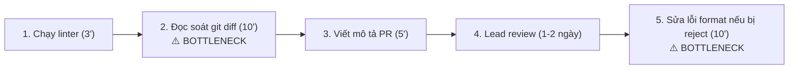

# Báo cáo cá nhân — 2A202603860_VuXuanHieu

> Đổi tên file theo quy tắc `MSSV_HoTen.md`, ví dụ `20241234_NguyenVanAn.md` (MSSV trước, dấu `_`, họ tên viết liền không dấu). Sửa cả dòng tiêu đề phía trên cho khớp.
> Template chi tiết và prompt mẫu cho từng mục: [docs/01-worksheet.md](../../docs/01-worksheet.md).
> Mỗi thành viên một file trong `report/individual/` trên repo nhóm: copy template này thành file mới, điền, rồi commit bằng tài khoản GitHub của bạn. Không viết hộ người khác.

## 1. Thông tin học viên

- Họ tên: Vũ Xuân Hiếu
- MSSV: 2A202603860
- Email trường (không bắt buộc, repo có thể để public): 26ai.hieuvx2@vinuni.edu.vn
- Tên nhóm: NhomBVH
- Link repo nhóm: https://github.com/NTheBao/K5-L3B-DAY02-NhomBVH-DiscoveryProblemFraming

---

## 2. Scan problem (CP1)

Lăng kính: **Lặp lại** · **Tốn thời gian** · **Cần đọc, tổng hợp nhiều thông tin** · **Pain từ người khác**.

| # | Lăng kính | Job Story: Khi… tôi muốn… để… | Ai chịu ảnh hưởng? | Dấu hiệu thật (thời gian, tần suất, số người, bằng chứng) |
|---:|---|---|---|---|
| 1 | Lặp lại | Khi chuẩn bị nộp bài tập lớn/bài lab môn học trước 23h59, tôi muốn tự động đối chiếu cấu trúc thư mục, quy tắc đặt tên file và các trường bắt buộc với tài liệu rubric, để không bị trừ điểm oan vì sai format nộp bài. | Sinh viên trong lớp (bản thân và các nhóm) | Mất 25–30 phút dò tay từng file trước hạn nộp; ở bài lab Day 01 vừa rồi có ít nhất 6 bạn trong lớp bị trừ điểm vì nhầm tên repo hoặc file con. |
| 2 | Lặp lại | Khi đến hạn hoàn thành sprint mỗi tuần, tôi muốn tự động kiểm tra nhanh định dạng docstring, commit message và chuẩn style code, để không bị tech lead reject pull request vì các lỗi định dạng vụn vặt. | Thành viên dev, Tech lead | Trung bình mất 15–20 phút/PR để tự rà soát; nhóm 4 người tạo khoảng 6–8 PR/tuần; 30% PR bị comment nhắc sửa format. |
| 3 | Tốn thời gian | Khi nhận một tài liệu đặc tả kỹ thuật/API spec từ đối tác dài hơn 25 trang, tôi muốn trích xuất nhanh các endpoint xác thực và payload dữ liệu bắt buộc, để lên kế hoạch tích hợp trong ngày mà không phải đọc thủ công từng trang. | Kỹ sư phần mềm / Backend dev | Mất 1.5–2 tiếng đọc lướt và lọc thông tin; tần suất 2–3 lần/tháng khi tích hợp hệ thống ngoài. |
| 4 | Tốn thời gian | Khi chuẩn bị slide cho buổi seminar hàng tuần tại phòng lab, tôi muốn trích xuất nhanh các đóng góp chính và bảng số liệu so sánh từ bài báo khoa học 10–12 trang, để hoàn thành dàn ý trình bày trong vòng 30 phút. | Sinh viên nghiên cứu, Báo cáo viên | Mất trung bình 3–4 tiếng đọc và ghi chép; 2 tuần làm 1 lần; thường xuyên bị sót các phân tích thử nghiệm (ablation study). |
| 5 | Cần đọc, tổng hợp | Khi debug một lỗi runtime lạ từ thư viện mã nguồn mở, tôi muốn tổng hợp các giải pháp khả thi từ nhiều luồng thảo luận trên GitHub Issues và Stack Overflow, để sửa lỗi nhanh mà không phải mở hàng chục tab trình duyệt. | Kỹ sư phần mềm, AI Engineer | Mất 1–2 tiếng mỗi lần gặp lỗi lạ; tần suất 1–2 lần/tuần; thường phải đọc qua 3–5 thread dài với nhiều ý kiến trái chiều. |
| 6 | Cần đọc, tổng hợp | Khi chuẩn bị bước vào tuần thi giữa kỳ từ 8–10 slide bài giảng rời rạc, tôi muốn tổng hợp bảng đối chiếu các khái niệm cốt lõi và công thức quan trọng theo từng chủ đề, để ôn tập trọng tâm mà không bị sót kiến thức. | Bản thân, sinh viên cùng lớp | Mất 4–5 tiếng tổng hợp tài liệu trước mỗi kỳ thi; các bạn trong lớp liên tục hỏi xin tài liệu tóm tắt trong nhóm chat. |
| 7 | Pain từ người khác | Khi thành viên mới gia nhập nhóm dự án, họ muốn có danh sách các bước cài đặt môi trường và cách xử lý lỗi môi trường phổ biến, để có thể chạy được mã nguồn ngay trong ngày đầu mà không phải hỏi từng người trong team. | Thành viên mới, Mentor/Leader | Quá trình onboarding mất 1–2 ngày; trong tháng qua có 4 lần thành viên mới hỏi lặp lại cùng một lỗi cấu hình biến môi trường trên Slack. |
| 8 | Pain từ người khác | Khi người dùng báo lỗi phần mềm qua kênh chat cộng đồng bằng văn bản tự do, nhân viên trực muốn phân loại mức độ khẩn cấp và chuyển đúng lập trình viên phụ trách module đó, để xử lý kịp cam kết hỗ trợ (SLA). | Nhân viên hỗ trợ, Lập trình viên | 15–20 phản ánh/ngày; mất trung bình 5 phút để đọc hiểu và phân loại thủ công; khoảng 10% trường hợp bị chuyển nhầm module. |
| 9 | Lặp lại | Khi kết thúc tuần làm việc vào chiều thứ Sáu, tôi muốn tổng hợp các task đã hoàn thành và danh sách blocker từ nhật ký commit thành 1 bản cập nhật ngắn, để gửi trưởng nhóm đúng hạn 17h mà không phải nhớ lại từng việc. | Bản thân, Trưởng nhóm | Tốn 35–45 phút mỗi chiều thứ Sáu; 2/4 tuần gần nhất bị nhắc gửi trễ vì phải lục lại lịch sử chat và commit Git. |
| 10 | Tốn thời gian | Khi đi thực tế dự án hoặc tổ chức sự kiện nhóm về, tôi muốn trích xuất số tiền, ngày tháng và mã số thuế từ ảnh chụp hóa đơn vào file Google Sheets kê khai chi phí, để hoàn ứng tài chính mà không cần nhập tay từng dòng. | Thủ quỹ nhóm, Ban hậu cần | Mất 45–60 phút nhập tay mỗi đợt 15–20 hóa đơn; thường xuyên bị phòng tài vụ trả về do sai sót số lẻ hoặc ngày tháng. |

**Nếu có dùng AI để gợi ý thêm:** 
- *Ý giữ lại:* Sau khi tự scan được 8 ý thực tế, tôi nhờ AI gợi ý thêm góc nhìn cho lăng kính "Lặp lại" và "Tốn thời gian". Tôi đã giữ lại ý #9 (Tổng hợp update tuần từ Git) và #10 (Trích xuất hóa đơn hoàn ứng) vì đây là hai việc tôi và bạn bè từng gặp khi làm dự án thực tế, có thể bấm giờ và đo lường được.
- *Ý bỏ qua:* Tôi đã loại bỏ ý tưởng do AI gợi ý là *"Trợ lý AI tự động quản lý toàn diện lịch trình học tập"* vì ý tưởng này quá mơ hồ, phạm vi quá rộng và không chỉ ra được điểm nghẽn cụ thể trong một quy trình làm việc thực tế.

---

## 3. Top 3 Problem Cards + quy trình nháp (CP2)

### Bảng chọn top 3

| Rank | Problem | Vì sao chọn | Điều còn chưa chắc |
|---:|---|---|---|
| 1 | Trích xuất thông tin & bảng số liệu thực nghiệm (Benchmark & Ablation Study) từ bài báo khoa học (#4) | Nỗi đau học thuật cực lớn của sinh viên nghiên cứu và học viên AI; tốn 3–4 tiếng mỗi bài; khâu đọc dò bảng thực nghiệm PDF 2 cột rất dễ hoa mắt nhầm lẫn thông số baseline; impact học thuật cao. | Bố cục bảng biểu trong PDF học thuật rất đa dạng (bảng ngang, bảng dọc 2 cột, bảng lồng nhau, ký hiệu toán học), công cụ OCR/LLM liệu có trích xuất chuẩn 100% không bị lệch cột? |
| 2 | Rà soát quy cách bài nộp theo rubric (#1) | Quy trình lặp lại rõ ràng và cấp bách trước mỗi deadline, baseline thời gian đo lường được bằng phút, impact lớn (tránh bị trừ điểm oan). | Có cần dùng AI hay chỉ cần một shell script/rule-based kiểm tra file là đủ? |
| 3 | Kiểm tra định dạng code & PR checklist (#2) | Actor cụ thể (Dev), quy trình rõ ràng trong Git workflow, có thể đo được số phút và tỷ lệ reject PR. | Tiêu chí đánh giá code review của mỗi tech lead có thể khác nhau, khó chuẩn hóa 100%. |

### Problem Card #1 (Card trọng tâm — Chọn để Pitch)

| Trường | Nội dung |
|---|---|
| **Job Story** | Khi chuẩn bị slide báo cáo cho buổi seminar học thuật hàng tuần hoặc làm tổng quan tài liệu (Literature Review) từ một bài báo khoa học 10–15 trang, tôi muốn trích xuất chính xác các đóng góp cốt lõi (contributions), kiến trúc mô hình và các bảng so sánh thực nghiệm (benchmark metrics & ablation studies), để lập bảng đối chiếu phương pháp và hoàn thành dàn ý seminar trong vòng 45 phút mà không phải đọc dò thủ công từng trang PDF 2 cột. |
| **Actor** | Sinh viên nghiên cứu / Học viên cao học tại phòng thí nghiệm AI (AI Lab), hoặc sinh viên năm cuối làm đồ án/khóa luận tốt nghiệp chuyên ngành AI / Khoa học Dữ liệu. |
| **Thời điểm / bối cảnh** | Chiều tối thứ Năm hàng tuần trước buổi Lab Seminar sáng thứ Sáu, hoặc giai đoạn đầu của đề tài nghiên cứu khi cần đọc và tổng hợp 10–20 paper liên quan trong thời gian ngắn. |
| **Quy trình hiện tại (6 bước)** | **1.** Tải PDF từ ArXiv / OpenReview, đọc Abstract và Introduction để nắm bài toán tác giả giải quyết (20 phút). **2.** Đọc lướt phần Methodology & Model Architecture để hiểu luồng xử lý và công thức chính (35 phút). **3.** Đọc phần Experimental Setup (Dataset, Hardware, Baselines, Hyperparameters) để nắm bối cảnh thử nghiệm (25 phút). **4.** **Đọc dò, bóc tách và ghi chép số liệu từ các bảng Benchmark & Ablation Study (75 phút — ⚠️ BOTTLENECK CHÍNH)**. **5.** Đọc đối chiếu phần Text thảo luận kết quả để hiểu vì sao mô hình vượt trội hoặc module nào đem lại hiệu quả cao nhất (30 phút). **6.** Copy-paste số liệu thủ công vào slide PowerPoint hoặc bảng ma trận Literature Review trên Notion (35 phút). ➔ *Tổng thời gian hiện tại: 220 phút (~3.6 tiếng/paper).* |
| **Bottleneck (bước nào, mất bao nhiêu phút)** | **Bước 4 (75 phút):** Bảng biểu trong bài báo khoa học định dạng PDF 2 cột rất phức tạp. Các bảng Benchmark thường có nhiều hàng/cột viết tắt (ví dụ: F1-score, mAP50, BLEU-4, Throughput, FLOPs, Latency). Tệ hơn là các bảng **Ablation Study** (thử nghiệm bóc tách thành phần): tác giả thử nghiệm kết hợp module A + B, bỏ module C, thay đổi loss function... Người đọc phải dùng mắt dò từng dòng, rất dễ nhìn nhầm dòng giữa các cấu hình baseline cũ/mới, nhầm giữa zero-shot vs few-shot, hoặc nhầm giữa kích thước backbone (ví dụ ResNet-50 vs ViT-B/16). |
| **Impact (nếu không giải thì sao)** | - Mất 3–4 tiếng cho mỗi bài báo, gây kiệt sức khi phải chuẩn bị seminar hàng tuần. - Nguy cơ hiểu sai hoặc trích xuất sai số liệu dẫn đến việc báo cáo sai trước Giáo sư và các thành viên lab, làm giảm uy tín học thuật. - Nguy cơ chọn sai Baseline để tái lập (reproduce) hoặc đối chiếu trong nghiên cứu của chính mình, dẫn đến việc lãng phí hàng tuần tính toán GPU để huấn luyện mô hình theo một thiết lập sai. |
| **Success metric (baseline → target)** | - **Baseline:** Mất trung bình 75 phút cho riêng khâu trích xuất và đối chiếu bảng số liệu thực nghiệm; tỷ lệ trích xuất sai/nhầm thông số cấu hình là 25% (đo từ 4 buổi seminar gần nhất). - **Target:** Giảm thời gian trích xuất và đối chiếu bảng số liệu xuống **dưới 15 phút**; tỷ lệ sai lệch số liệu so với paper gốc **dưới 2%**. - **Cách đo:** Bấm giờ từ lúc bắt đầu đọc phần Experiments đến khi hoàn thành bảng đối chiếu; đối chiếu ngẫu nhiên 20 ô số liệu trên bảng trích xuất với ảnh cắt bảng gốc (bounding box crop) từ PDF. |
| **Phương án không dùng AI** | Sử dụng bảng mẫu Literature Review Matrix trên Notion/Excel; in file PDF ra giấy và dùng bút dạ quang (highlighter) 3 màu để đánh dấu thủ công (màu vàng: metric chính, màu xanh: baseline, màu hồng: ablation study). |
| **Giả thuyết về AI (nếu có)** | Sử dụng Multimodal Document AI / Vision LLM đọc trực tiếp các trang PDF chứa bảng biểu, chuyển đổi cấu trúc bảng sang định dạng Markdown/JSON, đồng thời kết hợp prompt phân tích văn bản để tự động trích xuất bảng so sánh 5 cột chuẩn: *Tên mô hình | Dataset | Metric đạt được | Thiết lập thử nghiệm (setting) | Đóng góp của từng module (ablation gain)*. |
| **Cảm nhận nhanh** | **Workflow** (Document Parser trích xuất bảng + LLM reasoning đối chiếu ngữ cảnh). |

Quy trình nháp hiện tại:

### Problem Card #2

| Trường | Nội dung |
|---|---|
| Job Story | Khi chuẩn bị nộp bài tập lớn/bài lab môn học trước 23h59, tôi muốn tự động đối chiếu cấu trúc thư mục, quy tắc đặt tên file và các trường bắt buộc với tài liệu rubric, để không bị trừ điểm oan vì sai format nộp bài. |
| Actor | Sinh viên, học viên tham gia các khóa học thực hành công nghệ/AI. |
| Thời điểm / bối cảnh | 1–2 tiếng trước hạn chót nộp bài (thường vào đêm muộn, người làm dễ mất tập trung). |
| Quy trình hiện tại (3–7 bước) | 1. Mở file hướng dẫn/rubric đọc lại danh sách yêu cầu cấu trúc (8 phút) · 2. Mở file explorer đối chiếu từng tên thư mục và tên file xem có sai ký tự không (10 phút) · 3. Mở các file báo cáo kiểm tra tiêu đề và các trường thông tin bắt buộc (10 phút) · 4. Tạo commit, push lên GitHub và kiểm tra lại repo online (5 phút) · 5. Copy link nộp lên hệ thống trường LMS (2 phút). |
| Bottleneck (bước nào, mất bao nhiêu phút) | Bước 2 và 3 (mất 20 phút): Việc dò tay từng file và từng trường thông tin trong tình trạng mệt mỏi sát deadline rất dễ sót lỗi chính tả nhỏ (như nhầm `_` thành `-`, quên sửa template MSSV). |
| Impact (nếu không giải thì sao) | Bị trừ 5–10% tổng số điểm môn học dù nội dung làm tốt; gây tâm lý ức chế và tốn thời gian khiếu nại điểm sau đó. |
| Success metric (baseline → target) | - Baseline: Mất 20 phút kiểm tra thủ công; tỷ lệ sót lỗi format khoảng 15%. - Target: Giảm thời gian kiểm tra xuống dưới 3 phút; tỷ lệ sai sót format = 0%. - Cách đo: Bấm giờ từ lúc bắt đầu kiểm tra đến khi nộp bài; kiểm tra chéo với kết quả chấm điểm thực tế. |
| Phương án không dùng AI | Viết một shell script / checklist file Excel cố định để so khớp tên file và kiểm tra sự tồn tại của file. |
| Giả thuyết về AI (nếu có) | AI đọc file hướng dẫn Markdown tự sinh ra bộ kiểm tra và quét nội dung các file báo cáo xem đã trả lời đủ các câu hỏi bắt buộc chưa. |
| Cảm nhận nhanh | Rule (hoặc Workflow bán tự động) |

Quy trình nháp hiện tại:

### Problem Card #3

| Trường | Nội dung |
|---|---|
| Job Story | Khi đến hạn hoàn thành sprint mỗi tuần, tôi muốn tự động kiểm tra nhanh định dạng docstring, commit message và chuẩn style code, để không bị tech lead reject pull request vì các lỗi định dạng vụn vặt. |
| Actor | Lập trình viên trong nhóm phát triển dự án. |
| Thời điểm / bối cảnh | Trước khi tạo Pull Request trên GitHub/GitLab vào cuối mỗi tính năng. |
| Quy trình hiện tại (3–7 bước) | 1. Tự chạy linter/formatter cục bộ (3 phút) · 2. Đọc lại git diff từng file để kiểm tra comment và docstring (10 phút) · 3. Viết mô tả PR theo template của dự án (5 phút) · 4. Tạo PR và chờ Lead review (1–2 ngày) · 5. Nhận comment yêu cầu sửa format và commit lại (10 phút). |
| Bottleneck (bước nào, mất bao nhiêu phút) | Bước 2 (mất 10 phút tự đọc diff) và bước 5 (mất 10 phút sửa lại khi bị reject): Tốn thời gian lặp lại cho những lỗi quy ước không liên quan đến logic code. |
| Impact (nếu không giải thì sao) | Kéo dài chu kỳ review code, làm chậm tiến độ sprint, gây phiền hà cho người review. |
| Success metric (baseline → target) | - Baseline: 30% PR bị reject vì lỗi format/docstring; mất trung bình 20 phút xử lý. - Target: Tỷ lệ reject vì lỗi format giảm xuống dưới 5%; thời gian rà soát trước khi tạo PR dưới 5 phút. - Cách đo: Đếm số comment liên quan đến định dạng trên GitHub PR của sprint. |
| Phương án không dùng AI | Cài đặt Git pre-commit hooks (Flake8, Black, ESLint) để chặn commit nếu sai định dạng. |
| Giả thuyết về AI (nếu có) | LLM phân tích git diff và tự động sinh bản nháp mô tả PR kèm cảnh báo các hàm thiếu tài liệu giải thích logic. |
| Cảm nhận nhanh | Rule (pre-commit hooks) kết hợp Workflow |

Quy trình nháp hiện tại:

### Card muốn pitch nhất

- **Card số:** **Problem Card #1 (Trích xuất thông tin & bảng số liệu thực nghiệm từ bài báo khoa học)**.
- **Vì sao:** 
  1. Đây là bài toán có giá trị học thuật và thực tiễn cao nhất đối với sinh viên/học viên chuyên ngành AI; ai làm nghiên cứu hoặc chuẩn bị seminar cũng đều thấm thía nỗi khổ khi phải "vật lộn" với các bảng kết quả phức tạp trong PDF.
  2. Điểm nghẽn cực kỳ rõ ràng và nặng nề (mất tới 75 phút đọc dò từng dòng số liệu trong tổng số 3.6 tiếng đọc paper).
  3. Đây là bài toán mà các phương pháp truyền thống (No AI / Rule-based) **hoàn toàn bó tay** vì cấu trúc bảng biểu trong PDF phi cấu trúc không thể giải quyết bằng regex thông thường, chứng minh rõ ràng giá trị vượt trội của giải pháp **AI Workflow (Multimodal / Document AI)** so với Rule.
- **Câu hỏi muốn nhóm phản biện:** 
  > *"Nếu bảng biểu trong các file PDF khoa học có cấu trúc quá phức tạp (bảng kéo dài qua nhiều trang, bảng xoay ngang, ký hiệu toán học đặc biệt), làm thế nào để đảm bảo AI trích xuất chính xác 100% số liệu mà không bị hiện tượng 'bịa số' (hallucination), và quy trình kiểm duyệt (Human-in-the-Loop) của chúng ta cần thiết kế như thế nào để người dùng kiểm tra nhanh nhất?"*

### AI đã phản biện card thế nào

| Điểm yếu AI chỉ ra | Đồng ý? | Đã sửa gì |
|---|---|---|
| AI chỉ ra rằng phạm vi 'tóm tắt toàn bộ bài báo khoa học' là quá rộng, dễ sa đà vào việc xây dựng một chatbot chung chung không có điểm nghẽn cụ thể. | Đồng ý hoàn toàn | Tôi đã thu hẹp phạm vi chính xác vào **Bước 4: Bóc tách bảng Benchmark và Ablation Study**, biến bước này thành bottleneck cụ thể (75 phút) với các trường dữ liệu rõ ràng. |
| AI chất vấn rằng định dạng PDF rất đa dạng, nếu chỉ dựa vào LLM text-only thông thường thì sẽ làm mất liên kết giữa hàng và cột trong bảng. | Đồng ý | Tôi đã điều chỉnh phần Giả thuyết AI: Xác định rõ cần kết hợp **Document AI / Vision LLM (Multimodal)** để giữ nguyên cấu trúc không gian 2D của bảng biểu trước khi đưa vào LLM reasoning. |
| AI cảnh báo rủi ro 'bịa số' (Hallucination): LLM rất dễ nhầm lẫn hoặc tự suy diễn các con số ở các cột gần nhau trong bảng PDF phức tạp, nếu người dùng tin tưởng hoàn toàn sẽ dẫn đến báo cáo sai kết quả trước Giáo sư. | Đồng ý hoàn toàn | Tôi đã bổ sung cơ chế kiểm duyệt Human-in-the-Loop (HITL) bắt buộc vào giải pháp: AI không chỉ trích xuất số liệu thành bảng Markdown mà phải hiển thị song song ảnh cắt (bounding box crop) của bảng gốc trong PDF, giúp người đọc đối chiếu bằng mắt từng con số chỉ trong 1–2 phút trước khi copy sang slide. |

---

## 4. Tôi đã tham gia phần nào (CP3 → CP7)

| Hoạt động | Tôi đã làm gì? | Kết quả / ảnh hưởng tới bài nhóm |
|---|---|---|
| Pitch Problem Card | | |
| Phản biện bài của bạn khác | Câu hỏi tôi đã đặt: | |
| Nhận phản biện | Câu hỏi tôi nhận được: | Tôi đã sửa gì: |
| Gom cluster / cây OST | | |
| Chọn candidate problem | | |
| Kiểm chứng / research | | |
| Quy trình nhóm | | |
| Problem Statement | | |
| Mức can thiệp AI | | |
| Quyết định | | |

---

## 5. Dùng AI

| Checkpoint | Tôi dùng AI để làm gì? | AI hữu ích ở đâu? | AI sai hoặc hời hợt ở đâu? | Tôi sửa gì bằng nhận định của mình? |
|---|---|---|---|---|
| CP1 Scan | | | | |
| CP2 Problem Card | | | | |
| CP4 Research | | | | |
| CP5 Quy trình | | | | |
| CP5–6 Problem Statement | | | | |
| CP6 Mức can thiệp / quyết định | | | | |

---

## 6. Reflection (CP7)

Trả lời bằng trải nghiệm thật của bạn, tối thiểu 200 từ cho các câu 6.1–6.6 (không tính 6.7, câu này được chấm riêng ở tiêu chí C5). **Không dùng AI để viết thay.**

**6.1. Tôi học được gì khi nghe top 3 problems của các bạn khác?**

**6.2. Nhóm có lúc nào bị "solution-first" (nghĩ giải pháp trước khi hiểu vấn đề) không? Lúc đó nhóm nhận ra và xử lý thế nào?**

**6.3. Tôi có đổi ý sau khi bị phản biện không? Kể một lần cụ thể.**

**6.4. Kết quả kiểm chứng (phỏng vấn/survey/research) có làm tôi bất ngờ không? Điều gì?**

**6.5. Điều khó nhất khi viết Problem Statement là gì?**

**6.6. Nếu làm lại, tôi sẽ đổi gì? Tôi sẽ phản biện nhóm mạnh hơn ở điểm nào?**

**6.7. Hiểu bài:** giải thích bằng 5–8 câu, không nhìn tài liệu, chuỗi *problem → quy trình → metric → boundary → mức can thiệp AI → quyết định* của bài nhóm mình.

---

## 7. Tài liệu tham khảo

-
