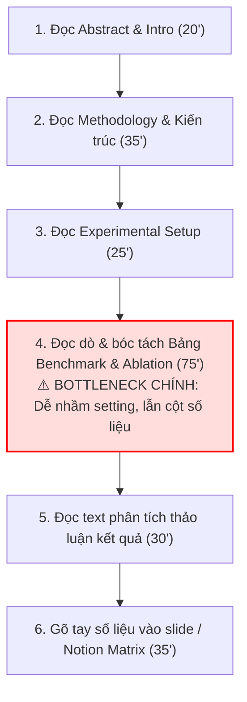
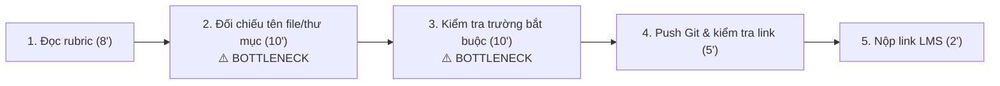
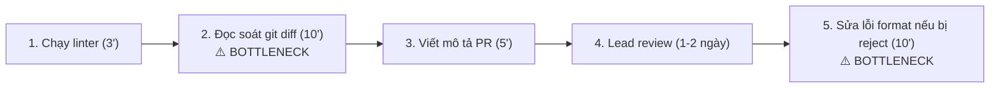

# Báo cáo cá nhân — 2A202603860_VuXuanHieu

> Đổi tên file theo quy tắc `MSSV_HoTen.md`, ví dụ `20241234_NguyenVanAn.md` (MSSV trước, dấu `_`, họ tên viết liền không dấu). Sửa cả dòng tiêu đề phía trên cho khớp.
> Template chi tiết và prompt mẫu cho từng mục: [docs/01-worksheet.md](../../docs/01-worksheet.md).
> Mỗi thành viên một file trong `report/individual/` trên repo nhóm: copy template này thành file mới, điền, rồi commit bằng tài khoản GitHub của bạn. Không viết hộ người khác.

## 1. Thông tin học viên

- Họ tên: Vũ Xuân Hiếu
- MSSV: 2A202603860
- Email trường (không bắt buộc, repo có thể để public): 26ai.hieuvx2@vinuni.edu.vn
- Tên nhóm: NhomBVH
- Link repo nhóm: https://github.com/NTheBao/K5-L3B-DAY02-NhomBVH-DiscoveryProblemFraming

---

## 2. Scan problem (CP1)

Lăng kính: **Lặp lại** · **Tốn thời gian** · **Cần đọc, tổng hợp nhiều thông tin** · **Pain từ người khác**.

| # | Lăng kính | Job Story: Khi… tôi muốn… để… | Ai chịu ảnh hưởng? | Dấu hiệu thật (thời gian, tần suất, số người, bằng chứng) |
|---:|---|---|---|---|
| 1 | Lặp lại | Khi chuẩn bị nộp bài tập lớn/bài lab môn học trước 23h59, tôi muốn tự động đối chiếu cấu trúc thư mục, quy tắc đặt tên file và các trường bắt buộc với tài liệu rubric, để không bị trừ điểm oan vì sai format nộp bài. | Sinh viên trong lớp (bản thân và các nhóm) | Mất 25–30 phút dò tay từng file trước hạn nộp; ở bài lab Day 01 vừa rồi có ít nhất 6 bạn trong lớp bị trừ điểm vì nhầm tên repo hoặc file con. |
| 2 | Lặp lại | Khi đến hạn hoàn thành sprint mỗi tuần, tôi muốn tự động kiểm tra nhanh định dạng docstring, commit message và chuẩn style code, để không bị tech lead reject pull request vì các lỗi định dạng vụn vặt. | Thành viên dev, Tech lead | Trung bình mất 15–20 phút/PR để tự rà soát; nhóm 4 người tạo khoảng 6–8 PR/tuần; 30% PR bị comment nhắc sửa format. |
| 3 | Tốn thời gian | Khi nhận một tài liệu đặc tả kỹ thuật/API spec từ đối tác dài hơn 25 trang, tôi muốn trích xuất nhanh các endpoint xác thực và payload dữ liệu bắt buộc, để lên kế hoạch tích hợp trong ngày mà không phải đọc thủ công từng trang. | Kỹ sư phần mềm / Backend dev | Mất 1.5–2 tiếng đọc lướt và lọc thông tin; tần suất 2–3 lần/tháng khi tích hợp hệ thống ngoài. |
| 4 | Tốn thời gian | Khi chuẩn bị slide cho buổi seminar hàng tuần tại phòng lab, tôi muốn trích xuất nhanh các đóng góp chính và bảng số liệu so sánh từ bài báo khoa học 10–12 trang, để hoàn thành dàn ý trình bày trong vòng 30 phút. | Sinh viên nghiên cứu, Báo cáo viên | Mất trung bình 3–4 tiếng đọc và ghi chép; 2 tuần làm 1 lần; thường xuyên bị sót các phân tích thử nghiệm (ablation study). |
| 5 | Cần đọc, tổng hợp | Khi debug một lỗi runtime lạ từ thư viện mã nguồn mở, tôi muốn tổng hợp các giải pháp khả thi từ nhiều luồng thảo luận trên GitHub Issues và Stack Overflow, để sửa lỗi nhanh mà không phải mở hàng chục tab trình duyệt. | Kỹ sư phần mềm, AI Engineer | Mất 1–2 tiếng mỗi lần gặp lỗi lạ; tần suất 1–2 lần/tuần; thường phải đọc qua 3–5 thread dài với nhiều ý kiến trái chiều. |
| 6 | Cần đọc, tổng hợp | Khi chuẩn bị bước vào tuần thi giữa kỳ từ 8–10 slide bài giảng rời rạc, tôi muốn tổng hợp bảng đối chiếu các khái niệm cốt lõi và công thức quan trọng theo từng chủ đề, để ôn tập trọng tâm mà không bị sót kiến thức. | Bản thân, sinh viên cùng lớp | Mất 4–5 tiếng tổng hợp tài liệu trước mỗi kỳ thi; các bạn trong lớp liên tục hỏi xin tài liệu tóm tắt trong nhóm chat. |
| 7 | Pain từ người khác | Khi thành viên mới gia nhập nhóm dự án, họ muốn có danh sách các bước cài đặt môi trường và cách xử lý lỗi môi trường phổ biến, để có thể chạy được mã nguồn ngay trong ngày đầu mà không phải hỏi từng người trong team. | Thành viên mới, Mentor/Leader | Quá trình onboarding mất 1–2 ngày; trong tháng qua có 4 lần thành viên mới hỏi lặp lại cùng một lỗi cấu hình biến môi trường trên Slack. |
| 8 | Pain từ người khác | Khi người dùng báo lỗi phần mềm qua kênh chat cộng đồng bằng văn bản tự do, nhân viên trực muốn phân loại mức độ khẩn cấp và chuyển đúng lập trình viên phụ trách module đó, để xử lý kịp cam kết hỗ trợ (SLA). | Nhân viên hỗ trợ, Lập trình viên | 15–20 phản ánh/ngày; mất trung bình 5 phút để đọc hiểu và phân loại thủ công; khoảng 10% trường hợp bị chuyển nhầm module. |
| 9 | Lặp lại | Khi kết thúc tuần làm việc vào chiều thứ Sáu, tôi muốn tổng hợp các task đã hoàn thành và danh sách blocker từ nhật ký commit thành 1 bản cập nhật ngắn, để gửi trưởng nhóm đúng hạn 17h mà không phải nhớ lại từng việc. | Bản thân, Trưởng nhóm | Tốn 35–45 phút mỗi chiều thứ Sáu; 2/4 tuần gần nhất bị nhắc gửi trễ vì phải lục lại lịch sử chat và commit Git. |
| 10 | Tốn thời gian | Khi đi thực tế dự án hoặc tổ chức sự kiện nhóm về, tôi muốn trích xuất số tiền, ngày tháng và mã số thuế từ ảnh chụp hóa đơn vào file Google Sheets kê khai chi phí, để hoàn ứng tài chính mà không cần nhập tay từng dòng. | Thủ quỹ nhóm, Ban hậu cần | Mất 45–60 phút nhập tay mỗi đợt 15–20 hóa đơn; thường xuyên bị phòng tài vụ trả về do sai sót số lẻ hoặc ngày tháng. |

**Nếu có dùng AI để gợi ý thêm:** 
- *Ý giữ lại:* Sau khi tự scan được 8 ý thực tế, tôi nhờ AI gợi ý thêm góc nhìn cho lăng kính "Lặp lại" và "Tốn thời gian". Tôi đã giữ lại ý #9 (Tổng hợp update tuần từ Git) và #10 (Trích xuất hóa đơn hoàn ứng) vì đây là hai việc tôi và bạn bè từng gặp khi làm dự án thực tế, có thể bấm giờ và đo lường được.
- *Ý bỏ qua:* Tôi đã loại bỏ ý tưởng do AI gợi ý là *"Trợ lý AI tự động quản lý toàn diện lịch trình học tập"* vì ý tưởng này quá mơ hồ, phạm vi quá rộng và không chỉ ra được điểm nghẽn cụ thể trong một quy trình làm việc thực tế.

---

## 3. Top 3 Problem Cards + quy trình nháp (CP2)

### Bảng chọn top 3

| Rank | Problem | Vì sao chọn | Điều còn chưa chắc |
|---:|---|---|---|
| 1 | Trích xuất thông tin & bảng số liệu thực nghiệm (Benchmark & Ablation Study) từ bài báo khoa học (#4) | Nỗi đau học thuật cực lớn của sinh viên nghiên cứu và học viên AI; tốn 3–4 tiếng mỗi bài; khâu đọc dò bảng thực nghiệm PDF 2 cột rất dễ hoa mắt nhầm lẫn thông số baseline; impact học thuật cao. | Bố cục bảng biểu trong PDF học thuật rất đa dạng (bảng ngang, bảng dọc 2 cột, bảng lồng nhau, ký hiệu toán học), công cụ OCR/LLM liệu có trích xuất chuẩn 100% không bị lệch cột? |
| 2 | Rà soát quy cách bài nộp theo rubric (#1) | Quy trình lặp lại rõ ràng và cấp bách trước mỗi deadline, baseline thời gian đo lường được bằng phút, impact lớn (tránh bị trừ điểm oan). | Có cần dùng AI hay chỉ cần một shell script/rule-based kiểm tra file là đủ? |
| 3 | Kiểm tra định dạng code & PR checklist (#2) | Actor cụ thể (Dev), quy trình rõ ràng trong Git workflow, có thể đo được số phút và tỷ lệ reject PR. | Tiêu chí đánh giá code review của mỗi tech lead có thể khác nhau, khó chuẩn hóa 100%. |

### Problem Card #1 (Card trọng tâm — Chọn để Pitch)

| Trường | Nội dung |
|---|---|
| **Job Story** | Khi chuẩn bị slide báo cáo cho buổi seminar học thuật hàng tuần hoặc làm tổng quan tài liệu (Literature Review) từ một bài báo khoa học 10–15 trang, tôi muốn trích xuất chính xác các đóng góp cốt lõi (contributions), kiến trúc mô hình và các bảng so sánh thực nghiệm (benchmark metrics & ablation studies), để lập bảng đối chiếu phương pháp và hoàn thành dàn ý seminar trong vòng 45 phút mà không phải đọc dò thủ công từng trang PDF 2 cột. |
| **Actor** | Sinh viên nghiên cứu / Học viên cao học tại phòng thí nghiệm AI (AI Lab), hoặc sinh viên năm cuối làm đồ án/khóa luận tốt nghiệp chuyên ngành AI / Khoa học Dữ liệu. |
| **Thời điểm / bối cảnh** | Chiều tối thứ Năm hàng tuần trước buổi Lab Seminar sáng thứ Sáu, hoặc giai đoạn đầu của đề tài nghiên cứu khi cần đọc và tổng hợp 10–20 paper liên quan trong thời gian ngắn. |
| **Quy trình hiện tại (6 bước)** | **1.** Tải PDF từ ArXiv / OpenReview, đọc Abstract và Introduction để nắm bài toán tác giả giải quyết (20 phút). **2.** Đọc lướt phần Methodology & Model Architecture để hiểu luồng xử lý và công thức chính (35 phút). **3.** Đọc phần Experimental Setup (Dataset, Hardware, Baselines, Hyperparameters) để nắm bối cảnh thử nghiệm (25 phút). **4.** **Đọc dò, bóc tách và ghi chép số liệu từ các bảng Benchmark & Ablation Study (75 phút — ⚠️ BOTTLENECK CHÍNH)**. **5.** Đọc đối chiếu phần Text thảo luận kết quả để hiểu vì sao mô hình vượt trội hoặc module nào đem lại hiệu quả cao nhất (30 phút). **6.** Copy-paste số liệu thủ công vào slide PowerPoint hoặc bảng ma trận Literature Review trên Notion (35 phút). ➔ *Tổng thời gian hiện tại: 220 phút (~3.6 tiếng/paper).* |
| **Bottleneck (bước nào, mất bao nhiêu phút)** | **Bước 4 (75 phút):** Bảng biểu trong bài báo khoa học định dạng PDF 2 cột rất phức tạp. Các bảng Benchmark thường có nhiều hàng/cột viết tắt (ví dụ: F1-score, mAP50, BLEU-4, Throughput, FLOPs, Latency). Tệ hơn là các bảng **Ablation Study** (thử nghiệm bóc tách thành phần): tác giả thử nghiệm kết hợp module A + B, bỏ module C, thay đổi loss function... Người đọc phải dùng mắt dò từng dòng, rất dễ nhìn nhầm dòng giữa các cấu hình baseline cũ/mới, nhầm giữa zero-shot vs few-shot, hoặc nhầm giữa kích thước backbone (ví dụ ResNet-50 vs ViT-B/16). |
| **Impact (nếu không giải thì sao)** | - Mất 3–4 tiếng cho mỗi bài báo, gây kiệt sức khi phải chuẩn bị seminar hàng tuần. - Nguy cơ hiểu sai hoặc trích xuất sai số liệu dẫn đến việc báo cáo sai trước Giáo sư và các thành viên lab, làm giảm uy tín học thuật. - Nguy cơ chọn sai Baseline để tái lập (reproduce) hoặc đối chiếu trong nghiên cứu của chính mình, dẫn đến việc lãng phí hàng tuần tính toán GPU để huấn luyện mô hình theo một thiết lập sai. |
| **Success metric (baseline → target)** | - **Baseline:** Mất trung bình 75 phút cho riêng khâu trích xuất và đối chiếu bảng số liệu thực nghiệm; tỷ lệ trích xuất sai/nhầm thông số cấu hình là 25% (đo từ 4 buổi seminar gần nhất). - **Target:** Giảm thời gian trích xuất và đối chiếu bảng số liệu xuống **dưới 15 phút**; tỷ lệ sai lệch số liệu so với paper gốc **dưới 2%**. - **Cách đo:** Bấm giờ từ lúc bắt đầu đọc phần Experiments đến khi hoàn thành bảng đối chiếu; đối chiếu ngẫu nhiên 20 ô số liệu trên bảng trích xuất với ảnh cắt bảng gốc (bounding box crop) từ PDF. |
| **Phương án không dùng AI** | Sử dụng bảng mẫu Literature Review Matrix trên Notion/Excel; in file PDF ra giấy và dùng bút dạ quang (highlighter) 3 màu để đánh dấu thủ công (màu vàng: metric chính, màu xanh: baseline, màu hồng: ablation study). |
| **Giả thuyết về AI (nếu có)** | Sử dụng Multimodal Document AI / Vision LLM đọc trực tiếp các trang PDF chứa bảng biểu, chuyển đổi cấu trúc bảng sang định dạng Markdown/JSON, đồng thời kết hợp prompt phân tích văn bản để tự động trích xuất bảng so sánh 5 cột chuẩn: *Tên mô hình | Dataset | Metric đạt được | Thiết lập thử nghiệm (setting) | Đóng góp của từng module (ablation gain)*. |
| **Cảm nhận nhanh** | **Workflow** (Document Parser trích xuất bảng + LLM reasoning đối chiếu ngữ cảnh). |

Quy trình nháp hiện tại:

### Problem Card #2

| Trường | Nội dung |
|---|---|
| Job Story | Khi chuẩn bị nộp bài tập lớn/bài lab môn học trước 23h59, tôi muốn tự động đối chiếu cấu trúc thư mục, quy tắc đặt tên file và các trường bắt buộc với tài liệu rubric, để không bị trừ điểm oan vì sai format nộp bài. |
| Actor | Sinh viên, học viên tham gia các khóa học thực hành công nghệ/AI. |
| Thời điểm / bối cảnh | 1–2 tiếng trước hạn chót nộp bài (thường vào đêm muộn, người làm dễ mất tập trung). |
| Quy trình hiện tại (3–7 bước) | 1. Mở file hướng dẫn/rubric đọc lại danh sách yêu cầu cấu trúc (8 phút) · 2. Mở file explorer đối chiếu từng tên thư mục và tên file xem có sai ký tự không (10 phút) · 3. Mở các file báo cáo kiểm tra tiêu đề và các trường thông tin bắt buộc (10 phút) · 4. Tạo commit, push lên GitHub và kiểm tra lại repo online (5 phút) · 5. Copy link nộp lên hệ thống trường LMS (2 phút). |
| Bottleneck (bước nào, mất bao nhiêu phút) | Bước 2 và 3 (mất 20 phút): Việc dò tay từng file và từng trường thông tin trong tình trạng mệt mỏi sát deadline rất dễ sót lỗi chính tả nhỏ (như nhầm `_` thành `-`, quên sửa template MSSV). |
| Impact (nếu không giải thì sao) | Bị trừ 5–10% tổng số điểm môn học dù nội dung làm tốt; gây tâm lý ức chế và tốn thời gian khiếu nại điểm sau đó. |
| Success metric (baseline → target) | - Baseline: Mất 20 phút kiểm tra thủ công; tỷ lệ sót lỗi format khoảng 15%. - Target: Giảm thời gian kiểm tra xuống dưới 3 phút; tỷ lệ sai sót format = 0%. - Cách đo: Bấm giờ từ lúc bắt đầu kiểm tra đến khi nộp bài; kiểm tra chéo với kết quả chấm điểm thực tế. |
| Phương án không dùng AI | Viết một shell script / checklist file Excel cố định để so khớp tên file và kiểm tra sự tồn tại của file. |
| Giả thuyết về AI (nếu có) | AI đọc file hướng dẫn Markdown tự sinh ra bộ kiểm tra và quét nội dung các file báo cáo xem đã trả lời đủ các câu hỏi bắt buộc chưa. |
| Cảm nhận nhanh | Rule (hoặc Workflow bán tự động) |

Quy trình nháp hiện tại:

### Problem Card #3

| Trường | Nội dung |
|---|---|
| Job Story | Khi đến hạn hoàn thành sprint mỗi tuần, tôi muốn tự động kiểm tra nhanh định dạng docstring, commit message và chuẩn style code, để không bị tech lead reject pull request vì các lỗi định dạng vụn vặt. |
| Actor | Lập trình viên trong nhóm phát triển dự án. |
| Thời điểm / bối cảnh | Trước khi tạo Pull Request trên GitHub/GitLab vào cuối mỗi tính năng. |
| Quy trình hiện tại (3–7 bước) | 1. Tự chạy linter/formatter cục bộ (3 phút) · 2. Đọc lại git diff từng file để kiểm tra comment và docstring (10 phút) · 3. Viết mô tả PR theo template của dự án (5 phút) · 4. Tạo PR và chờ Lead review (1–2 ngày) · 5. Nhận comment yêu cầu sửa format và commit lại (10 phút). |
| Bottleneck (bước nào, mất bao nhiêu phút) | Bước 2 (mất 10 phút tự đọc diff) và bước 5 (mất 10 phút sửa lại khi bị reject): Tốn thời gian lặp lại cho những lỗi quy ước không liên quan đến logic code. |
| Impact (nếu không giải thì sao) | Kéo dài chu kỳ review code, làm chậm tiến độ sprint, gây phiền hà cho người review. |
| Success metric (baseline → target) | - Baseline: 30% PR bị reject vì lỗi format/docstring; mất trung bình 20 phút xử lý. - Target: Tỷ lệ reject vì lỗi format giảm xuống dưới 5%; thời gian rà soát trước khi tạo PR dưới 5 phút. - Cách đo: Đếm số comment liên quan đến định dạng trên GitHub PR của sprint. |
| Phương án không dùng AI | Cài đặt Git pre-commit hooks (Flake8, Black, ESLint) để chặn commit nếu sai định dạng. |
| Giả thuyết về AI (nếu có) | LLM phân tích git diff và tự động sinh bản nháp mô tả PR kèm cảnh báo các hàm thiếu tài liệu giải thích logic. |
| Cảm nhận nhanh | Rule (pre-commit hooks) kết hợp Workflow |

Quy trình nháp hiện tại:

### Card muốn pitch nhất

- **Card số:** **Problem Card #1 (Trích xuất thông tin & bảng số liệu thực nghiệm từ bài báo khoa học)**.
- **Vì sao:** 
  1. Đây là bài toán có giá trị học thuật và thực tiễn cao nhất đối với sinh viên/học viên chuyên ngành AI; ai làm nghiên cứu hoặc chuẩn bị seminar cũng đều thấm thía nỗi khổ khi phải "vật lộn" với các bảng kết quả phức tạp trong PDF.
  2. Điểm nghẽn cực kỳ rõ ràng và nặng nề (mất tới 75 phút đọc dò từng dòng số liệu trong tổng số 3.6 tiếng đọc paper).
  3. Đây là bài toán mà các phương pháp truyền thống (No AI / Rule-based) **hoàn toàn bó tay** vì cấu trúc bảng biểu trong PDF phi cấu trúc không thể giải quyết bằng regex thông thường, chứng minh rõ ràng giá trị vượt trội của giải pháp **AI Workflow (Multimodal / Document AI)** so với Rule.
- **Câu hỏi muốn nhóm phản biện:** 
  > *"Nếu bảng biểu trong các file PDF khoa học có cấu trúc quá phức tạp (bảng kéo dài qua nhiều trang, bảng xoay ngang, ký hiệu toán học đặc biệt), làm thế nào để đảm bảo AI trích xuất chính xác 100% số liệu mà không bị hiện tượng 'bịa số' (hallucination), và quy trình kiểm duyệt (Human-in-the-Loop) của chúng ta cần thiết kế như thế nào để người dùng kiểm tra nhanh nhất?"*

### AI đã phản biện card thế nào

| Điểm yếu AI chỉ ra | Đồng ý? | Đã sửa gì |
|---|---|---|
| AI chỉ ra rằng phạm vi 'tóm tắt toàn bộ bài báo khoa học' là quá rộng, dễ sa đà vào việc xây dựng một chatbot chung chung không có điểm nghẽn cụ thể. | Đồng ý hoàn toàn | Tôi đã thu hẹp phạm vi chính xác vào **Bước 4: Bóc tách bảng Benchmark và Ablation Study**, biến bước này thành bottleneck cụ thể (75 phút) với các trường dữ liệu rõ ràng. |
| AI chất vấn rằng định dạng PDF rất đa dạng, nếu chỉ dựa vào LLM text-only thông thường thì sẽ làm mất liên kết giữa hàng và cột trong bảng. | Đồng ý | Tôi đã điều chỉnh phần Giả thuyết AI: Xác định rõ cần kết hợp **Document AI / Vision LLM (Multimodal)** để giữ nguyên cấu trúc không gian 2D của bảng biểu trước khi đưa vào LLM reasoning. |
| AI cảnh báo rủi ro 'bịa số' (Hallucination): LLM rất dễ nhầm lẫn hoặc tự suy diễn các con số ở các cột gần nhau trong bảng PDF phức tạp, nếu người dùng tin tưởng hoàn toàn sẽ dẫn đến báo cáo sai kết quả trước Giáo sư. | Đồng ý hoàn toàn | Tôi đã bổ sung cơ chế kiểm duyệt Human-in-the-Loop (HITL) bắt buộc vào giải pháp: AI không chỉ trích xuất số liệu thành bảng Markdown mà phải hiển thị song song ảnh cắt (bounding box crop) của bảng gốc trong PDF, giúp người đọc đối chiếu bằng mắt từng con số chỉ trong 1–2 phút trước khi copy sang slide. |

---

## 4. Tôi đã tham gia phần nào (CP3 → CP7)

| Hoạt động | Tôi đã làm gì? | Kết quả / ảnh hưởng tới bài nhóm |
|---|---|---|
| Pitch Problem Card | Pitch 3 card: #1 rà soát quy cách bài nộp theo rubric, #2 PR checklist, #3 trích xuất bảng benchmark/ablation từ paper (card muốn pitch nhất ban đầu). | Card #1 đạt điểm cao nhất (31/35) và được nhóm chọn làm candidate problem chính thức; #2 và #3 bị loại có lập luận rõ ràng. |
| Phản biện bài của bạn khác | Câu hỏi tôi đã đặt: - Hỏi Vinh (#4): *"Số liệu 6 MST và 14 hóa đơn sót là thật hay giả định? Nếu XLOOKUP là đủ thì bài còn đáng đào sâu không?"* - Hỏi Vinh (#6): *"Bao nhiêu % nhà cung cấp lặp lại hằng tháng? Nếu cao thì chỉ cần tra nhà cung cấp mới."* - Hỏi Bảo (#8): *"Word Compare đã làm được việc này, AI thêm được gì? Tài liệu khách hàng có được phép đưa lên AI không?"* | - Câu hỏi cho #4 làm rõ số liệu chỉ là giả định minh họa (Pain 3/5), là căn cứ quan trọng để nhóm loại #4. - Gợi ý cho #6 giúp ghi nhận giải pháp bằng danh sách nhà cung cấp đã tra. - Câu hỏi cho #8 giúp nhóm nhận diện rủi ro bảo mật tài liệu khách hàng và loại card #8. |
| Nhận phản biện | Câu hỏi tôi nhận được: - Bảo hỏi (#1): *"Viết shell script hay Python regex là kiểm tra được, sao cần AI?"* - Vinh hỏi (#1): *"Con số 6 bạn bị trừ điểm ở Day 01 lấy từ đâu, có bảng điểm không?"* - Vinh hỏi (#2): *"Pre-commit hook với Flake8/Black đã chặn được lỗi format, phần còn lại là gì?"* - Bảo hỏi (#3): *"Tỷ lệ sai 25% đo từ 4 buổi seminar, mẫu có quá nhỏ không? Kiểm chứng trong một buổi lab bằng cách nào?"* | **Tôi đã sửa gì:** - Tiếp thu phản biện của Bảo: chấp nhận kiến trúc Rule-based làm mặc định ở Tầng 1 (quét file/folder/chuỗi mẫu), AI chỉ can thiệp ở Tầng 2 để phân tích ngữ nghĩa nội dung các trường bắt buộc. - Đưa nghi vấn của Vinh vào Assumption Map CP4 để kiểm chứng: TA xác nhận có đúng 6/30 bài Day 01 sai tên file. - Loại bỏ con số "sót lỗi 15%" không có nguồn và bỏ target tuyệt đối "0% lỗi", thay bằng target pilot thực tế $\le$ 1/30 bài. |
| Gom cluster / cây OST | Người chính CP3 (theo `TEAM.md`): chủ trì thảo luận gom 9 problem thành 4 cụm (A, B, C, D); dựng cây OST xuất phát từ 1 outcome đo được (giảm số lần sản phẩm bị trả về/bị trừ điểm) và 4 opportunity nhánh; cùng nhóm gạch bỏ các giải pháp đội lốt nhu cầu; lập bảng chấm shortlist 7 tiêu chí. | Phân loại rõ ràng 4 cụm vấn đề, giúp nhóm không bị sa đà vào công cụ (gạch bỏ bot Discord, trợ lý LLM...); shortlist được 3 card mạnh nhất với điểm số minh bạch. |
| Chọn candidate problem | Đề xuất chọn Candidate #1 vì: có sự kiện thật kiểm chứng được ngay trong lớp (Day 01), cả nhóm hiểu rõ domain nộp bài, và bài toán buộc nhóm so sánh đủ 4 mức can thiệp (Rule vs Workflow). Cùng nhóm phân tích lý do loại #4, #9, #2, #3, #5–#8. | Nhóm đạt đồng thuận 100% chọn Candidate #1 với 31/35 điểm; văn bản hóa đầy đủ lý do chọn và lý do loại trong Mục 2.4 của báo cáo nhóm. |
| Kiểm chứng / research | Người hỗ trợ kiểm chứng CP4 (theo `TEAM.md`): cùng Vinh xây dựng Assumption Map (6 giả định) và kịch bản phỏng vấn The Mom Test (`report/assets/cp4-interview-script.md`); trực tiếp thực hiện phỏng vấn Interview Snapshot 1 (sinh viên năm 3 bị trừ 5 điểm vì nhầm `_` thành `-`) và Interview Snapshot 3 (nhóm trưởng bị thành viên nộp template rỗng). | Thu thập được bằng chứng sống động về nỗi đau format sát deadline và nhu cầu kiểm tra template rỗng; xác định rõ ranh giới sản phẩm là Augment/Read-only chứ không tự động sửa file. |
| Quy trình nhóm | Người chính CP5 quy trình trước/sau (theo `TEAM.md`): vẽ sơ đồ quy trình hiện tại (6 bước, 40 phút, bottleneck 20 phút); thiết kế sơ đồ quy trình tương lai 2 tầng (Tầng 1 Rule Engine chạy vài giây, Tầng 2 LLM Validator tùy chọn dưới 15 giây, có bước HITL sinh viên tự duyệt) và lập bảng so sánh Before/After. | Hoàn thiện Mục 4 trong `group_report.md` với sơ đồ Mermaid trực quan, có cơ chế Fallback offline khi mạng lag sát 23h59 và ranh giới HITL an toàn cho sinh viên. |
| Problem Statement | Hỗ trợ Bảo hoàn thiện Problem Statement v0 (CP5); chủ trì soạn thảo Problem Statement v1 (CP6) với đầy đủ các trường: Actor, Quy trình 2 tầng, Bottleneck, Metric đo lường thực tế, Boundary read-only, AI intervention point và bảng đối chiếu thay đổi v0 vs v1. | Problem Statement v1 thể hiện rõ sự trưởng thành từ số liệu giả định sang số liệu kiểm chứng; xác định chính xác điểm can thiệp hẹp của AI ở bước phân tích ngữ nghĩa. |
| Mức can thiệp AI | Người chính CP6 (theo `TEAM.md`): định vị bài toán trên ma trận Độ mơ hồ thấp × Độ phức tạp trung bình; lập bảng so sánh 4 mức (No AI, Rule, Workflow, Agent); xây dựng AI Canvas rút gọn (6 thành phần); phân tích 2 câu hỏi Google PAIR (chọn Augment và High Recall); thiết kế bộ dữ liệu Eval mẫu gồm 10 Test Cases (TC-01 đến TC-10). | Quyết định chọn mức Workflow bán tự động được chứng minh chặt chẽ tại Mục 6; bộ 10 test case eval giúp nhóm đạt trọn vẹn điểm thưởng **Bonus B3 (+3 điểm)**. |
| Quyết định | Người hỗ trợ phần quyết định (theo `TEAM.md`): cùng Bảo phân tích 4 Big Risks (Value, Usability, Feasibility, Viability); thống nhất quyết định GO ở phạm vi pilot nhỏ và thiết lập ngưỡng dừng (Stop condition) định lượng. | Nhóm có quyết định GO thuyết phục tại Mục 8 kèm kế hoạch thử nghiệm pilot ở Day 03 và ngưỡng dừng an toàn (nếu False Positive > 20% hoặc thời gian > 10 phút sau 2 bài lab thì dừng dự án và quay về No AI checklist Excel). |

---

## 5. Dùng AI

| Checkpoint | Tôi dùng AI để làm gì? | AI hữu ích ở đâu? | AI sai hoặc hời hợt ở đâu? | Tôi sửa gì bằng nhận định của mình? |
|---|---|---|---|---|
| CP1 Scan | Sau khi tự scan được 8 problem từ trải nghiệm thực tế, tôi dùng AI gợi ý thêm góc nhìn cho lăng kính "Lặp lại" và "Tốn thời gian". | Gợi ý thêm các khía cạnh quản lý công việc và báo cáo định kỳ trong tuần. | AI đề xuất các ý tưởng rất sáo rỗng và "solution-first" như *"Trợ lý AI tự động quản lý toàn diện lịch trình học tập"* (ý tưởng chung chung, không có bối cảnh hay nỗi đau đo được). | Tôi loại bỏ hoàn toàn các ý tưởng mơ hồ của AI; chỉ giữ lại 2 ý tưởng thực tế (#9 tổng hợp Git commit và #10 trích xuất hóa đơn), tự viết lại theo Job Story và tự điền baseline thời gian thực tế. |
| CP2 Problem Card | Đóng vai Product Manager khó tính (Skeptical PM) để phản biện bản nháp Problem Card #1 và #2 của tôi. | Nhắc nhở phạm vi ban đầu của Card #1 ("tóm tắt toàn bộ paper") quá rộng; cảnh báo nguy cơ AI bịa số (hallucination) trong bảng thực nghiệm. | AI vội vàng khuyên nên xây dựng một "Hệ thống AI Multi-agent" để tự động sửa toàn bộ bài làm của sinh viên, lờ đi rủi ro sinh viên bị mất quyền kiểm soát bài nộp. | Tôi bác bỏ giải pháp Agent của AI; chủ động thu hẹp ranh giới (Boundary) xuống mức công cụ chỉ đọc và báo lỗi (read-only), giữ nguyên tắc Human-in-the-Loop (HITL) bắt buộc để người dùng tự tay sửa file. |
| CP4 Research | Tra cứu các công cụ mã nguồn mở hiện có trên thị trường có khả năng kiểm tra định dạng và cấu trúc repository Git. | Liệt kê nhanh các công cụ phổ biến như `pre-commit`, `markdownlint`, `Flake8`. | AI đưa ra một số link tài liệu đã cũ; nhận định phiến diện rằng *"pre-commit đã giải quyết được 100% bài toán quy cách"*. | Tôi tự tay mở từng link trên trình duyệt để kiểm chứng ngày 09/11/2026; tự phân tích khoảng trống mà `pre-commit` không giải được: không thể đọc hiểu ngữ nghĩa xem nội dung mục bắt buộc có bị bỏ trống hay để nguyên template mẫu hay không. |
| CP5 Quy trình | Chuyển đổi bản nháp quy trình thành cú pháp Mermaid Markdown để hiển thị sơ đồ trực quan. | Hỗ trợ sinh nhanh cú pháp sơ đồ Mermaid `graph TD` chuẩn xác, không bị lỗi render. | Sơ đồ AI tự vẽ ban đầu đã gộp thẳng bước kiểm tra cấu trúc với bước nộp bài tự động lên LMS thành 1 luồng khép kín không có con người can thiệp (Full Automation). | Tôi tự vẽ lại quy trình: tách rõ khâu Tầng 1 (Rule checker kiểm tra file) và Tầng 2 (LLM cảnh báo ngữ nghĩa); bổ sung nhánh rẽ bắt buộc con người tự duyệt và tự thao tác commit/push/nộp LMS. |
| CP5–6 Problem Statement | Kiểm tra xem bản nháp Problem Statement v0 và v1 đã đầy đủ các trường theo Lean UX Canvas và Google PAIR chưa. | Rà soát đối chiếu danh mục các trường bắt buộc (Actor, Bottleneck, Metric, Boundary, AI intervention point). | AI tự ý điền các metric rất bay bổng và vô căn cứ như *"tiết kiệm 99% thời gian"*, *"đạt độ chính xác 100% tuyệt đối"*, *"giảm 0% lỗi"*. | Tôi gạch bỏ toàn bộ các con số phóng đại của AI; thay bằng số liệu thực tế đo được từ buổi phỏng vấn CP4 (baseline: 6/30 bài Day 01 sai format; target pilot thực tế $\le$ 1/30 bài; thời gian rà soát từ 15–35 phút giảm xuống dưới 5 phút). |
| CP6 Mức can thiệp / quyết định | Thử phản biện xem nếu giải bài toán này bằng Agent tự hành thì có ưu thế gì hơn Workflow bán tự động không. | Liệt kê các kịch bản bất định mà Agent có thể xử lý. | AI có xu hướng "thần thánh hóa" Agent, cổ xúy cho việc dùng Agent để tự động sửa file và tự push code nhằm tạo cảm giác "công nghệ cao". | Tôi giữ vững lập trường của nhóm: quy trình nộp bài là luồng tuần tự cố định (deterministic), dùng Agent là lãng phí và nguy hiểm. Tôi quyết định chốt phương án **Workflow bán tự động** (Rule-based trước, LLM chỉ làm bước hẹp đọc hiểu ngữ nghĩa), có Fallback offline an toàn khi mất mạng. |

---

## 6. Reflection (CP7)

Trả lời bằng trải nghiệm thật của bạn, tối thiểu 200 từ cho các câu 6.1–6.6 (không tính 6.7, câu này được chấm riêng ở tiêu chí C5). **Không dùng AI để viết thay.**

**6.1. Tôi học được gì khi nghe top 3 problems của các bạn khác?**

Khi lắng nghe bài pitch của Phạm Đức Vinh (về đối chiếu hóa đơn cổng thuế với phần mềm kế toán) và Nguyễn Thế Bảo (về quản lý thay đổi yêu cầu từ khách hàng và bổ sung thông tin bug report từ Tester), tôi học được hai bài học lớn:
- Thứ nhất, một bài toán nhìn từ bên ngoài có vẻ rất chuyên nghiệp và phức tạp (như bài hóa đơn thuế của Vinh với 6 MST và 14 hóa đơn sót) chưa hẳn đã là bài toán phù hợp nhất để làm product discovery trong môi trường học tập, nếu nhóm không thể tiếp cận được người dùng thực (kế toán dịch vụ thật) ngay trong buổi lab để kiểm chứng.
- Thứ hai, việc các bạn phân tích quy trình giúp tôi nhận ra rằng hầu hết các điểm nghẽn thực tế đều xuất phát từ việc con người phải đối chiếu hai nguồn thông tin bằng mắt (bảng này so với bảng kia, tài liệu cũ so với tài liệu mới). Điều này giúp tôi nhìn nhận lại card của chính mình: không phải cứ đề tài to tát mới có giá trị, mà bài toán giải quyết đúng nỗi đau sát sườn mà cả 3 thành viên đều hiểu sâu và kiểm chứng được ngay tại lớp mới là bài toán có sức thuyết phục cao nhất.

**6.2. Nhóm có lúc nào bị "solution-first" (nghĩ giải pháp trước khi hiểu vấn đề) không? Lúc đó nhóm nhận ra và xử lý thế nào?**

Nhóm tôi đã bị "solution-first" ngay từ những phút đầu tiên của CP3. Khi tôi vừa đưa ra vấn đề sinh viên bị trừ điểm vì sai quy cách bài nộp, phản xạ đầu tiên của cả nhóm là lập tức bàn về giải pháp công nghệ: Thế Bảo đề xuất viết một con bot Discord tự chạy script kiểm tra bài nộp, tôi thì hào hứng nghĩ đến việc dùng một prompt LLM để đọc rubric rồi tự động sinh ra file checklist, còn Vinh thì nghĩ đến việc tích hợp thẳng vào GitHub Actions để tự sửa bài.
Nhóm chỉ giật mình nhận ra sai lầm khi cùng nhau vẽ cây Opportunity Solution Tree (OST) theo hướng dẫn của Teresa Torres. Khi nhìn vào quy tắc yêu cầu các nhánh con của outcome bắt buộc phải là "Opportunity" (nhu cầu, nỗi đau của người dùng) chứ không được là "Solution" (tính năng, công cụ), nhóm mới nhận ra rằng "Bot Discord" hay "LLM" đều chỉ là cái vỏ giải pháp đội lốt. Nỗi đau thực sự của sinh viên là: *sát giờ nộp 23h59 thì mệt mỏi, hoa mắt nên dễ gõ nhầm dấu gạch dưới thành gạch ngang, và rubric quá dài nên không nhớ hết các trường bắt buộc*. Nhóm đã lập tức gạch bỏ 4 giải pháp công nghệ đó ra khỏi cây OST và chỉ tập trung vào việc làm rõ hành vi rà soát thủ công của sinh viên.

**6.3. Tôi có đổi ý sau khi bị phản biện không? Kể một lần cụ thể.**

Có, tôi đã đổi ý rất dứt khoát ở CP3 khi nghe câu hỏi phản biện của Thế Bảo.
Ban đầu, tôi rất hào hứng và ra sức bảo vệ phương án dùng AI để "đọc hiểu toàn diện bài nộp của sinh viên". Nhưng Bảo đã chất vấn thẳng: *"Nếu chỉ là kiểm tra xem repo có đúng tên không, file cá nhân có đúng định dạng MSSV_HoTen.md không, và các thư mục bắt buộc có tồn tại không, thì một script Python regex hoặc Bash script chạy 1 giây là xong, cớ sao lại phải lôi AI vào cho tốn tiền và chậm chạp?"*.
Câu hỏi này đã "chạm đúng huyệt". Lúc đầu tôi hơi ngượng vì thấy mình bị bẫy "lạm dụng AI", nhưng sau khi cùng nhóm phân tích sâu, tôi hoàn toàn đồng ý và đổi ý: tôi chấp nhận rằng phần lớn cấu trúc bài nộp (phần vỏ) bắt buộc phải do Rule-based xử lý để đảm bảo độ chính xác 100% và tốc độ tức thì; AI chỉ được phép can thiệp ở một bước rất hẹp (Tầng 2) là đọc hiểu ngữ nghĩa để phát hiện xem các mục bắt buộc như Success Metric có bị điền qua loa hoặc để nguyên template rỗng hay không. Sự đổi ý này đã cứu giải pháp của nhóm khỏi cái bẫy "over-engineering".

**6.4. Kết quả kiểm chứng (phỏng vấn/survey/research) có làm tôi bất ngờ không? Điều gì?**

Điều làm tôi bất ngờ nhất đến từ buổi phỏng vấn Trợ giảng (TA) ở CP4.
Trước khi phỏng vấn, nhóm tôi cứ đinh ninh rằng việc kiểm tra quy cách bài nộp là một công việc rất phức tạp mà các thầy cô phải đọc từng file bằng tay nên rất cần AI hỗ trợ chấm. Nhưng khi hỏi TA, anh chia sẻ nguyên văn rằng: các anh đã có sẵn bash script để chấm tự động theo quy tắc cố định; bài nào sinh viên gõ sai tên file là script báo lỗi đỏ và gán điểm 0 phần format ngay lập tức.
Tín hiệu phản bác này làm tôi sững sờ vì nó chứng minh giả định "cần AI để kiểm tra quy cách" là hoàn toàn sai. Nỗi đau thật sự không nằm ở việc thiếu công nghệ chấm, mà nằm ở chỗ **sinh viên không có trong tay bộ kiểm tra đó để tự chạy trên máy mình trước khi nộp**.
Một bất ngờ thứ hai là từ bạn sinh viên năm 4: bạn nói thẳng là không bao giờ muốn AI tự động sửa file bài làm của mình vì sợ làm hỏng nội dung gốc. Hai phản hồi thực tế này đã làm nhóm thay đổi hoàn toàn thiết kế: đưa sản phẩm về dạng công cụ chỉ đọc và báo lỗi (read-only / Augment) và ưu tiên Rule làm mặc định.

**6.5. Điều khó nhất khi viết Problem Statement là gì?**

Điều khó khăn nhất đối với tôi là việc **từ bỏ thói quen viết các con số giả định "đao to búa lớn" để quay về với các con số đo lường có căn cứ thực tế**.
Khi mới viết Problem Card ở CP2, tôi rất dễ dãi viết vào bảng: "tiết kiệm 80% thời gian", "giảm tỷ lệ lỗi về 0% tuyệt đối", "nguy cơ bị trừ 5–10% tổng điểm". Đến khi sang CP5 và CP6, khi phải viết Problem Statement v0 và v1, nhóm bị chất vấn gắt gao: 5–10% lấy ở dòng nào trong rubric? 0% có đo được không hay là ảo tưởng? 
Tôi đã phải mất rất nhiều thời gian cùng nhóm tra cứu lại toàn bộ văn bản `RUBRIC.md`, đối chiếu từng lời kể của TA và sinh viên được phỏng vấn để viết lại: thay 5–10% bằng "trừ 5 điểm trực tiếp do sai tên file/repo theo rubric", thay 0% bằng "giảm số bài sai quy chuẩn từ mốc tham chiếu 6/30 xuống $\le$ 1/30 bài", và ghi rõ baseline thời gian là 15–35 phút của 3 sinh viên thật. Việc học cách chấp nhận sự chưa hoàn hảo của dữ liệu ban đầu thay vì "làm màu" số liệu là bài học khó nhất nhưng thấm thía nhất.

**6.6. Nếu làm lại, tôi sẽ đổi gì? Tôi sẽ phản biện nhóm mạnh hơn ở điểm nào?**

Nếu có cơ hội làm lại từ đầu bài lab Day 02, tôi sẽ thay đổi hai điểm:
- Thứ nhất, tôi sẽ làm bước phỏng vấn người dùng (The Mom Test) ngay từ trước khi viết Problem Card ở CP2 thay vì đợi đến CP4. Nếu phỏng vấn TA và các bạn cùng lớp sớm hơn 1 tiếng, nhóm tôi đã không mất thời gian tranh cãi về việc có nên dùng AI để quét cấu trúc file hay không, vì TA đã có câu trả lời từ trước.
- Thứ hai, ở bước chấm điểm shortlist CP3, tôi sẽ phản biện mạnh hơn và yêu cầu nhóm chấm điểm khắt khe hơn đối với các con số giả định. Ví dụ card #4 của Vinh dù được viết rất chỉn chu nhưng toàn bộ số liệu 6 MST và 14 hóa đơn đều là giả định chưa kiểm chứng; nếu tôi phản biện quyết liệt hơn ngay từ đầu thì nhóm đã tiết kiệm được thời gian tranh luận giữa card #1 và card #4 để tập trung đào sâu vào quy trình của card #1 sớm hơn.

**6.7. Hiểu bài:** giải thích bằng 5–8 câu, không nhìn tài liệu, chuỗi *problem → quy trình → metric → boundary → mức can thiệp AI → quyết định* của bài nhóm mình.

1. **Problem:** Sinh viên làm bài lab thường mất từ 15–35 phút rà soát thủ công trong tình trạng mệt mỏi sát deadline 23h59, dẫn đến việc bỏ sót các lỗi hình thức (sai tên file, sai tên repo, để template rỗng) và bị trừ 5 điểm oan theo quy tắc rubric.
2. **Quy trình:** Nhóm thiết kế quy trình hai tầng: sinh viên chạy một lệnh kiểm tra cục bộ trước khi nộp, hệ thống quét Tầng 1 (Rule checker kiểm tra file và thư mục) rồi đến Tầng 2 (LLM validator kiểm tra nội dung trường bắt buộc), sau đó xuất bảng checklist cảnh báo để sinh viên tự rà soát và tự quyết định sửa trước khi push Git nộp lên LMS.
3. **Metric:** Thành công được đo lường bằng việc giảm thời gian rà soát checklist từ 15–35 phút xuống dưới 5 phút, và giảm số bài nộp sai quy cách từ mốc tham chiếu 6/30 bài (Day 01) xuống còn tối đa 1/30 bài trong lớp.
4. **Boundary:** Ranh giới an toàn tuyệt đối là hệ thống chỉ hoạt động ở chế độ chỉ đọc (`read-only`), hiển thị cảnh báo để hỗ trợ người dùng (Augment), không bao giờ tự ý sửa file hay tự ý nộp bài, và phải có Fallback chạy offline trong vòng 15 giây nếu mất kết nối mạng.
5. **Mức can thiệp AI:** Nhóm chọn mức **Workflow bán tự động** (kết hợp Rule-based script cho việc quét file và 1 bước LLM validation hẹp để phát hiện mục rỗng hoặc metric định tính) vì bài toán có độ mơ hồ thấp và quy trình mang tính tuần tự cố định.
6. **Quyết định:** Nhóm đưa ra quyết định **GO** để triển khai thử nghiệm ở phạm vi nhỏ (pilot 3 nhóm tại bài lab Day 03), đi kèm ngưỡng dừng nghiêm ngặt: nếu sau 2 bài lab thử nghiệm mà tỷ lệ cảnh báo sai (False Positive) vượt quá 20% hoặc sinh viên vẫn mất hơn 10 phút để tự dò lại, nhóm sẽ lập tức dừng dự án và quay về phương án No AI checklist Excel.

---

## 7. Tài liệu tham khảo

### 7.1. Framework phương pháp luận sản phẩm & Thiết kế AI
1. **Design Council (UK)**, *Framework for Innovation: The Double Diamond design process*. [Link](https://www.designcouncil.org.uk/resources/framework-for-innovation/) — Áp dụng xuyên suốt toàn bài để mở rộng tìm kiếm vấn đề (Discover) và hội tụ định nghĩa bài toán (Define).
2. **Alan Klement & Intercom**, *Jobs-to-be-Done / Job Stories Framework*. [Link](https://www.intercom.com/blog/accidentally-invented-job-stories/) — Dùng để chuẩn hóa 10 bài toán scan (CP1) và 3 Problem Cards (CP2) theo cú pháp *"Khi… tôi muốn… để…"*, tập trung vào động cơ và hoàn cảnh thay vì sa đà vào giải pháp.
3. **Teresa Torres**, *Continuous Discovery Habits: Discover Products that Create Customer Value and Business Value*. [Link](https://www.producttalk.org/opportunity-solution-trees/) — Áp dụng xây dựng cây Opportunity Solution Tree (OST) để phân tách rạch ròi giữa Outcome, Opportunity và Solution.
4. **Rob Fitzpatrick**, *The Mom Test: How to talk to customers & learn if your business is a good idea when everyone is lying to you* (2013). [Link](https://www.momtestbook.com/) — Nguyên tắc vàng trong CP4: phỏng vấn hành vi đã xảy ra trong quá khứ, không hỏi ý kiến giả định tương lai, tìm kiếm tín hiệu phản bác.
5. **Google PAIR**, *People + AI Guidebook: User Needs + Defining Success*. [Link](https://pair.withgoogle.com/chapter/user-needs/) — Căn cứ giải quyết bài toán can thiệp hỗ trợ (Augment) thay vì tự động hóa hoàn toàn (Automate), và ưu tiên tránh bỏ sót (High Recall).
6. **Anthropic Research**, *Building Effective Agents* (2024). [Link](https://www.anthropic.com/research/building-effective-agents) — Phân biệt rõ ranh giới giữa Workflow (hệ thống điều phối cố định bằng code) và Agent (tự chủ), là cơ sở để chọn mức can thiệp Workflow bán tự động cho bài toán.
7. **Marty Cagan (SVPG)**, *Inspired: How to Create Tech Products Customers Love* — Khung đánh giá Four Big Risks (Value, Usability, Feasibility, Viability) dùng để ra quyết định GO ở CP6.

### 7.2. Tài liệu kỹ thuật, tiêu chuẩn & công cụ gắn với 3 Problem Cards
1. **Card #1 & Scan #1 — Rà soát quy cách bài nộp theo Rubric:**
   - *Pre-commit Framework*, [pre-commit.com](https://pre-commit.com/) — Cơ chế quản lý hook cục bộ kiểm tra quy chuẩn file, cấu trúc thư mục và chặn chuỗi mẫu template trước khi commit git.
   - *GitHub Docs: Use autograding with GitHub Classroom*, [docs.github.com](https://docs.github.com/en/education/manage-coursework-with-github-classroom/teach-with-github-classroom/use-autograding) — Mô hình kiểm tra bài tập tự động mỗi lần sinh viên push bài.
   - *markdownlint-cli*, [github.com/igorshubovych/markdownlint-cli](https://github.com/igorshubovych/markdownlint-cli) — Công cụ phân tích tĩnh kiểm tra cấu trúc tiêu đề, khoảng trắng và định dạng Markdown.
2. **Card #2 & Scan #4 — Trích xuất bảng Benchmark & Ablation Study từ bài báo khoa học:**
   - *Papers With Code*, [paperswithcode.com](https://paperswithcode.com/) — Nền tảng chuẩn hóa cấu trúc đối chiếu thử nghiệm AI: mô hình, dataset, metric và kết quả thực nghiệm.
   - *Xu et al., LayoutLM: Pre-training of Text and Layout for Document Image Understanding* (KDD 2020) — Nghiên cứu nền tảng về Document AI sử dụng hình ảnh không gian 2D để trích xuất cấu trúc bảng biểu từ file PDF phi cấu trúc.
3. **Card #3 & Scan #2 — Kiểm tra định dạng code & PR Checklist:**
   - *PEP 8 – Style Guide for Python Code*, [peps.python.org/pep-0008](https://peps.python.org/pep-0008/) — Quy chuẩn quốc tế về phong cách viết mã nguồn, đặt tên hàm và cấu trúc docstring trong dự án phần mềm.
   - *Black: The Uncompromising Code Formatter*, [black.readthedocs.io](https://black.readthedocs.io/) & *Flake8 Tooling* — Bộ công cụ linter tự động hóa kiểm tra quy chuẩn code trong quy trình CI/CD và Pull Request review.
