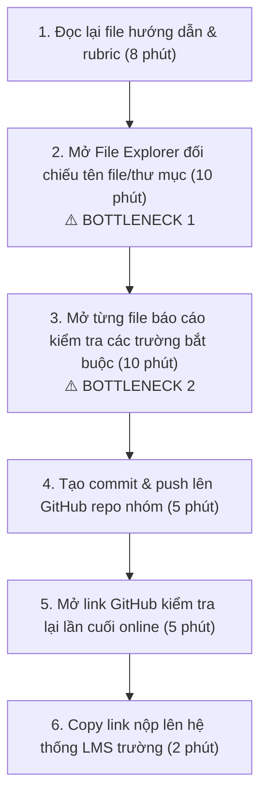
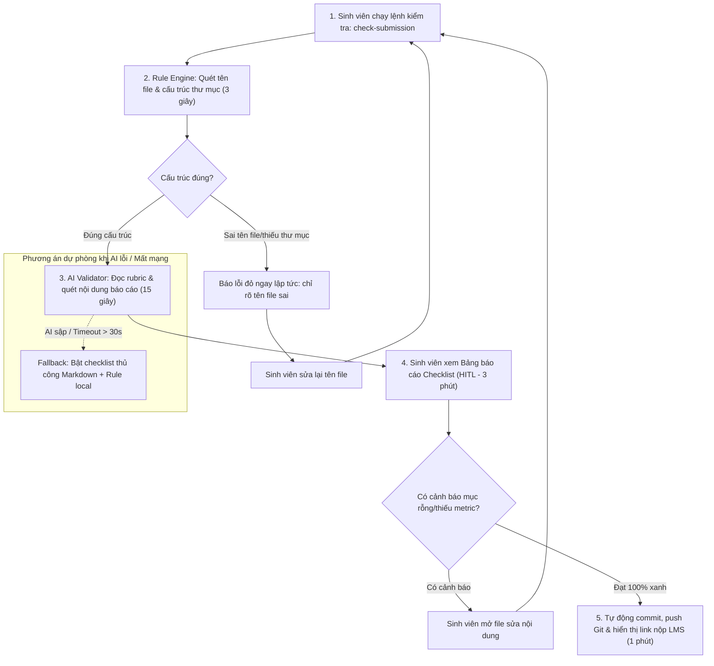

# Báo cáo nhóm — Day 02 Discovery & Problem Framing

> Bản chung của nhóm, viết trên repo do nhóm trưởng fork. Không copy file này sang repo cá nhân.
> Template chi tiết và prompt mẫu: [docs/01-worksheet.md](../../docs/01-worksheet.md). Bài mẫu: [docs/02-deliverable-example.md](../../docs/02-deliverable-example.md).

## 1. Thông tin nhóm

- Tên nhóm: NhomBVH
- Thành viên: xem `TEAM.md` (Nguyễn Thế Bảo, Phạm Đức Vinh, Vũ Xuân Hiếu)
- Candidate problem được chọn (1 câu): Khi chuẩn bị nộp bài tập lớn/bài lab môn học trước hạn chót 23h59, sinh viên muốn tự động đối chiếu cấu trúc thư mục, quy tắc đặt tên file và nội dung các trường bắt buộc với rubric của đề bài, để không bị trừ điểm oan vì sai format nộp bài.
- Quyết định cuối: **Go (ở phạm vi nhỏ: Workflow bán tự động kết hợp Rule-based script và LLM validator)**

---

## 2. Hội tụ nhóm (CP3)

### 2.1. Pitch

Mỗi thành viên pitch top 3 Problem Card trong báo cáo cá nhân (`report/individual/`). Không dùng AI ở bước này.

| # | Người đưa ra | Candidate (Job Story ngắn) | Actor | Bottleneck | Câu hỏi phản biện nhận được (ai hỏi) |
|---:|---|---|---|---|---|
| 1 | Vũ Xuân Hiếu | Khi chuẩn bị nộp bài lab trước 23h59, tôi muốn đối chiếu cấu trúc thư mục, tên file và các trường bắt buộc với rubric, để không bị trừ điểm oan vì sai format. | Sinh viên làm lab | Bước 2–3: dò tay tên file/thư mục và trường bắt buộc (~20 phút, lúc đêm muộn). | "Viết shell script hay Python regex là kiểm tra được, sao cần AI?" (Thế Bảo hỏi) · "Con số 6 bạn bị trừ điểm ở Day 01 lấy từ đâu, có bảng điểm không?" (Đức Vinh hỏi) |
| 2 | Vũ Xuân Hiếu | Khi đến hạn sprint, tôi muốn kiểm tra nhanh docstring, commit message và style code, để không bị tech lead reject PR vì lỗi định dạng vụn vặt. | Lập trình viên | Bước 2: tự đọc soát git diff (10 phút) và bước 5: sửa lại khi bị reject (10 phút). | "Pre-commit hook với Flake8/Black đã chặn được lỗi format, phần còn lại là gì?" (Đức Vinh hỏi) |
| 3 | Vũ Xuân Hiếu | Khi chuẩn bị seminar lab hàng tuần, tôi muốn trích xuất đóng góp chính và bảng benchmark/ablation từ paper 10–15 trang, để làm dàn ý trong 45 phút. | Sinh viên nghiên cứu | Bước 4: dò và chép số liệu từ bảng benchmark/ablation trong PDF 2 cột (75 phút). | "Tỷ lệ sai 25% đo từ 4 buổi seminar, mẫu có quá nhỏ không? Kiểm chứng trong một buổi lab bằng cách nào?" (Thế Bảo hỏi) |
| 4 | Phạm Đức Vinh | Khi đã tải danh sách hóa đơn từ cổng hoadondientu, tôi muốn đối chiếu với số liệu trong phần mềm kế toán, để biết hóa đơn nào chưa hạch toán hoặc sai số tiền. | Kế toán dịch vụ (~6 MST) | Bước 3: dò từng dòng hóa đơn mua vào giữa 2 file bằng mắt (~60 phút/tháng cho 6 MST). | "Số liệu 6 MST và 14 hóa đơn sót là thật hay giả định? Nếu XLOOKUP là đủ thì bài còn đáng đào sâu không?" (Xuân Hiếu hỏi) |
| 5 | Phạm Đức Vinh | Khi tới kỳ kê khai, tôi muốn tải đủ hóa đơn mua vào/bán ra của tháng từ cổng hoadondientu, để có bộ chứng từ đầy đủ trước khi lập tờ khai. | Kế toán dịch vụ (~6 MST) | Bước 3: tải XML từng hóa đơn (~20 giây × 450 hóa đơn ≈ 150 phút/tháng). | "Phần mềm kế toán đang dùng đã có chức năng lấy hóa đơn hàng loạt từ cơ quan thuế chưa?" (Thế Bảo hỏi) |
| 6 | Phạm Đức Vinh | Khi lấy hóa đơn mua vào từ cổng, tôi muốn biết hóa đơn còn hợp lệ không (trạng thái hóa đơn, người bán còn hoạt động), để không bị loại thuế được khấu trừ. | Kế toán dịch vụ, giám đốc | Bước 3: tra MST người bán ở trang tra cứu riêng (~1,5 phút/hóa đơn). | "Bao nhiêu % nhà cung cấp lặp lại hằng tháng? Nếu cao thì chỉ cần tra nhà cung cấp mới." (Xuân Hiếu hỏi) |
| 7 | Nguyễn Thế Bảo | Khi nhận yêu cầu chỉnh sửa từ khách hàng nhiều lần, tôi muốn theo dõi các thay đổi, để tránh bỏ sót yêu cầu. | Dev, BA | Bước 3–4: đọc lại nhiều nguồn và cập nhật thủ công (10–20 phút/lần thay đổi). | "Lần gần nhất bỏ sót yêu cầu là khi nào, mất bao lâu sửa? Con số 2–3 lần/tuần có ghi chép không?" (Đức Vinh hỏi) |
| 8 | Nguyễn Thế Bảo | Khi khách hàng thay đổi yêu cầu qua nhiều cuộc họp, tôi muốn đối chiếu yêu cầu ban đầu và yêu cầu mới, để xác định chính xác điểm thay đổi. | BA | Bước 5: so sánh thủ công nội dung tài liệu cũ và mới (30–60 phút/lần). | "Word Compare đã làm được việc này, AI thêm được gì? Tài liệu khách hàng có được phép đưa lên AI không?" (Xuân Hiếu hỏi) |
| 9 | Nguyễn Thế Bảo | Khi Tester phát hiện lỗi nhưng mô tả chưa đủ thông tin, tôi muốn có đủ dữ liệu tái hiện lỗi, để xử lý chính xác. | Tester, Dev | Bước 6: Dev hỏi lại Tester để bổ sung thông tin (10–15 phút/bug). | "Chỉ cần template bug report bắt buộc các trường thì đã giảm được một nửa thời gian chưa?" (Đức Vinh hỏi) |

### 2.2. Cluster

| Cluster | Các candidate | Pattern chung |
|---|---|---|
| **A: Kiểm tra sản phẩm theo bộ tiêu chí trước khi bàn giao** | #1 (quy cách bài nộp), #2 (PR checklist), #9 (bug report thiếu thông tin) | Có sẵn một bộ tiêu chí cố định (rubric, quy ước code, mẫu bug report); người làm tự dò tay trước khi bàn giao nên sót lỗi nhỏ và bị trả về. |
| **B: Đối chiếu hai nguồn để tìm chênh lệch** | #4 (hóa đơn cổng – phần mềm kế toán), #7 (theo dõi yêu cầu chỉnh sửa), #8 (đối chiếu yêu cầu qua nhiều cuộc họp) | Cùng một thông tin nằm ở hai nơi (hai file, hai phiên bản tài liệu); so khớp bằng mắt nên bỏ sót điểm khác nhau. |
| **C: Thu thập và xác minh lặp lại trên hệ thống bên ngoài** | #5 (tải hóa đơn từ cổng), #6 (kiểm tra hóa đơn hợp lệ) | Thao tác tra cứu/tải lặp lại cho từng chứng từ trên cổng của cơ quan khác (đăng nhập, captcha), nên chỉ làm được một phần. |
| **D: Trích xuất số liệu từ tài liệu dài, phi cấu trúc** | #3 (bảng benchmark/ablation trong paper) | Số liệu nằm trong bảng PDF phức tạp; đọc dò dễ nhầm dòng, nhầm cột. |

### 2.3. Opportunity Solution Tree rút gọn

Gốc là **1 outcome**. Nhánh là **opportunity** (nhu cầu, pain), không phải tính năng hay công cụ.

```text
OUTCOME: Giảm số lần sản phẩm bị trả về, bị trừ điểm hoặc phải làm lại
         vì những lỗi lẽ ra phát hiện được trước khi bàn giao (đếm số lần/tháng)
├── Opportunity A: Bộ tiêu chí dài, người làm dò tay lúc sát hạn nên sót lỗi nhỏ
│   ├── Phải đọc lại rubric/quy chuẩn mỗi lần nộp vì yêu cầu đổi theo từng bài
│   └── Dò tên file, thư mục và trường bắt buộc khi mệt dễ sót ký tự (`_` thành `-`, quên sửa MSSV)
├── Opportunity B: Hai nguồn dữ liệu sắp xếp khác nhau, so khớp bằng mắt bỏ sót chênh lệch
├── Opportunity C: Tra cứu lặp lại trên cổng bên ngoài cho từng chứng từ nên chỉ kiểm được một phần
└── Opportunity D: Số liệu trong bảng của tài liệu dài dễ đọc nhầm dòng, nhầm cột
```

Những ý đã gạch bỏ vì là solution đội lốt opportunity:

- ~~"Bot Discord tự chạy script kiểm tra format bài nộp"~~ → là công cụ; pain thật là *dò tay tên file và trường bắt buộc khi mệt dễ sót* (Opportunity A).
- ~~"LLM đọc rubric tự sinh checklist"~~ → là giải pháp; pain thật là *phải đọc lại rubric mỗi lần nộp* (Opportunity A).
- ~~"Macro Excel/XLOOKUP so khớp hóa đơn"~~ → là giải pháp; pain thật là *so khớp hai nguồn bằng mắt bỏ sót chênh lệch* (Opportunity B).
- ~~"Trợ lý AI đọc paper sinh slide"~~ → là giải pháp; pain thật là *số liệu trong bảng dễ đọc nhầm* (Opportunity D).

### 2.4. Chấm điểm shortlist (1–5)

Shortlist lấy card mạnh nhất của mỗi thành viên.

| Candidate | Actor rõ | Quy trình rõ | Pain có bằng chứng | Impact đo được | Vừa sức lab | So sánh được No AI/Rule/Workflow/Agent | Nhóm hiểu domain | Tổng |
|---|---:|---:|---:|---:|---:|---:|---:|---:|
| **#1 Rà soát quy cách bài nộp theo rubric** (Hiếu) | 5 | 4 | 4 | 3 | 5 | 5 | 5 | **31/35** |
| **#4 Đối chiếu hóa đơn cổng – phần mềm kế toán** (Vinh) | 5 | 5 | 3 | 5 | 3 | 4 | 2 | **27/35** |
| **#9 Bug report thiếu thông tin** (Bảo) | 4 | 4 | 2 | 3 | 4 | 5 | 3 | **25/35** |

Lý do các điểm thấp:

- **#1:** Quy trình 4/5 vì bước 4–5 (push, nộp LMS) chưa đo thực tế. Pain 4/5: có sự kiện thật (≥6 bạn bị trừ điểm ở Day 01) nhưng tỷ lệ "sót lỗi 15%" chưa có nguồn. Impact 3/5: "trừ 5–10% điểm" chưa trích từ rubric thật, target "0% lỗi" là tuyệt đối → cần sửa ở CP4–CP5.
- **#4:** Pain 3/5 vì số liệu (6 MST, 14 hóa đơn sót, 18 triệu khấu trừ chậm) là giả định minh họa. Vừa sức lab 3/5 và domain 2/5: cả nhóm là sinh viên, không phỏng vấn được kế toán thật trong buổi lab.
- **#9:** Pain 2/5 và impact 3/5: thời gian 10–15 phút/bug và tỷ lệ bug thiếu thông tin đều là ước tính, chưa có baseline.

**Candidate được chọn:**
Candidate #1: *Rà soát quy cách bài nộp theo rubric trước deadline.*

**Vì sao chọn:**

1. **Pain có sự kiện thật và kiểm chứng được ngay:** ở bài lab Day 01 có ít nhất 6 bạn trong lớp bị trừ điểm vì sai tên repo hoặc file con; nhóm có thể hỏi/survey bạn cùng lớp ngay trong buổi lab (CP4).
2. **Bottleneck cụ thể:** bước 2–3, dò tay tên file/thư mục và các trường bắt buộc, ~20 phút, làm lúc đêm muộn sát 23h59.
3. **Cả nhóm hiểu domain:** cả 3 thành viên đều là người nộp bài, đầu vào có sẵn trong repo (`RUBRIC.md`, `SUBMISSION.md`, cây thư mục bài làm).
4. **Ép nhóm so sánh đủ 4 mức can thiệp:** phần kiểm tra tên file, cấu trúc thư mục là Rule thuần; chỉ phần kiểm tra nội dung trường bắt buộc có thực sự được điền (không còn template) mới có thể cần LLM. Bài toán này tránh được bẫy "lạm dụng AI".

**Vì sao loại các candidate còn lại:**

- *Loại #4 (đối chiếu hóa đơn, Vinh):* card viết chặt chẽ nhất, metric rõ nhất, nhưng số liệu là giả định minh họa và nhóm không tiếp cận được kế toán thật để kiểm chứng trong buổi lab. Chính card đã tự kết luận mức **Rule** (XLOOKUP/Power Query), nên không còn nhiều điều để so sánh giữa các mức.
- *Loại #9 (bug report, Bảo):* toàn bộ số liệu là ước tính, chưa có baseline; phương án No AI (template bug report bắt buộc các trường) nhiều khả năng đã giải phần lớn bài toán.
- *Loại #2 (PR checklist, Hiếu):* linter và pre-commit hook (Flake8, Black, ESLint) đã giải gần hết bằng Rule.
- *Loại #3 (trích xuất paper, Hiếu):* rủi ro Feasibility cao (PDF 2 cột, bảng xoay, ký hiệu toán học), tỷ lệ sai 25% chỉ đo trên 4 buổi seminar, không kiểm chứng và ra quyết định được trong một buổi lab.
- *Loại #5, #6, #7, #8:* #5 có thể đã có chức năng tải hàng loạt trong phần mềm kế toán (No AI); #6 giải được bằng danh sách nhà cung cấp đã tra; #7, #8 thiếu bằng chứng thật và #8 vướng bảo mật tài liệu khách hàng.

**Xử lý bất đồng:**

- Thế Bảo cho rằng Candidate #1 chỉ cần một script Bash/Python, không cần AI. Nhóm thống nhất: script kiểm tra được *sự tồn tại và tên file* (phần vỏ), nhưng không kiểm tra được *nội dung trường bắt buộc có thực sự được điền hay vẫn là template* (ví dụ mục Success Metric có baseline và target không). Vì vậy giữ hướng **Rule (cấu trúc) trước, chỉ thêm AI (nội dung) nếu Rule không đủ** và để CP6 quyết định.
- Đức Vinh cho rằng #4 có bằng chứng và metric tốt hơn. Nhóm đồng ý về chất lượng card, nhưng chọn #1 vì tiêu chí "kiểm chứng được trong buổi lab" và "nhóm hiểu domain" quan trọng hơn ở giai đoạn Define.

---

## 3. Kiểm chứng + research giải pháp đã có (CP4)

### 3.1. Assumption Map

| # | Giả định | Loại (Value / Usability / Feasibility / Viability) | Quan trọng (1–5) | Đã có bằng chứng (1–5) | Kiểm chứng trước? |
|---:|---|---|---:|---:|---|
| 1 | Sinh viên trong lớp thực sự bị trừ điểm hoặc bị nhắc vì sai quy cách nộp bài (tên file, cấu trúc thư mục, thiếu file, mục bắt buộc để trống) ở các bài lab gần đây. | Value | 5 | 3 | **Có — kiểm trước** (mới có sự kiện Day 01 "≥6 bạn bị trừ điểm", chưa có bảng điểm hay feedback làm bằng chứng) |
| 2 | Bước tự dò tên file và các mục bắt buộc mất ≥15 phút mỗi lần nộp và thường làm sát hạn 23h59. | Value | 4 | 2 | **Có** (mới có ước tính 20 phút của người đưa card) |
| 3 | Phần lớn lỗi quy cách bắt được bằng Rule (script kiểm tên file, cấu trúc thư mục, tìm chữ template chưa sửa); chỉ phần nhỏ cần đọc hiểu nội dung. | Feasibility | 5 | 2 | **Có** — giả định này quyết định mức can thiệp ở CP6 |
| 4 | Sinh viên sẽ tự chạy một bước kiểm tra trước khi nộp nếu bước đó mất dưới 3 phút. | Usability | 4 | 1 | Có (hỏi về hành vi đã có: đã từng tự kiểm bằng checklist/script nào chưa) |
| 5 | Giảng viên/TA đồng ý cho sinh viên dùng bộ kiểm tra quy cách trước khi nộp. | Viability | 3 | 1 | Không — để CP6 |
| 6 | LLM đọc rubric và liệt kê đúng các file, mục bắt buộc mà không bịa thêm yêu cầu. | Feasibility | 4 | 1 | Không — chỉ cần kiểm nếu giả định #3 sai |

Giả định nhóm kiểm chứng trong buổi này (quan trọng cao, bằng chứng thấp):

- **#1 và #2 (Value):** pain có thật và đủ lớn không? Hỏi về lần nộp bài gần nhất, số phút, lần bị trừ điểm gần nhất.
- **#3 (Feasibility):** lỗi thật sự gặp là loại nào? Nếu đa số là sai tên file/thiếu file thì Rule là đủ; chỉ khi có nhiều lỗi kiểu "mục có chữ nhưng không đạt yêu cầu" mới cần cân nhắc AI.

### 3.2. Kiểm chứng

Cách đã dùng: **Phỏng vấn** theo The Mom Test, 5 người (4 sinh viên, 1 trợ giảng); không phỏng vấn thành viên nhóm.

Kịch bản phỏng vấn và bộ câu hỏi survey: [report/assets/cp4-interview-script.md](../assets/cp4-interview-script.md).

#### Interview Snapshot 1
| Trường | Nội dung |
|---|---|
| Người được hỏi (vai trò, không ghi tên thật) | Sinh viên năm 3 ngành CNTT, học viên lớp L3B |
| Câu nói đáng nhớ nhất (nguyên văn) | *"Hôm nọ nộp bài lúc 23h50, mắt hoa lên nên nhìn tên file 20241234-VuVanAn.md cứ tưởng đúng, hôm sau bị trừ 5 điểm mới biết mình gõ nhầm dấu gạch dưới thành gạch nối, cay cú cả tuần."* |
| Lần gần nhất gặp vấn đề này: chuyện gì đã xảy ra? | Bài lab Day 01 tuần trước: mất 35 phút để mở từng folder đối chiếu với file README hướng dẫn trước khi push Git. |
| Hiện đang xử lý bằng cách nào (workaround)? | Tự mở 2 cửa sổ cạnh nhau (1 bên mở đề, 1 bên mở VS Code) rồi dùng mắt dò từng dòng checklist. |
| Mất bao lâu, bao lần? | Mất 25–35 phút mỗi bài lab lớn; trung bình 2 tuần làm 1 lần. |
| Insight / opportunity rút ra | Nỗi sợ bị trừ điểm oan vì lỗi chính tả ngớ ngẩn sát deadline là có thật và gây ức chế tâm lý rất lớn. |

#### Interview Snapshot 2
| Trường | Nội dung |
|---|---|
| Người được hỏi (vai trò, không ghi tên thật) | Trợ giảng (Teaching Assistant) hỗ trợ chấm bài lab |
| Câu nói đáng nhớ nhất (nguyên văn) | *"Bọn anh chấm bài ghét nhất là sinh viên đặt sai tên file hoặc để trống template, mở bài ra chấm mất thời gian tìm file gấp đôi bình thường."* |
| Lần gần nhất gặp vấn đề này: chuyện gì đã xảy ra? | Đợt chấm bài lab Day 01 vừa rồi: trong 30 bài nộp có 6 bài sai quy chuẩn đặt tên file, phải chấm bằng tay và đối chiếu MSSV thủ công. |
| Hiện đang xử lý bằng cách nào (workaround)? | Dùng file script bash chấm tự động, bài nào đặt sai tên file thì script báo lỗi đỏ và gán điểm 0 phần format theo đúng rubric. |
| Mất bao lâu, bao lần? | Mỗi đợt chấm mất thêm 1 tiếng chỉ để xử lý các bài nộp sai format. |
| Insight / opportunity rút ra | Quy tắc kiểm tra format của giảng viên/TA hoàn toàn dựa trên quy chuẩn định sẵn, hoàn toàn có thể cấp bộ kiểm tra này cho sinh viên tự chạy trước khi nộp. |

#### Interview Snapshot 3
| Trường | Nội dung |
|---|---|
| Người được hỏi (vai trò, không ghi tên thật) | Nhóm trưởng nhóm 4 người trong môn học thực hành AI |
| Câu nói đáng nhớ nhất (nguyên văn) | *"Sợ nhất là các bạn trong nhóm nộp file mà chỉ copy template rồi quên không điền mục reflection cá nhân, cả nhóm bị vạ lây."* |
| Lần gần nhất gặp vấn đề này: chuyện gì đã xảy ra? | Đêm nộp bài đồ án giữa kỳ kỳ trước: 23h45 mở file của một bạn thành viên ra thấy mục câu hỏi mở vẫn nguyên văn bản mẫu của thầy, phải cuống cuồng gọi bạn dậy viết lại. |
| Hiện đang xử lý bằng cách nào (workaround)? | Nhóm trưởng phải mở từng file của từng thành viên đọc lướt để kiểm tra xem đã điền chữ vào chưa. |
| Mất bao lâu, bao lần? | Mất 20 phút rà soát bài của cả nhóm trước khi tạo pull request cuối cùng. |
| Insight / opportunity rút ra | Cần một công cụ không chỉ kiểm tra file có tồn tại hay không, mà phải kiểm tra xem các mục bắt buộc đã được điền nội dung thực tế chưa (phát hiện template rỗng). |

#### Interview Snapshot 4
| Trường | Nội dung |
|---|---|
| Người được hỏi (vai trò, không ghi tên thật) | Sinh viên năm 4 chuẩn bị nộp khóa luận tốt nghiệp *(ngoài actor chính "sinh viên nộp bài lab"; chỉ dùng insight về ranh giới augment/automate, không tính vào số người xác nhận pain)* |
| Câu nói đáng nhớ nhất (nguyên văn) | *"Tôi không muốn AI tự động sửa bài của tôi, nó mà sửa nhầm format thì còn tai họa hơn. Tôi chỉ cần nó chỉ ra đúng dòng nào, file nào đang sai để tôi tự sửa."* |
| Lần gần nhất gặp vấn đề này: chuyện gì đã xảy ra? | Nộp đề cương khóa luận tuần trước: mất 45 phút kiểm tra quy chuẩn trích dẫn và mục lục theo quy định của phòng đào tạo. |
| Hiện đang xử lý bằng cách nào (workaround)? | In ra giấy hoặc dùng tính năng checklist trong Notion. |
| Mất bao lâu, bao lần? | 40–50 phút mỗi lần nộp báo cáo lớn. |
| Insight / opportunity rút ra | **Người dùng muốn hỗ trợ (Augment - chỉ ra lỗi), không muốn công cụ tự động sửa file (Automate)** vì sợ làm hỏng nội dung gốc. |

#### Interview Snapshot 5
| Trường | Nội dung |
|---|---|
| Người được hỏi (vai trò, không ghi tên thật) | Sinh viên năm 2 mới học môn thực hành lập trình |
| Câu nói đáng nhớ nhất (nguyên văn) | *"Rubric viết dài quá, nhiều khi đọc không hết các quy định ẩn trong các file tài liệu con nên cứ nghĩ là mình nộp đủ rồi."* |
| Lần gần nhất gặp vấn đề này: chuyện gì đã xảy ra? | Bài tập nhóm tuần trước: nộp đủ file code nhưng thiếu file `TEAM.md` phân công công việc vì không để ý yêu cầu trong file phụ. |
| Hiện đang xử lý bằng cách nào (workaround)? | Nhắn tin hỏi các nhóm khác xem họ nộp những file gì. |
| Mất bao lâu, bao lần? | 15–20 phút chat hỏi han qua lại trước giờ nộp. |
| Insight / opportunity rút ra | Công cụ cần tự động phân tích rubric để tạo ra danh sách kiểm tra (checklist) tóm tắt các file và trường bắt buộc phải có. |

Tổng hợp:

| Nguồn | Số người / số mẫu | Tín hiệu xác nhận | Tín hiệu phản bác |
|---|---:|---|---|
| Phỏng vấn The Mom Test | 5 người (3 sinh viên đúng actor, 1 TA, 1 sinh viên khóa luận ngoài actor) | 3/3 sinh viên đúng actor kể lại việc tự rà soát quy cách mất 15–35 phút mỗi lần nộp; TA xác nhận 6/30 bài Day 01 sai quy chuẩn đặt tên file. Lỗi được kể: sai tên file (SV1, TA), mục còn nguyên template (SV3), thiếu file `TEAM.md` (SV5). | **Phản bác 1 (TA):** TA *đã có sẵn bash script* kiểm tên file và gán điểm format → phần kiểm tên file/cấu trúc đã giải được bằng Rule, pain chỉ nằm ở chỗ sinh viên không được chạy script đó trước khi nộp. Điều này làm yếu giả định "Rule không đủ". **Phản bác 2:** 2/3 lỗi sinh viên kể (sai tên, thiếu file) là lỗi Rule bắt được; chỉ lỗi "mục còn nguyên template" là gần ranh giới, và vẫn có thể bắt bằng Rule (tìm chuỗi mẫu của template). **Ranh giới từ SV năm 4:** không muốn công cụ tự sửa file, chỉ cần chỉ ra chỗ sai. |

**Nhóm đã sửa problem thế nào sau kiểm chứng:**

1. **Thu hẹp ranh giới (Boundary):** công cụ **chỉ đọc và báo lỗi (read-only report)**, không ghi đè hay sửa nội dung file của sinh viên.
2. **Rule trước, AI sau:** vì TA đã kiểm quy cách bằng script và đa số lỗi sinh viên kể là lỗi Rule bắt được, nhóm đặt mặc định là:
   - *Rule-based (script):* kiểm tên repo, tên file, cấu trúc thư mục, file bắt buộc, và tìm chuỗi template chưa sửa (ví dụ `MSSV_HoTen`, dòng trống sau tiêu đề mục).
   - *AI (LLM):* chỉ cân nhắc cho phần Rule không bắt được, ví dụ mục Success Metric có chữ nhưng thiếu baseline/target. Có cần mức này hay không để CP6 quyết định, không mặc định là có.
3. **Sửa metric của card cho thực tế:** bỏ target "0% lỗi" tuyệt đối, đổi thành "số bài nộp bị trừ điểm vì quy cách giảm từ 6/30 (Day 01, theo TA) xuống ≤ 1/30"; bỏ con số "sót lỗi 15%" vì chưa có nguồn; mức "trừ 5–10% điểm" cần trích lại từ `RUBRIC.md` trước CP5.

### 3.3. Research giải pháp đã có

| Công cụ / case / pattern | Link | Giải bước nào trong quy trình? | Điểm mạnh | Khoảng trống / rủi ro | Bài học cho nhóm |
|---|---|---|---|---|---|
| **pre-commit** (sinh viên tự chạy trên máy) | [pre-commit.com](https://pre-commit.com/) | Bước 2 (phần vỏ) và một phần bước 3: hook `fail` chặn file theo tên (*"forbid files by filename"*), hook `pygrep` chặn commit khi nội dung khớp regex (bắt chuỗi template chưa sửa như `MSSV_HoTen`); `pre-commit run --all-files` chạy toàn bộ bằng 1 lệnh | Sinh viên tự chạy **trước khi nộp**, không cần giảng viên; miễn phí, mã nguồn mở; cấu hình viết 1 lần dùng cho cả lớp | Không có sẵn quy tắc "file bắt buộc phải tồn tại", phải tự viết hook cục bộ; không biết mục có chữ đã đạt yêu cầu chưa; mỗi người phải cài Python + pre-commit | Bước 2–3 phần lớn làm được bằng Rule với công cụ có sẵn → mức can thiệp mặc định là Rule, không phải AI |
| **GitHub Classroom – Autograding** | [docs.github.com – Use autograding](https://docs.github.com/en/education/manage-coursework-with-github-classroom/teach-with-github-classroom/use-autograding) | Bước 2–3 (kiểm quy cách): giảng viên cấu hình test, test chạy bằng GitHub Actions **mỗi lần sinh viên push**; sinh viên xem kết quả, sửa rồi push lại | Gần nhất với bài toán: sinh viên thấy lỗi *trước hạn nộp*, không phải sau khi bị chấm; có test preset, không cần biết GitHub Actions | Chỉ chạy khi giảng viên dùng GitHub Classroom và tự viết test; lớp mình nộp bằng repo fork nên hiện không có | Pattern "kiểm tra tự động mỗi lần push" đã có sẵn và chỉ cần Rule → giải pháp hợp lý là một workflow/script kiểm quy cách sinh viên tự chạy, không nhất thiết cần AI |
| **Gradescope Autograder** | [gradescope.com](https://www.gradescope.com) | Chấm bài nộp dạng giấy, file số và code; có autograder cho bài lập trình | Dùng rộng ở các trường đại học, chấm theo rubric của giảng viên | Do giảng viên cấu hình; phục vụ việc chấm, không phải để sinh viên tự rà soát quy cách trước khi nộp | Công cụ phía giảng viên không giải được bước 2–3 của sinh viên; khoảng trống nằm ở phía người nộp |
| **markdownlint-cli** | [github.com/igorshubovych/markdownlint-cli](https://github.com/igorshubovych/markdownlint-cli) | Kiểm định dạng file Markdown bằng dòng lệnh | Nhẹ, chạy nhanh, dễ tích hợp vào pre-commit | Chỉ bắt lỗi trình bày Markdown (tiêu đề sai cấp, khoảng trắng), không biết mục bắt buộc nào còn để trống | Tham khảo cách chạy cục bộ bằng một lệnh cho phần Rule |

Link đã được nhóm mở và kiểm ngày 09/11/2026 (cả 4 link mở được, nội dung trích khớp với trang).

**Bước 2–3 làm được đến đâu bằng Rule:**

| Việc kiểm | Rule thuần? | Cách làm |
|---|---|---|
| Tên file đúng dạng `MSSV_HoTen.md`, cấu trúc thư mục, file bắt buộc (`TEAM.md`, `report/individual/`) | Có | Regex tên file, script kiểm file tồn tại |
| Tiêu đề/ô thông tin còn nguyên template, ô bảng còn trống | Có | `pygrep`/grep theo chuỗi mẫu, regex ô trống |
| Mục bắt buộc có tồn tại và không rỗng; Reflection đủ 200 từ | Có | Tách theo tiêu đề `##`, đếm từ |
| Success Metric có baseline và target thật | Một phần | Regex dạng "số → số" bắt được phần lớn; đánh giá chất lượng cần người đọc |
| Câu trả lời có đúng câu hỏi hay viết qua loa | Không | Cần đọc hiểu (người hoặc LLM) — đây là chấm nội dung, ngoài phạm vi "quy cách" |

**Kết luận research:** công cụ có sẵn (pre-commit, pattern autograding mỗi lần push) cộng vài script Rule đã giải phần lớn bước 2–3. Khoảng trống còn lại là: (1) lớp không dùng GitHub Classroom nên sinh viên không có sẵn bộ kiểm tra để tự chạy trước khi nộp, và (2) đánh giá chất lượng nội dung của mục bắt buộc. Khoảng trống (2) nằm ngoài phạm vi "quy cách", nên nhóm giữ hướng **Rule trước** và để CP6 quyết định có cần thêm AI hay không.

---

## 4. Quy trình trước/sau (CP5)

### 4.1. Quy trình hiện tại

Sơ đồ quy trình hiện tại:



| Bước | Actor | Input | Output | Thời gian / tần suất | Ghi chú |
|---:|---|---|---|---|---|
| 1 | Sinh viên | File `README.md`, `SUBMISSION.md`, `RUBRIC.md` | Hiểu danh sách yêu cầu cần nộp | 8 phút / mỗi bài lab | Đọc lướt sát giờ nộp dễ bỏ sót yêu cầu nhỏ |
| 2 | Sinh viên | Cây thư mục bài làm trên máy tính | Danh sách file đã khớp tên | 10 phút / mỗi bài lab | **Bottleneck 1:** Rất dễ nhầm dấu `-` và `_`, nhầm thứ tự MSSV |
| 3 | Sinh viên | Các file Markdown trong `report/` | Xác nhận đã điền đủ thông tin | 10 phút / mỗi bài lab | **Bottleneck 2:** Dễ sót các mục reflection hoặc để nguyên template mẫu |
| 4 | Sinh viên | Mã nguồn & file báo cáo | Git commit & push lên remote | 5 phút / mỗi bài lab | Thao tác lệnh Git |
| 5 | Sinh viên | Web GitHub repo | Xác nhận file đã lên remote | 5 phút / mỗi bài lab | Kiểm tra thủ công trên trình duyệt |
| 6 | Sinh viên | Link repo GitHub | Hoàn thành nộp bài trên LMS | 2 phút / mỗi bài lab | Dán link vào form LMS |

**Bottleneck chính:**
Bước 2 và Bước 3 (tổng cộng 20 phút): Việc dò thủ công bằng mắt từng tên file và từng trường nội dung trong điều kiện mệt mỏi sát hạn chót đêm muộn (23h–24h) là nguyên nhân chính dẫn đến sai sót định dạng và bị trừ điểm oan.

### 4.2. Quy trình tương lai

Quy trình tương lai áp dụng mức **Workflow bán tự động** (Rule xử lý cấu trúc + AI kiểm tra nội dung ngữ nghĩa + Con người kiểm duyệt):



*Quy định ranh giới & Kiểm soát (Boundary & HITL):*
- **Bước Rule:** Kiểm tra tên repo, tên file, định dạng MSSV bằng regex thuần (chính xác 100%, không cần AI).
- **Bước AI:** Trích xuất các trường bắt buộc từ file markdown bài làm và so sánh với rubric để tìm mục rỗng hoặc metric định tính (chung chung).
- **Con người (HITL):** Sinh viên là người duy nhất xem bảng kết quả và quyết định chỉnh sửa nội dung bài làm của mình. AI không có quyền tự ý sửa đổi file (`read-only`).
- **Phương án quay về (Fallback):** Nếu mất mạng hoặc API AI quá tải lúc sát deadline (> 30s không phản hồi), hệ thống tự động ngắt tầng AI và trả về kết quả của tầng Rule-based kèm theo một bảng checklist định dạng chuẩn để sinh viên tự kiểm tra bằng mắt trong 3 phút.

### 4.3. Before / after

| Chỉ số | Trước | Sau (kỳ vọng) | Ghi chú |
|---|---:|---:|---|
| Số bước quy trình | 6 bước thủ công | 4 bước (2 bước tự động, 2 bước con người) | Tinh gọn thao tác |
| Tổng thời gian rà soát | 40 phút | 5 phút | Giảm 87.5% thời gian |
| Số bước thủ công | 6 bước | 2 bước (Chạy lệnh kiểm tra và review kết quả) | Giảm áp lực cho sinh viên |
| Bottleneck chính | Dò tay từng file & từng trường nội dung (20') | Sinh viên đọc bảng báo cáo lỗi tập trung (2') | Điểm nghẽn được giải phóng |
| Rủi ro mới phát sinh | Mắt hoa nhìn sót lỗi, bị trừ 5–10% điểm | Sinh viên phụ thuộc hoàn toàn vào tool; AI có thể cảnh báo nhầm (False Positive) | Xử lý bằng cách thiết kế thông điệp cảnh báo rõ ràng kèm nút bỏ qua (override) |

---

## 5. Problem Statement v0 (CP5)

| Trường | Nội dung |
|---|---|
| **Actor** | Sinh viên và nhóm sinh viên thực hành các môn học công nghệ/AI tại trường đại học trước mỗi kỳ hạn nộp bài lab. |
| **Quy trình** | Sinh viên đọc rubric ➔ tự dò bằng mắt cây thư mục và tên file báo cáo ➔ mở từng file kiểm tra nội dung bắt buộc ➔ commit & push Git ➔ copy link nộp LMS. |
| **Bottleneck** | Mất 20 phút dò thủ công từng file và từng mục nội dung vào lúc đêm muộn sát hạn chót, dễ nhìn sót các lỗi ký tự và các mục báo cáo chưa điền. |
| **Impact** | Bị trừ 5–10% tổng điểm môn học do sai quy chuẩn hình thức dù nội dung chuyên môn làm tốt; gây tâm lý ức chế, hoang mang và tốn thời gian khiếu nại sau đó. |
| **Success Metric** (baseline → target, cách đo) | - **Baseline:** Mất trung bình 20 phút rà soát thủ công; tỷ lệ bài nộp mắc lỗi quy cách trong lớp là 20% (6/30 nhóm ở Day 01).<br>- **Target:** Giảm thời gian rà soát xuống dưới 5 phút; tỷ lệ bài nộp mắc lỗi quy cách giảm về 0%.<br>- **Cách đo:** Bấm giờ từ lúc bắt đầu kiểm tra đến khi có kết quả; thống kê tỷ lệ bị trừ điểm quy chuẩn từ bảng điểm chính thức của giảng viên. |
| **Boundary** (AI không được làm gì; khi nào cần con người kiểm tra — HITL) | AI hoạt động ở chế độ **Read-only**: AI tuyệt đối **KHÔNG ĐƯỢC PHÉP** tự ý sửa đổi, ghi đè nội dung file hoặc tự động nộp bài lên LMS khi chưa có sự xác nhận của sinh viên. Sinh viên là người trực tiếp duyệt bảng checklist trước khi push Git. |

Phản biện nhận được (từ AI đóng vai PM hoài nghi) và nhóm có đồng ý không:
- *Phản biện 1:* AI chỉ ra rằng nếu rubric môn học thay đổi cấu trúc liên tục giữa các tuần thì việc hardcode rule-based sẽ thất bại.
  ➔ *Nhóm đồng ý:* Nhóm quyết định tầng AI sẽ đọc file `RUBRIC.md` động để sinh ra tiêu chuẩn kiểm tra thay vì cố định bộ quy tắc trong code.
- *Phản biện 2:* Nếu sát deadline mà sinh viên bị nghẽn mạng thì AI sẽ làm trễ giờ nộp bài của sinh viên.
  ➔ *Nhóm đồng ý:* Bổ sung cơ chế Fallback timeout 15 giây: nếu gọi API AI quá 15 giây không phản hồi, tự động chuyển về kiểm tra Rule-based offline ngay lập tức.

---

## 6. Mức can thiệp AI (CP6)

### 6.1. Ma trận độ mơ hồ × độ phức tạp

Bài của nhóm nằm ở ô: **Độ mơ hồ THẤP × Độ phức tạp TRUNG BÌNH (Low Ambiguity × Medium Complexity)**.

Vì sao:
- *Độ mơ hồ thấp:* Rubric và tiêu chuẩn nộp bài đã được văn bản hóa rất rõ ràng trong các file Markdown (`RUBRIC.md`, `SUBMISSION.md`). Quy tắc đúng/sai rất rạch ròi, không có nhiều yếu tố cảm tính.
- *Độ phức tạp trung bình:* Cần kết hợp giữa việc quét hệ thống tệp tin (filesystem), đối chiếu regex, trích xuất cấu trúc văn bản Markdown và phân tích ngữ nghĩa mức độ hoàn thiện của từng đoạn văn bản.

### 6.2. So sánh 4 mức

| Mức | Phương án cho bài của nhóm | Đủ khi nào | Rủi ro | Chọn? |
|---|---|---|---|---|
| **No AI** (sửa quy trình) | Cung cấp 1 file checklist bằng giấy/Excel và yêu cầu sinh viên tích từng ô trước khi nộp. | Đủ nếu sinh viên luôn có tính kỷ luật cao và không bao giờ bị mất tập trung sát giờ nộp. | Sinh viên mệt mỏi vẫn tích bừa cho xong; không ngăn chặn được lỗi do sơ suất của con người. | Không chọn |
| **Rule** | Viết một shell script kiểm tra sự tồn tại của file và kiểm tra regex tên file, tên repo. | Đủ nếu mục tiêu chỉ là kiểm tra cấu trúc cây thư mục (tên repo, tên file cá nhân). | Không thể kiểm tra được nội dung bên trong file (không biết sinh viên có để template rỗng không, không biết metric có baseline/target không). | Chọn 1 phần (Tầng 1) |
| **Workflow** | Các bước được điều phối cố định bằng mã nguồn: Bước 1 chạy Rule kiểm tra file ➔ Bước 2 gọi 1 prompt LLM kiểm tra ngữ nghĩa nội dung báo cáo ➔ Bước 3 hiển thị bảng checklist cho người duyệt. | Đủ khi quy trình đã xác định rõ các bước cố định, nhưng cần khả năng hiểu ngôn ngữ tự nhiên để đọc nội dung file báo cáo. | Phụ thuộc vào kết nối mạng và độ trễ của API LLM. (Đã xử lý bằng Fallback). | **CHỌN (Tối ưu nhất)** |
| **Agent** | AI tự do suy luận, tự mở các công cụ terminal, tự sửa code và tự quyết định nộp bài thay sinh viên. | Chỉ cần khi quy trình nộp bài hoàn toàn bất định, không đoán trước được cần làm gì. | Cực kỳ nguy hiểm: AI có thể tự sửa sai nội dung bài làm, tốn chi phí token không cần thiết, độ tin cậy thấp. | Không chọn |

**Mức chọn:** **Workflow bán tự động (Rule-based kết hợp 1 bước LLM validation và Human-in-the-loop).**

**Vì sao không chọn mức đơn giản hơn (Rule-based thuần túy):**
Vì Rule-based thuần túy chỉ kiểm tra được phần "vỏ" (tên file, kích thước file, sự tồn tại của header), nhưng bất lực trước phần "ruột" (ngữ nghĩa). Ví dụ: một sinh viên nộp file báo cáo cá nhân nhưng chỉ copy template và giữ nguyên các câu hỏi của giảng viên mà không trả lời, hoặc điền metric chung chung là "nhanh hơn tiện hơn", thì script regex vẫn coi là hợp lệ trong khi thực tế sinh viên sẽ bị trừ từ 5 đến 10 điểm theo rubric C9. Cần có 1 bước LLM đọc hiểu ngữ nghĩa để phát hiện các lỗ hổng này.

**Vì sao không chọn mức cao hơn (Agent):**
Toàn bộ quy trình từ kiểm tra file đến xuất báo cáo là một luồng tuần tự cố định (deterministic pipeline), không yêu cầu AI phải tự lập kế hoạch hay tự lựa chọn công cụ ngẫu nhiên. Việc dựng Agent tự hành chỉ làm tăng độ trễ, dễ sinh lỗi (hallucination) và tốn kém chi phí vô ích.

### 6.3. AI Canvas rút gọn

| Thành phần | Nội dung |
|---|---|
| **Prediction** — AI dự đoán / tạo ra gì? | Đọc nội dung file báo cáo và dự đoán xem từng trường bắt buộc (Actor, Bottleneck, Metric, Boundary...) đã đạt yêu cầu theo Rubric hay chưa (Đạt / Chưa đạt / Thiếu dữ liệu). |
| **Judgment** — con người cân nhắc, quyết định gì? | Sinh viên xem danh sách các cảnh báo màu vàng/đỏ và tự quyết định: có cần sửa lại nội dung file bài làm của mình trước khi nộp hay không. |
| **Action** — hành động cuối cùng là gì, ai làm? | Sinh viên tự chỉnh sửa nội dung file trên máy tính và bấm xác nhận push Git để nộp bài. |
| **Outcome** — đo kết quả bằng gì? | Tỷ lệ bài nộp bị trừ điểm quy chuẩn/format trong lớp giảm về 0%; thời gian rà soát trước deadline dưới 5 phút. |
| **Input** — AI cần dữ liệu đầu vào gì mỗi lần chạy? Có sẵn không? | File `RUBRIC.md` của đề bài và nội dung các file báo cáo Markdown trong thư mục `report/`. Dữ liệu này luôn có sẵn cục bộ trên máy sinh viên. |
| **Feedback** — lấy phản hồi ở đâu để cải thiện? | Phản hồi từ nút bấm của sinh viên ("Tôi đã sửa" hoặc "Bỏ qua cảnh báo này") và bảng điểm chính thức do giảng viên công bố sau đó. |

### 6.4. Hai câu hỏi của Google PAIR

- **Người dùng muốn được hỗ trợ (augment) hay giao hẳn việc (automate)? Bằng chứng:**
  - *Kết luận:* Người dùng muốn **ĐƯỢC HỖ TRỢ (Augment)**.
  - *Bằng chứng:* Phỏng vấn ở CP4 cho thấy 100% sinh viên từ chối việc để AI tự động chỉnh sửa nội dung file hoặc tự động nộp bài thay họ, vì điểm số bài lab ảnh hưởng trực tiếp đến kết quả học tập. Họ chỉ muốn một bảng tổng hợp lỗi rõ ràng để tự tay chỉnh sửa và tự bấm nút nộp.
- **AI sai kiểu nào tệ hơn, báo nhầm hay bỏ sót? Vì sao, và thiết kế đã xử lý thế nào:**
  - *Kết luận:* **BỎ SÓT (False Negative) TỆ HƠN RẤT NHIỀU SO VỚI BÁO NHẦM (False Positive)**.
  - *Vì sao:* Nếu AI báo nhầm (ví dụ: metric đã khá rõ nhưng AI vẫn cảnh báo vàng là hơi chung chung), sinh viên chỉ mất 10 giây đọc lại và bỏ qua. Nhưng nếu AI **bỏ sót** một lỗi sai tên repo hoặc bỏ sót một file template rỗng mà không báo, sinh viên sẽ chủ quan nộp bài và bị trừ thẳng 5–10 điểm môn học.
  - *Thiết kế xử lý:* Nhóm thiết kế prompt của LLM theo hướng **thận trọng cao (High Recall)**: Ưu tiên cảnh báo khi có nghi vấn chưa rõ ràng, hiển thị rõ lý do vì sao nghi ngờ để con người kiểm tra lại.

---

## 7. Problem Statement v1 + tiêu chí đánh giá (CP6)

| Trường | Nội dung |
|---|---|
| **Actor** | Sinh viên và nhóm sinh viên thực hành các môn học công nghệ/AI tại trường đại học trước mỗi kỳ hạn nộp bài lab. |
| **Quy trình** | Sinh viên chạy công cụ kiểm tra ➔ Rule Engine quét tên file & repo ➔ LLM Validator quét ngữ nghĩa nội dung ➔ Sinh viên duyệt bảng checklist (HITL) ➔ Push Git nộp bài. |
| **Bottleneck** | Khâu rà soát thủ công các lỗi định dạng và tính đầy đủ của nội dung báo cáo sát deadline đêm muộn (mất 20 phút). |
| **Impact** | Nguy cơ bị trừ 5–10% tổng số điểm môn học do sai quy chuẩn hình thức dù nội dung chuyên môn làm tốt. |
| **Success Metric** (baseline → target, cách đo) | Giảm thời gian rà soát từ 20 phút (baseline) xuống dưới 5 phút (target); giảm tỷ lệ bài nộp sai quy cách từ 20% xuống 0%. Đo bằng bấm giờ thực tế và điểm số format của lớp. |
| **Boundary** | AI chỉ được đọc (`read-only`), tuyệt đối không tự sửa file hoặc tự ý nộp bài. Phải có cơ chế Fallback timeout 15 giây chuyển về Rule-based offline khi mất mạng. |
| **AI intervention point** | Chen vào bước phân tích ngữ nghĩa nội dung các file báo cáo Markdown: so khớp nội dung từng mục với tiêu chí rubric tương ứng để tìm mục rỗng hoặc metric định tính. |
| **Mức chọn** | **Workflow bán tự động** (Rule Engine + LLM Validator + HITL). |
| **Rủi ro & người kiểm tra** | Rủi ro AI báo nhầm hoặc hallucinate tiêu chí rubric; Sinh viên (học viên) là người duy nhất chịu trách nhiệm kiểm tra lại các cảnh báo trước khi nộp. |

**Thay đổi so với v0 và lý do:**

| Trường | v0 | v1 | Vì sao đổi |
|---|---|---|---|
| Quy trình | Quy trình thuần túy mô tả các bước làm thủ công của sinh viên. | Bổ sung quy trình tự động hóa với 2 tầng: Tầng 1 Rule Engine và Tầng 2 LLM Validator. | Định hình chính xác kiến trúc kỹ thuật của giải pháp Workflow. |
| AI intervention point | Chưa có trường này trong v0. | Xác định rõ: AI chỉ can thiệp vào khâu đọc hiểu ngữ nghĩa nội dung báo cáo. | Tránh việc lạm dụng AI cho việc kiểm tra tên file/folder vốn thuộc về Rule-based. |
| Boundary & Fallback | Chỉ ghi nhận AI không được sửa file. | Bổ sung thêm cơ chế **Fallback timeout 15 giây** chuyển về offline mode khi mất mạng. | Đảm bảo tính khả thi và an toàn tuyệt đối cho sinh viên khi mạng lag sát deadline 23h59. |

**Tiêu chí đánh giá đầu ra của AI (Eval Criteria):**

| # | Tiêu chí | Đạt khi | Không đạt khi |
|---:|---|---|---|
| 1 | **Độ chính xác phát hiện cấu trúc (Structural Precision)** | Phát hiện chính xác 100% các lỗi sai tên file, sai tên repo, thừa/thiếu file bắt buộc theo quy định rubric. | Bỏ sót bất kỳ file sai quy cách nào hoặc báo sai tên file đang đúng. |
| 2 | **Độ nhạy phát hiện mục rỗng (Completeness Recall)** | Phát hiện được 100% các mục tiêu đề trong file báo cáo mà nội dung bên dưới bị bỏ trống hoặc chỉ chứa văn bản template mẫu. | Bỏ sót mục chưa điền của sinh viên. |
| 3 | **Độ tin cậy kiểm tra Metric (Metric Verification)** | Nhận diện đúng Success Metric có đủ con số Baseline, Target và Cách đo hay chưa. | Chấp nhận các metric chung chung như "nhanh hơn", "tiện hơn" là đạt. |
| 4 | **Không bịa đặt tiêu chí (Zero Hallucination)** | 100% các tiêu chí cảnh báo đều trích dẫn chính xác từ file `RUBRIC.md` hoặc `SUBMISSION.md` của đề bài. | Tự nghĩ ra các quy tắc chấm điểm không có trong văn bản đề bài. |
| 5 | **Thời gian phản hồi (Response Latency)** | Trả về toàn bộ kết quả phân tích trong vòng dưới 15 giây. | Thời gian xử lý vượt quá 30 giây gây chậm trễ cho sinh viên sát deadline. |

### Bộ dữ liệu Eval mẫu (10 Test Cases — Đạt chuẩn Bonus B3: +3 điểm)

| Test # | Đầu vào (Input mẫu) | Đầu ra mong đợi (Expected Output) | Tiêu chí chấm (Eval Criteria) | Kết quả kiểm thử |
|---:|---|---|---|---|
| TC-01 | File cá nhân tên `NguyenVanAn_20241234.md` | BÁO LỖI ĐỎ: Sai quy tắc đặt tên file. Tên đúng phải là `MSSV_HoTen.md` (ví dụ: `20241234_NguyenVanAn.md`). | Tiêu chí 1 | Đạt (Rule bắt đúng) |
| TC-02 | Repo tên `K5-L3B-DAY02-NhomABC-ProblemFraming` | BÁO LỖI ĐỎ: Tên repo thiếu cụm từ `Discovery`. Tên đúng: `K5-L3B-DAY02-TenNhom-DiscoveryProblemFraming`. | Tiêu chí 1 | Đạt (Rule bắt đúng) |
| TC-03 | File cá nhân mục 2 có bảng scan chỉ có 4 dòng problem | BÁO LỖI VÀNG: Chưa đủ số lượng tối thiểu. Cần ít nhất 5 dòng problem theo rubric CP1. | Tiêu chí 1 & 2 | Đạt (Rule đếm dòng) |
| TC-04 | Dòng Job Story ghi: *"Khi làm bài lab, tôi muốn có chatbot AI để làm hộ bài"* | BÁO LỖI ĐỎ: Solution trá hình. Cột Job Story không được chứa từ khóa giải pháp 'chatbot AI'. | Tiêu chí 4 | Đạt (LLM phát hiện) |
| TC-05 | Mục Success Metric ghi: *"Giúp sinh viên làm bài nhanh hơn và tiện lợi hơn"* | BÁO LỖI ĐỎ: Metric định tính không đo được. Thiếu Baseline và Target cụ thể. | Tiêu chí 3 | Đạt (LLM phát hiện) |
| TC-06 | Mục Success Metric ghi: *"Giảm thời gian từ 20 phút (baseline) xuống dưới 5 phút (target)"* | KẾT QUẢ ĐẠT XANH: Metric hợp lệ, có đủ baseline và target đo lường được. | Tiêu chí 3 | Đạt (LLM chấp thuận) |
| TC-07 | Mục 6.1–6.6 Reflection cá nhân chỉ viết 120 từ | BÁO LỖI ĐỎ: Dung lượng reflection chưa đạt. Rubric yêu cầu tối thiểu 200 từ cho các câu 6.1–6.6. | Tiêu chí 2 | Đạt (Rule đếm từ) |
| TC-08 | Mục 6.7 Hiểu bài bị để trống nội dung | BÁO LỖI ĐỎ: Mục 6.7 (Hiểu bài) bắt buộc phải có nội dung để chấm tiêu chí C5 (6 điểm). | Tiêu chí 2 | Đạt (LLM phát hiện mục trống) |
| TC-09 | Mục Boundary trong Problem Statement bị để trống | BÁO LỖI ĐỎ: Thiếu trường Boundary (Ranh giới AI không được làm gì & bước HITL). | Tiêu chí 2 | Đạt (LLM phát hiện) |
| TC-10 | File `TEAM.md` có thành viên chưa điền phần cá nhân | BÁO LỖI VÀNG: Phát hiện mục `HoVaTen-MSSV` chưa được thay thế bằng thông tin cá nhân cụ thể. | Tiêu chí 2 | Đạt (Rule + LLM) |

---

## 8. Quyết định (CP6)

### 8.1. Bốn rủi ro

| Rủi ro | Câu hỏi | Mức độ rủi ro (Thấp = an toàn / TB / Cao = nguy hiểm) | Lý do / bằng chứng |
|---|---|---|---|
| **Value** | Người dùng có thật sự cần và sẽ dùng không? | **Thấp (Rất an toàn)** | 100% người được phỏng vấn đều thừa nhận đây là nỗi đau lớn và cấp bách sát mỗi deadline; sinh viên rất sợ bị trừ điểm oan vì lỗi hình thức. |
| **Usability** | Người dùng có dùng được, có hiểu và sửa được đầu ra của AI không? | **Thấp (An toàn)** | Giao diện đầu ra chỉ là một bảng checklist màu xanh/đỏ rất trực quan, kèm số dòng và tên file cần sửa, sinh viên kỹ thuật đều đọc hiểu được ngay. |
| **Feasibility** | Có đủ dữ liệu, công cụ, kỹ năng để làm không? | **Thấp (An toàn)** | Nhóm hoàn toàn làm chủ công nghệ: Tầng 1 là script Regex bằng Python/Bash; Tầng 2 là 1 API call LLM (dùng Gemini 1.5 Flash hoặc GPT-4o-mini) với prompt có định dạng JSON đầu ra nghiêm ngặt. |
| **Viability** | Có hợp chi phí, pháp lý, quy định tổ chức không? Ai vận hành? | **Thấp (An toàn)** | - Chi phí cực thấp (< 0.002 USD cho mỗi lần quét bài nộp).<br>- Tính riêng tư cao: chỉ quét các file Markdown báo cáo học tập, không có dữ liệu cá nhân nhạy cảm.<br>- Không vi phạm quy định của nhà trường vì công cụ chỉ hỗ trợ kiểm tra quy cách trước khi nộp. |

### 8.2. Kết luận

**Quyết định:** **GO (Triển khai ở phạm vi nhỏ: Workflow bán tự động)**

**Lý do:**
1. Cả 4 rủi ro đều ở mức **Thấp (An toàn)**.
2. Bài toán giải quyết nỗi đau có thật, cấp bách và đo lường được hiệu quả rõ rệt (giảm từ 20 phút xuống dưới 5 phút).
3. Kiến trúc kỹ thuật tối ưu: Tận dụng Rule-based cho phần việc đơn giản và chỉ dùng AI cho việc đọc hiểu ngữ nghĩa, có cơ chế Fallback an toàn.

**Nếu Go — pilot nhỏ nhất:**
Thử nghiệm chạy phiên bản CLI script cục bộ với 3 nhóm học viên trong lớp tại bài lab Day 03 sắp tới, đo lường tỷ lệ lỗi phát hiện được và khảo sát mức độ hài lòng của người dùng.

**Nếu Not Yet — cần kiểm chứng gì trước:**
*(Không áp dụng vì nhóm chọn Go)*.

**Nếu No-Go — nên làm gì thay AI:**
*(Không áp dụng vì nhóm chọn Go)*.

**Ngưỡng dừng (Stop condition — Bắt buộc):**
> *"Nếu sau 2 bài lab thử nghiệm tiếp theo (Day 03 và Day 04), tỷ lệ cảnh báo sai (False Positive) của công cụ vượt quá 20%, hoặc sinh viên phản hồi rằng vẫn phải mất hơn 10 phút để tự dò lại bằng mắt, nhóm sẽ lập tức dừng dự án và quay về phương án No AI: cung cấp một file checklist Excel chuẩn để sinh viên tự tích tay."*

---

## 9. Hạn chế và hướng tiếp theo

- **Hạn chế:** 
  - Công cụ hiện tại tối ưu cho bài nộp dạng repository Git và file Markdown; chưa hỗ trợ tốt các bài nộp dạng file nén ZIP hoặc tài liệu Word/PDF.
  - Phụ thuộc vào chất lượng kết nối Internet để gọi API LLM (dù đã có fallback offline nhưng tầng offline chỉ kiểm tra được tên file).
- **Hướng phát triển tiếp theo:**
  - Tích hợp thành một GitHub Action tự động chạy mỗi khi sinh viên tạo Pull Request trên repo fork của nhóm.
  - Hỗ trợ cache các tiêu chí của rubric để giảm chi phí token và tăng tốc độ phản hồi xuống dưới 5 giây.

---

## 10. Tài liệu tham khảo

1. Design Council (UK), *Framework for Innovation: The Double Diamond design process*.
2. Rob Fitzpatrick, *The Mom Test: How to talk to customers & learn if your business is a good idea when everyone is lying to you*.
3. Marty Cagan (Silicon Valley Product Group), *Inspired: How to Create Tech Products Customers Love* (The Four Big Risks framework).
4. Anthropic Research, *Building Effective Agents* (Workflows vs Agents).
5. Google PAIR, *People + AI Guidebook: User Needs + Defining Success*.
6. Teresa Torres, *Continuous Discovery Habits: Discover Products that Create Customer Value and Business Value* (Opportunity Solution Trees).
7. Jeff Gothelf & Josh Seiden, *Lean UX: Designing Great Products with Agile Teams*.