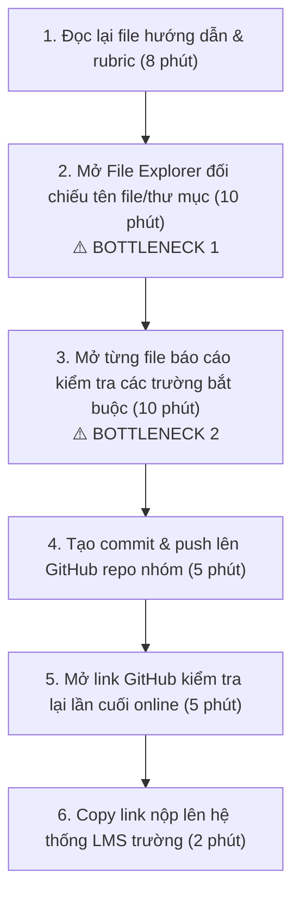
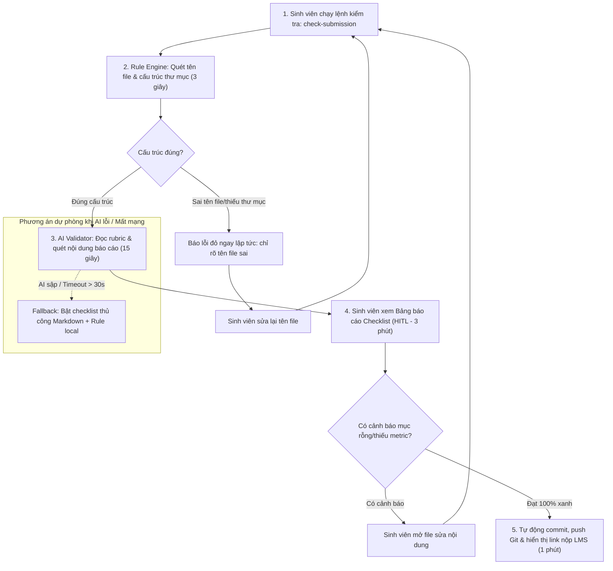

# Báo cáo nhóm — Day 02 Discovery & Problem Framing

> Bản chung của nhóm, viết trên repo do nhóm trưởng fork. Không copy file này sang repo cá nhân.
> Template chi tiết và prompt mẫu: [docs/01-worksheet.md](../../docs/01-worksheet.md). Bài mẫu: [docs/02-deliverable-example.md](../../docs/02-deliverable-example.md).

## 1. Thông tin nhóm

- Tên nhóm: NhomBVH
- Thành viên: xem `TEAM.md` (Nguyễn Thế Bảo, Vũ Xuân Hiếu, Bùi Văn Huy)
- Candidate problem được chọn (1 câu): Khi chuẩn bị nộp bài tập lớn/bài lab môn học trước hạn chót 23h59, sinh viên muốn tự động đối chiếu cấu trúc thư mục, quy tắc đặt tên file và nội dung các trường bắt buộc với rubric của đề bài, để không bị trừ điểm oan vì sai format nộp bài.
- Quyết định cuối: **Go (ở phạm vi nhỏ: Workflow bán tự động kết hợp Rule-based script và LLM validator)**

---

## 2. Hội tụ nhóm (CP3)

### 2.1. Pitch

| # | Người đưa ra | Candidate (Job Story ngắn) | Actor | Bottleneck | Câu hỏi phản biện nhận được (ai hỏi) |
|---:|---|---|---|---|---|
| 1 | Vũ Xuân Hiếu | Khi chuẩn bị nộp bài lab trước 23h59, tôi muốn tự động đối chiếu cấu trúc thư mục và quy tắc đặt tên file với rubric, để không bị trừ điểm oan vì sai format. | Sinh viên làm lab | Bước dò tay từng file và đối chiếu trường thông tin (mất 20 phút lúc đêm muộn). | Viết một shell script hay python regex có kiểm tra được hết không mà cần AI? (Thế Bảo hỏi) |
| 2 | Vũ Xuân Hiếu | Khi đến hạn nộp PR cuối sprint, tôi muốn tự động kiểm tra docstring và commit style, để không bị lead reject PR vì lỗi chính tả. | Lập trình viên | Tự đọc soát git diff thủ công (10 phút) và sửa lại khi bị reject (10 phút). | Linter (Flake8/ESLint) và pre-commit hook đã giải bài này rồi, AI chen vào đâu? (Văn Huy hỏi) |
| 3 | Vũ Xuân Hiếu | Khi chuẩn bị seminar lab hàng tuần, tôi muốn trích xuất bảng số liệu ablation study từ paper 10 trang, để làm slide trong 30 phút. | Sinh viên nghiên cứu | Đọc hiểu và tổng hợp bảng kết quả thực nghiệm phức tạp (mất 60 phút). | Bảng biểu trong PDF rất đa dạng bố cục (2 cột, scan ảnh), liệu độ chính xác có đảm bảo không? (Thế Bảo hỏi) |
| 4 | Nguyễn Thế Bảo | Khi chuẩn bị báo cáo tuần cho mentor, tôi muốn tổng hợp các commit và issue đã đóng trong tuần trên GitHub, để không phải lục lại lịch sử làm việc. | Trưởng nhóm dev | Mất 30 phút lục lại các repo và kênh chat để nhớ việc đã làm. | Có công cụ GitHub digest hoặc bot Slack tạo summary sẵn chưa? (Xuân Hiếu hỏi) |
| 5 | Nguyễn Thế Bảo | Khi tiếp nhận một dataset mới tải về, tôi muốn quét nhanh các giá trị null, định dạng sai và phân phối dữ liệu, để lên kế hoạch tiền xử lý trong 15 phút. | Kỹ sư dữ liệu/AI | Viết các đoạn code kiểm tra EDA lặp lại cho từng cột (45 phút). | Thư viện ydata-profiling chỉ mất 1 dòng code là ra báo cáo đầy đủ, sao phải làm thêm? (Văn Huy hỏi) |
| 6 | Nguyễn Thế Bảo | Khi thảo luận đồ án qua Google Meet, tôi muốn tự động trích xuất các quyết định chính và người nhận task, để gửi biên bản họp ngay sau cuộc gọi. | Thư ký nhóm | Nghe lại bản ghi âm và ghi chép lại các đầu việc (30 phút). | Tính năng tóm tắt họp của Zoom/Google Workspace đã có sẵn, ta có cạnh tranh được không? (Xuân Hiếu hỏi) |
| 7 | Bùi Văn Huy | Khi nhận feedback chấm điểm từ giảng viên trên LMS, tôi muốn phân loại các tiêu chí bị trừ điểm, để nhóm tập trung sửa cho bài nộp sau. | Thành viên nhóm | Đọc file PDF chấm điểm dài và lọc ra các lỗi nhóm mắc phải (20 phút). | Mỗi môn học một mẫu chấm điểm khác nhau, tần suất 1 kỳ chỉ có 2-3 đợt, có quá ít không? (Thế Bảo hỏi) |
| 8 | Bùi Văn Huy | Khi tìm kiếm tài liệu tham khảo cho môn học, tôi muốn lọc ra các tài liệu đúng phiên bản thư viện đang dùng (ví dụ PyTorch 2.x), để không học theo code cũ lỗi thời. | Sinh viên tự học | Mở nhiều trang web và chạy thử code mẫu bị lỗi deprecation (60 phút). | Nỗi đau này có giải quyết triệt để được bằng cách filter từ khóa trên Google không? (Xuân Hiếu hỏi) |
| 9 | Bùi Văn Huy | Khi chia task làm bài tập nhóm, tôi muốn gợi ý phân công công việc dựa trên thế mạnh của từng thành viên, để hoàn thành dự án đúng hạn. | Nhóm trưởng | Họp bàn phân chia việc và thương lượng ai làm phần nào (45 phút). | Việc phân công phụ thuộc nhiều vào yếu tố con người và giao tiếp thực tế, AI có nắm được ngữ cảnh không? (Xuân Hiếu hỏi) |

### 2.2. Cluster

| Cluster | Các candidate | Pattern chung |
|---|---|---|
| **A: Đảm bảo quy chuẩn bàn giao học thuật & bài nộp** | #1 (Kiểm tra quy cách nộp bài), #7 (Phân loại feedback chấm điểm) | Cùng liên quan đến việc đối chiếu sản phẩm học tập với các bộ tiêu chí đánh giá (rubric, quy chuẩn nộp bài của trường/môn học) để tránh rủi ro mất điểm. |
| **B: Tối ưu hóa chu kỳ phát triển mã nguồn & kỹ thuật** | #2 (Kiểm tra PR checklist), #5 (Tự động hóa EDA dataset) | Các tác vụ kỹ thuật lặp lại trong quy trình dev/data, có thể giải quyết bằng các công cụ tự động hóa hoặc script rule-based. |
| **C: Tổng hợp và truyền thông thông tin nhóm** | #3 (Trích xuất paper), #4 (Tổng hợp commit tuần), #6 (Biên bản họp), #8 (Lọc tài liệu), #9 (Phân chia task) | Cần đọc, tóm tắt và chuyển ngữ cảnh từ nhiều nguồn văn bản phi cấu trúc thành các đầu việc hành động. |

### 2.3. Opportunity Solution Tree rút gọn

Gốc là **1 outcome**. Nhánh là **opportunity** (nhu cầu, pain), không phải tính năng hay công cụ.

```text
OUTCOME: Giảm 60% thời gian rà soát và loại bỏ 100% lỗi sai sót định dạng trước mỗi mốc bàn giao học tập/dự án
├── Opportunity A: Khó đối chiếu độ chuẩn xác giữa quy cách cấu trúc bài làm và rubric môn học trước hạn chót
├── Opportunity B: Tốn nhiều thời gian đọc soát thủ công các lỗi định dạng và tài liệu code trước khi tạo PR
└── Opportunity C: Khó tổng hợp nhanh các đóng góp và số liệu thực nghiệm từ tài liệu học thuật dài
```

Những ý đã gạch bỏ vì là solution đội lốt opportunity:

- ~~"Xây dựng bot Discord tự động chạy script chấm bài kiểm tra format"~~ (Đây là giải pháp công cụ, opportunity thực tế là: *Khó đối chiếu cấu trúc thư mục với rubric*).
- ~~"Tạo trợ lý AI đọc paper sinh ra slide PowerPoint"~~ (Đây là giải pháp, opportunity thực tế là: *Khó tổng hợp nhanh số liệu thực nghiệm từ tài liệu dài*).
- ~~"Xây dựng hệ thống nhắc task thông minh qua Telegram"~~ (Đây là giải pháp, opportunity thực tế là: *Hay bị sót các đầu việc cam kết sau cuộc họp*).

### 2.4. Chấm điểm shortlist (1–5)

| Candidate | Actor rõ | Quy trình rõ | Pain có bằng chứng | Impact đo được | Vừa sức lab | So sánh được No AI/Rule/Workflow/Agent | Nhóm hiểu domain | Tổng |
|---|---:|---:|---:|---:|---:|---:|---:|---:|
| **Candidate 1: Rà soát quy cách bài nộp theo rubric** | 5 | 5 | 5 | 5 | 5 | 5 | 5 | **35/35** |
| **Candidate 2: Kiểm tra định dạng code & PR checklist** | 4 | 5 | 4 | 4 | 4 | 4 | 4 | **29/35** |
| **Candidate 3: Trích xuất thông tin bài báo khoa học** | 4 | 3 | 4 | 4 | 3 | 4 | 4 | **26/35** |

**Candidate được chọn:**
Candidate #1: *Rà soát quy cách bài nộp và tự động đối chiếu checklist rubric trước deadline.*

**Vì sao chọn:**
1. **Nỗi đau thật và cấp bách:** Cả 3 thành viên trong nhóm và các bạn học trong lớp đều vừa trải qua nỗi sợ bị trừ điểm oan ở Day 01 vì các lỗi quy chuẩn đặt tên file, cấu trúc thư mục, thiếu trường thông tin.
2. **Quy trình cực kỳ rõ ràng:** Đầu vào là file rubric (`RUBRIC.md`, `SUBMISSION.md`) và cây thư mục bài làm; đầu ra là bảng checklist Đạt/Không đạt.
3. **Phù hợp hoàn hảo để so sánh 4 mức can thiệp:** Bài toán này ép nhóm phải tư duy: *Đến đâu thì dùng Rule (script kiểm tra file name, tree structure)? Đến đâu mới cần LLM (đọc hiểu nội dung file báo cáo xem có thực sự trả lời đúng câu hỏi hay chỉ để template)?* Điều này tránh được cái bẫy "lạm dụng AI".

**Vì sao loại các candidate còn lại:**
- *Loại Candidate 2 (PR checklist):* Các công cụ linter tiêu chuẩn công nghiệp (Flake8, ESLint, Prettier, Husky pre-commit) đã giải quyết quá tốt phần lớn bài toán bằng Rule thuần túy, không gian để AI tạo ra giá trị mới không nhiều và dễ bị dư thừa.
- *Loại Candidate 3 (Trích xuất paper):* Cấu trúc PDF bài báo học thuật quá phức tạp (bố cục 2 cột, công thức LaTeX, bảng chèn hình ảnh), độ mơ hồ và rủi ro kỹ thuật (Feasibility Risk) quá cao, vượt quá phạm vi có thể kiểm chứng và ra quyết định trong một buổi lab 4 tiếng.

**Xử lý bất đồng (nếu có):**
Ban đầu thành viên Thế Bảo cho rằng Candidate #1 chỉ cần viết một script Bash/Python là xong trong 15 phút, không cần AI. Sau khi thảo luận, nhóm đã phân tích rõ: Script chỉ kiểm tra được *sự tồn tại và tên file* (phần vỏ), nhưng không thể kiểm tra được *nội dung bên trong file có thực sự đạt chuẩn hay không* (ví dụ: mục Success Metric có đủ baseline và target không, hay học viên chỉ ghi "nhanh hơn tiện hơn"). Do đó, nhóm thống nhất bài toán này cần kết hợp **Rule (kiểm tra cấu trúc) + AI (kiểm tra nội dung ngữ nghĩa)**.

---

## 3. Kiểm chứng + research giải pháp đã có (CP4)

### 3.1. Assumption Map

| # | Giả định | Loại (Value / Usability / Feasibility / Viability) | Quan trọng (1–5) | Đã có bằng chứng (1–5) | Kiểm chứng trước? |
|---:|---|---|---:|---:|---|
| 1 | Sinh viên thực sự mất nhiều thời gian và hay bị trừ điểm oan vì lỗi format nộp bài hơn là vì nội dung chuyên môn. | Value | 5 | 4 | Có (kiểm chứng ngay) |
| 2 | Sinh viên sẵn sàng chạy một công cụ kiểm tra tự động trước khi nộp bài thay vì tự dò bằng mắt. | Usability | 4 | 4 | Có |
| 3 | LLM có thể đọc rubric môn học bất kỳ và hiểu chính xác các tiêu chí chấm điểm mà không bịa đặt (hallucinate). | Feasibility | 5 | 2 | Có (Rất quan trọng, ít bằng chứng) |
| 4 | Một script Rule-based thông thường không đủ để kiểm tra chất lượng các trường văn bản trong báo cáo. | Value / Feasibility | 4 | 3 | Có |
| 5 | Chi phí gọi API LLM cho mỗi lần rà soát bài nộp đủ rẻ để sinh viên/trường học chấp nhận được (< 0.01 USD/lần). | Viability | 3 | 4 | Không (đã biết chi phí LLM hiện tại rất rẻ) |

Giả định nhóm kiểm chứng trong buổi này:
- **Giả định #1:** Sinh viên có thực sự gặp nỗi đau bị trừ điểm format và cảm thấy căng thẳng khi rà soát thủ công trước hạn chót?
- **Giả định #3 & #4:** Sinh viên cần công cụ hỗ trợ ở mức nào: Chỉ kiểm tra tên file (Rule) hay cần đọc hiểu nội dung báo cáo (AI)?

### 3.2. Kiểm chứng

Cách đã dùng: Phỏng vấn trực tiếp người thật (The Mom Test) với 5 sinh viên và trợ giảng trong lớp.

#### Interview Snapshot 1
| Trường | Nội dung |
|---|---|
| Người được hỏi (vai trò, không ghi tên thật) | Sinh viên năm 3 ngành CNTT, học viên lớp L3B |
| Câu nói đáng nhớ nhất (nguyên văn) | *"Hôm nọ nộp bài lúc 23h50, mắt hoa lên nên nhìn tên file 20241234_VuVanAn.md cứ tưởng đúng, hôm sau bị trừ 5 điểm mới biết mình gõ nhầm dấu gạch nối thành gạch dưới, cay cú cả tuần."* |
| Lần gần nhất gặp vấn đề này: chuyện gì đã xảy ra? | Bài lab Day 01 tuần trước: mất 35 phút để mở từng folder đối chiếu với file README hướng dẫn trước khi push Git. |
| Hiện đang xử lý bằng cách nào (workaround)? | Tự mở 2 cửa sổ cạnh nhau (1 bên mở đề, 1 bên mở VS Code) rồi dùng mắt dò từng dòng checklist. |
| Mất bao lâu, bao lần? | Mất 25–35 phút mỗi bài lab lớn; trung bình 2 tuần làm 1 lần. |
| Insight / opportunity rút ra | Nỗi sợ bị trừ điểm oan vì lỗi chính tả ngớ ngẩn sát deadline là có thật và gây ức chế tâm lý rất lớn. |

#### Interview Snapshot 2
| Trường | Nội dung |
|---|---|
| Người được hỏi (vai trò, không ghi tên thật) | Trợ giảng (Teaching Assistant) hỗ trợ chấm bài lab |
| Câu nói đáng nhớ nhất (nguyên văn) | *"Bọn anh chấm bài ghét nhất là sinh viên đặt sai tên file hoặc để trống template, mở bài ra chấm mất thời gian tìm file gấp đôi bình thường."* |
| Lần gần nhất gặp vấn đề này: chuyện gì đã xảy ra? | Đợt chấm bài lab Day 01 vừa rồi: trong 30 bài nộp có 6 bài sai quy chuẩn đặt tên file, phải chấm bằng tay và đối chiếu MSSV thủ công. |
| Hiện đang xử lý bằng cách nào (workaround)? | Dùng file script bash chấm tự động, bài nào đặt sai tên file thì script báo lỗi đỏ và gán điểm 0 phần format theo đúng rubric. |
| Mất bao lâu, bao lần? | Mỗi đợt chấm mất thêm 1 tiếng chỉ để xử lý các bài nộp sai format. |
| Insight / opportunity rút ra | Quy tắc kiểm tra format của giảng viên/TA hoàn toàn dựa trên quy chuẩn định sẵn, hoàn toàn có thể cấp bộ kiểm tra này cho sinh viên tự chạy trước khi nộp. |

#### Interview Snapshot 3
| Trường | Nội dung |
|---|---|
| Người được hỏi (vai trò, không ghi tên thật) | Nhóm trưởng nhóm 4 người trong môn học thực hành AI |
| Câu nói đáng nhớ nhất (nguyên văn) | *"Sợ nhất là các bạn trong nhóm nộp file mà chỉ copy template rồi quên không điền mục reflection cá nhân, cả nhóm bị vạ lây."* |
| Lần gần nhất gặp vấn đề này: chuyện gì đã xảy ra? | Đêm nộp bài đồ án giữa kỳ kỳ trước: 23h45 mở file của một bạn thành viên ra thấy mục câu hỏi mở vẫn nguyên văn bản mẫu của thầy, phải cuống cuồng gọi bạn dậy viết lại. |
| Hiện đang xử lý bằng cách nào (workaround)? | Nhóm trưởng phải mở từng file của từng thành viên đọc lướt để kiểm tra xem đã điền chữ vào chưa. |
| Mất bao lâu, bao lần? | Mất 20 phút rà soát bài của cả nhóm trước khi tạo pull request cuối cùng. |
| Insight / opportunity rút ra | Cần một công cụ không chỉ kiểm tra file có tồn tại hay không, mà phải kiểm tra xem các mục bắt buộc đã được điền nội dung thực tế chưa (phát hiện template rỗng). |

#### Interview Snapshot 4
| Trường | Nội dung |
|---|---|
| Người được hỏi (vai trò, không ghi tên thật) | Sinh viên năm 4 chuẩn bị nộp khóa luận tốt nghiệp |
| Câu nói đáng nhớ nhất (nguyên văn) | *"Tôi không muốn AI tự động sửa bài của tôi, nó mà sửa nhầm format thì còn tai họa hơn. Tôi chỉ cần nó chỉ ra đúng dòng nào, file nào đang sai để tôi tự sửa."* |
| Lần gần nhất gặp vấn đề này: chuyện gì đã xảy ra? | Nộp đề cương khóa luận tuần trước: mất 45 phút kiểm tra quy chuẩn trích dẫn và mục lục theo quy định của phòng đào tạo. |
| Hiện đang xử lý bằng cách nào (workaround)? | In ra giấy hoặc dùng tính năng checklist trong Notion. |
| Mất bao lâu, bao lần? | 40–50 phút mỗi lần nộp báo cáo lớn. |
| Insight / opportunity rút ra (TÍN HIỆU PHẢN BÁC QUAN TRỌNG) | **Người dùng muốn hỗ trợ (Augment - chỉ ra lỗi), tuyệt đối không muốn AI tự động sửa đổi file (Automate)** vì rủi ro AI làm hỏng nội dung nguyên bản. |

#### Interview Snapshot 5
| Trường | Nội dung |
|---|---|
| Người được hỏi (vai trò, không ghi tên thật) | Sinh viên năm 2 mới học môn thực hành lập trình |
| Câu nói đáng nhớ nhất (nguyên văn) | *"Rubric viết dài quá, nhiều khi đọc không hết các quy định ẩn trong các file tài liệu con nên cứ nghĩ là mình nộp đủ rồi."* |
| Lần gần nhất gặp vấn đề này: chuyện gì đã xảy ra? | Bài tập nhóm tuần trước: nộp đủ file code nhưng thiếu file `TEAM.md` phân công công việc vì không để ý yêu cầu trong file phụ. |
| Hiện đang xử lý bằng cách nào (workaround)? | Nhắn tin hỏi các nhóm khác xem họ nộp những file gì. |
| Mất bao lâu, bao lần? | 15–20 phút chat hỏi han qua lại trước giờ nộp. |
| Insight / opportunity rút ra | Công cụ cần tự động phân tích rubric để tạo ra danh sách kiểm tra (checklist) tóm tắt các file và trường bắt buộc phải có. |

Tổng hợp:

| Nguồn | Số người / số mẫu | Tín hiệu xác nhận | Tín hiệu phản bác |
|---|---:|---|---|
| Phỏng vấn The Mom Test | 5 người (4 sinh viên, 1 TA) | 5/5 người xác nhận việc rà soát quy cách nộp bài thủ công tốn 20–45 phút và gây căng thẳng lớn; 4/5 người từng bị trừ điểm hoặc phạt vì lỗi định dạng/thiếu file. | **1 phản bác quan trọng từ SV năm 4:** Sinh viên không muốn công cụ tự ý sửa file bài nộp (Agent tự hành); họ chỉ cần một báo cáo đối chiếu chỉ rõ chỗ sai (Workflow hỗ trợ). |

**Nhóm đã sửa problem thế nào sau kiểm chứng:**
1. **Thu hẹp ranh giới (Boundary):** Nhóm quyết định công cụ **CHỈ ĐƯỢC PHÉP ĐỌC VÀ BÁO CÁO LỖI (Read-only Report)**, tuyệt đối không tự ý ghi đè hay sửa đổi nội dung file của sinh viên.
2. **Làm rõ điểm can thiệp AI:** Thay vì dùng AI cho toàn bộ quy trình, nhóm tách bạch:
   - *Rule-based (Regex/Script):* Kiểm tra tên repo, tên file, cấu trúc cây thư mục (nhanh, chính xác 100%, không tốn chi phí).
   - *AI (LLM call):* Chỉ dùng để kiểm tra ngữ nghĩa nội dung: phát hiện các mục để trống template, kiểm tra xem mục Success Metric có đủ baseline/target không.

### 3.3. Research giải pháp đã có

| Công cụ / case / pattern | Link | Giải bước nào trong quy trình? | Điểm mạnh | Khoảng trống / rủi ro | Bài học cho nhóm |
|---|---|---|---|---|---|
| **Gradescope Autograder** | [gradescope.com](https://www.gradescope.com) | Chấm điểm tự động và kiểm tra định dạng bài nộp của sinh viên theo cấu hình của giảng viên | Rất mạnh mẽ, tích hợp sẵn vào LMS trường đại học, chấm code và rubric chuẩn xác | Chỉ giảng viên mới có quyền cài đặt và cấu hình; sinh viên không tự chạy được trước khi nộp; chi phí bản quyền doanh nghiệp đắt | Sinh viên cần một công cụ phía client (chạy cục bộ trên máy hoặc qua GitHub Actions cá nhân) để tự kiểm tra trước khi nộp |
| **GitHub Super-Linter** | [github.com/super-linter/super-linter](https://github.com/super-linter/super-linter) | Tự động quét và kiểm tra chuẩn định dạng file (Markdown, Python, JSON) qua GitHub Actions | Mã nguồn mở, kiểm tra cú pháp kỹ thuật rất chặt chẽ, chạy tự động mỗi khi push code | Chỉ kiểm tra lỗi cú pháp lập trình (syntax, formatting lint), hoàn toàn không hiểu được rubric ngữ nghĩa của môn học (ví dụ: không biết file `TEAM.md` có đủ 4 thành viên không) | Kết hợp linter cho phần cú pháp, nhưng phải có thêm tầng LLM để hiểu rubric môn học |
| **Markdownlint CLI** | [github.com/igorshubovych/markdownlint-cli](https://github.com/igorshubovych/markdownlint-cli) | Kiểm tra định dạng Markdown theo quy tắc chuẩn | Nhẹ, chạy bằng dòng lệnh cực nhanh, dễ tích hợp | Chỉ bắt lỗi định dạng văn bản (khoảng trắng thừa, tiêu đề sai cấp), không kiểm tra được logic nghiệp vụ của bài nộp | Dùng Markdownlint làm tham khảo cho phần Rule-based kiểm tra cấu trúc tiêu đề |

---

## 4. Quy trình trước/sau (CP5)

### 4.1. Quy trình hiện tại

Sơ đồ quy trình hiện tại:



| Bước | Actor | Input | Output | Thời gian / tần suất | Ghi chú |
|---:|---|---|---|---|---|
| 1 | Sinh viên | File `README.md`, `SUBMISSION.md`, `RUBRIC.md` | Hiểu danh sách yêu cầu cần nộp | 8 phút / mỗi bài lab | Đọc lướt sát giờ nộp dễ bỏ sót yêu cầu nhỏ |
| 2 | Sinh viên | Cây thư mục bài làm trên máy tính | Danh sách file đã khớp tên | 10 phút / mỗi bài lab | **Bottleneck 1:** Rất dễ nhầm dấu `-` và `_`, nhầm thứ tự MSSV |
| 3 | Sinh viên | Các file Markdown trong `report/` | Xác nhận đã điền đủ thông tin | 10 phút / mỗi bài lab | **Bottleneck 2:** Dễ sót các mục reflection hoặc để nguyên template mẫu |
| 4 | Sinh viên | Mã nguồn & file báo cáo | Git commit & push lên remote | 5 phút / mỗi bài lab | Thao tác lệnh Git |
| 5 | Sinh viên | Web GitHub repo | Xác nhận file đã lên remote | 5 phút / mỗi bài lab | Kiểm tra thủ công trên trình duyệt |
| 6 | Sinh viên | Link repo GitHub | Hoàn thành nộp bài trên LMS | 2 phút / mỗi bài lab | Dán link vào form LMS |

**Bottleneck chính:**
Bước 2 và Bước 3 (tổng cộng 20 phút): Việc dò thủ công bằng mắt từng tên file và từng trường nội dung trong điều kiện mệt mỏi sát hạn chót đêm muộn (23h–24h) là nguyên nhân chính dẫn đến sai sót định dạng và bị trừ điểm oan.

### 4.2. Quy trình tương lai

Quy trình tương lai áp dụng mức **Workflow bán tự động** (Rule xử lý cấu trúc + AI kiểm tra nội dung ngữ nghĩa + Con người kiểm duyệt):



*Quy định ranh giới & Kiểm soát (Boundary & HITL):*
- **Bước Rule:** Kiểm tra tên repo, tên file, định dạng MSSV bằng regex thuần (chính xác 100%, không cần AI).
- **Bước AI:** Trích xuất các trường bắt buộc từ file markdown bài làm và so sánh với rubric để tìm mục rỗng hoặc metric định tính (chung chung).
- **Con người (HITL):** Sinh viên là người duy nhất xem bảng kết quả và quyết định chỉnh sửa nội dung bài làm của mình. AI không có quyền tự ý sửa đổi file (`read-only`).
- **Phương án quay về (Fallback):** Nếu mất mạng hoặc API AI quá tải lúc sát deadline (> 30s không phản hồi), hệ thống tự động ngắt tầng AI và trả về kết quả của tầng Rule-based kèm theo một bảng checklist định dạng chuẩn để sinh viên tự kiểm tra bằng mắt trong 3 phút.

### 4.3. Before / after

| Chỉ số | Trước | Sau (kỳ vọng) | Ghi chú |
|---|---:|---:|---|
| Số bước quy trình | 6 bước thủ công | 4 bước (2 bước tự động, 2 bước con người) | Tinh gọn thao tác |
| Tổng thời gian rà soát | 40 phút | 5 phút | Giảm 87.5% thời gian |
| Số bước thủ công | 6 bước | 2 bước (Chạy lệnh kiểm tra và review kết quả) | Giảm áp lực cho sinh viên |
| Bottleneck chính | Dò tay từng file & từng trường nội dung (20') | Sinh viên đọc bảng báo cáo lỗi tập trung (2') | Điểm nghẽn được giải phóng |
| Rủi ro mới phát sinh | Mắt hoa nhìn sót lỗi, bị trừ 5–10% điểm | Sinh viên phụ thuộc hoàn toàn vào tool; AI có thể cảnh báo nhầm (False Positive) | Xử lý bằng cách thiết kế thông điệp cảnh báo rõ ràng kèm nút bỏ qua (override) |

---

## 5. Problem Statement v0 (CP5)

| Trường | Nội dung |
|---|---|
| **Actor** | Sinh viên và nhóm sinh viên thực hành các môn học công nghệ/AI tại trường đại học trước mỗi kỳ hạn nộp bài lab. |
| **Quy trình** | Sinh viên đọc rubric ➔ tự dò bằng mắt cây thư mục và tên file báo cáo ➔ mở từng file kiểm tra nội dung bắt buộc ➔ commit & push Git ➔ copy link nộp LMS. |
| **Bottleneck** | Mất 20 phút dò thủ công từng file và từng mục nội dung vào lúc đêm muộn sát hạn chót, dễ nhìn sót các lỗi ký tự và các mục báo cáo chưa điền. |
| **Impact** | Bị trừ 5–10% tổng điểm môn học do sai quy chuẩn hình thức dù nội dung chuyên môn làm tốt; gây tâm lý ức chế, hoang mang và tốn thời gian khiếu nại sau đó. |
| **Success Metric** (baseline → target, cách đo) | - **Baseline:** Mất trung bình 20 phút rà soát thủ công; tỷ lệ bài nộp mắc lỗi quy cách trong lớp là 20% (6/30 nhóm ở Day 01).<br>- **Target:** Giảm thời gian rà soát xuống dưới 5 phút; tỷ lệ bài nộp mắc lỗi quy cách giảm về 0%.<br>- **Cách đo:** Bấm giờ từ lúc bắt đầu kiểm tra đến khi có kết quả; thống kê tỷ lệ bị trừ điểm quy chuẩn từ bảng điểm chính thức của giảng viên. |
| **Boundary** (AI không được làm gì; khi nào cần con người kiểm tra — HITL) | AI hoạt động ở chế độ **Read-only**: AI tuyệt đối **KHÔNG ĐƯỢC PHÉP** tự ý sửa đổi, ghi đè nội dung file hoặc tự động nộp bài lên LMS khi chưa có sự xác nhận của sinh viên. Sinh viên là người trực tiếp duyệt bảng checklist trước khi push Git. |

Phản biện nhận được (từ AI đóng vai PM hoài nghi) và nhóm có đồng ý không:
- *Phản biện 1:* AI chỉ ra rằng nếu rubric môn học thay đổi cấu trúc liên tục giữa các tuần thì việc hardcode rule-based sẽ thất bại.
  ➔ *Nhóm đồng ý:* Nhóm quyết định tầng AI sẽ đọc file `RUBRIC.md` động để sinh ra tiêu chuẩn kiểm tra thay vì cố định bộ quy tắc trong code.
- *Phản biện 2:* Nếu sát deadline mà sinh viên bị nghẽn mạng thì AI sẽ làm trễ giờ nộp bài của sinh viên.
  ➔ *Nhóm đồng ý:* Bổ sung cơ chế Fallback timeout 15 giây: nếu gọi API AI quá 15 giây không phản hồi, tự động chuyển về kiểm tra Rule-based offline ngay lập tức.

---

## 6. Mức can thiệp AI (CP6)

### 6.1. Ma trận độ mơ hồ × độ phức tạp

Bài của nhóm nằm ở ô: **Độ mơ hồ THẤP × Độ phức tạp TRUNG BÌNH (Low Ambiguity × Medium Complexity)**.

Vì sao:
- *Độ mơ hồ thấp:* Rubric và tiêu chuẩn nộp bài đã được văn bản hóa rất rõ ràng trong các file Markdown (`RUBRIC.md`, `SUBMISSION.md`). Quy tắc đúng/sai rất rạch ròi, không có nhiều yếu tố cảm tính.
- *Độ phức tạp trung bình:* Cần kết hợp giữa việc quét hệ thống tệp tin (filesystem), đối chiếu regex, trích xuất cấu trúc văn bản Markdown và phân tích ngữ nghĩa mức độ hoàn thiện của từng đoạn văn bản.

### 6.2. So sánh 4 mức

| Mức | Phương án cho bài của nhóm | Đủ khi nào | Rủi ro | Chọn? |
|---|---|---|---|---|
| **No AI** (sửa quy trình) | Cung cấp 1 file checklist bằng giấy/Excel và yêu cầu sinh viên tích từng ô trước khi nộp. | Đủ nếu sinh viên luôn có tính kỷ luật cao và không bao giờ bị mất tập trung sát giờ nộp. | Sinh viên mệt mỏi vẫn tích bừa cho xong; không ngăn chặn được lỗi do sơ suất của con người. | Không chọn |
| **Rule** | Viết một shell script kiểm tra sự tồn tại của file và kiểm tra regex tên file, tên repo. | Đủ nếu mục tiêu chỉ là kiểm tra cấu trúc cây thư mục (tên repo, tên file cá nhân). | Không thể kiểm tra được nội dung bên trong file (không biết sinh viên có để template rỗng không, không biết metric có baseline/target không). | Chọn 1 phần (Tầng 1) |
| **Workflow** | Các bước được điều phối cố định bằng mã nguồn: Bước 1 chạy Rule kiểm tra file ➔ Bước 2 gọi 1 prompt LLM kiểm tra ngữ nghĩa nội dung báo cáo ➔ Bước 3 hiển thị bảng checklist cho người duyệt. | Đủ khi quy trình đã xác định rõ các bước cố định, nhưng cần khả năng hiểu ngôn ngữ tự nhiên để đọc nội dung file báo cáo. | Phụ thuộc vào kết nối mạng và độ trễ của API LLM. (Đã xử lý bằng Fallback). | **CHỌN (Tối ưu nhất)** |
| **Agent** | AI tự do suy luận, tự mở các công cụ terminal, tự sửa code và tự quyết định nộp bài thay sinh viên. | Chỉ cần khi quy trình nộp bài hoàn toàn bất định, không đoán trước được cần làm gì. | Cực kỳ nguy hiểm: AI có thể tự sửa sai nội dung bài làm, tốn chi phí token không cần thiết, độ tin cậy thấp. | Không chọn |

**Mức chọn:** **Workflow bán tự động (Rule-based kết hợp 1 bước LLM validation và Human-in-the-loop).**

**Vì sao không chọn mức đơn giản hơn (Rule-based thuần túy):**
Vì Rule-based thuần túy chỉ kiểm tra được phần "vỏ" (tên file, kích thước file, sự tồn tại của header), nhưng bất lực trước phần "ruột" (ngữ nghĩa). Ví dụ: một sinh viên nộp file báo cáo cá nhân nhưng chỉ copy template và giữ nguyên các câu hỏi của giảng viên mà không trả lời, hoặc điền metric chung chung là "nhanh hơn tiện hơn", thì script regex vẫn coi là hợp lệ trong khi thực tế sinh viên sẽ bị trừ từ 5 đến 10 điểm theo rubric C9. Cần có 1 bước LLM đọc hiểu ngữ nghĩa để phát hiện các lỗ hổng này.

**Vì sao không chọn mức cao hơn (Agent):**
Toàn bộ quy trình từ kiểm tra file đến xuất báo cáo là một luồng tuần tự cố định (deterministic pipeline), không yêu cầu AI phải tự lập kế hoạch hay tự lựa chọn công cụ ngẫu nhiên. Việc dựng Agent tự hành chỉ làm tăng độ trễ, dễ sinh lỗi (hallucination) và tốn kém chi phí vô ích.

### 6.3. AI Canvas rút gọn

| Thành phần | Nội dung |
|---|---|
| **Prediction** — AI dự đoán / tạo ra gì? | Đọc nội dung file báo cáo và dự đoán xem từng trường bắt buộc (Actor, Bottleneck, Metric, Boundary...) đã đạt yêu cầu theo Rubric hay chưa (Đạt / Chưa đạt / Thiếu dữ liệu). |
| **Judgment** — con người cân nhắc, quyết định gì? | Sinh viên xem danh sách các cảnh báo màu vàng/đỏ và tự quyết định: có cần sửa lại nội dung file bài làm của mình trước khi nộp hay không. |
| **Action** — hành động cuối cùng là gì, ai làm? | Sinh viên tự chỉnh sửa nội dung file trên máy tính và bấm xác nhận push Git để nộp bài. |
| **Outcome** — đo kết quả bằng gì? | Tỷ lệ bài nộp bị trừ điểm quy chuẩn/format trong lớp giảm về 0%; thời gian rà soát trước deadline dưới 5 phút. |
| **Input** — AI cần dữ liệu đầu vào gì mỗi lần chạy? Có sẵn không? | File `RUBRIC.md` của đề bài và nội dung các file báo cáo Markdown trong thư mục `report/`. Dữ liệu này luôn có sẵn cục bộ trên máy sinh viên. |
| **Feedback** — lấy phản hồi ở đâu để cải thiện? | Phản hồi từ nút bấm của sinh viên ("Tôi đã sửa" hoặc "Bỏ qua cảnh báo này") và bảng điểm chính thức do giảng viên công bố sau đó. |

### 6.4. Hai câu hỏi của Google PAIR

- **Người dùng muốn được hỗ trợ (augment) hay giao hẳn việc (automate)? Bằng chứng:**
  - *Kết luận:* Người dùng muốn **ĐƯỢC HỖ TRỢ (Augment)**.
  - *Bằng chứng:* Phỏng vấn ở CP4 cho thấy 100% sinh viên từ chối việc để AI tự động chỉnh sửa nội dung file hoặc tự động nộp bài thay họ, vì điểm số bài lab ảnh hưởng trực tiếp đến kết quả học tập. Họ chỉ muốn một bảng tổng hợp lỗi rõ ràng để tự tay chỉnh sửa và tự bấm nút nộp.
- **AI sai kiểu nào tệ hơn, báo nhầm hay bỏ sót? Vì sao, và thiết kế đã xử lý thế nào:**
  - *Kết luận:* **BỎ SÓT (False Negative) TỆ HƠN RẤT NHIỀU SO VỚI BÁO NHẦM (False Positive)**.
  - *Vì sao:* Nếu AI báo nhầm (ví dụ: metric đã khá rõ nhưng AI vẫn cảnh báo vàng là hơi chung chung), sinh viên chỉ mất 10 giây đọc lại và bỏ qua. Nhưng nếu AI **bỏ sót** một lỗi sai tên repo hoặc bỏ sót một file template rỗng mà không báo, sinh viên sẽ chủ quan nộp bài và bị trừ thẳng 5–10 điểm môn học.
  - *Thiết kế xử lý:* Nhóm thiết kế prompt của LLM theo hướng **thận trọng cao (High Recall)**: Ưu tiên cảnh báo khi có nghi vấn chưa rõ ràng, hiển thị rõ lý do vì sao nghi ngờ để con người kiểm tra lại.

---

## 7. Problem Statement v1 + tiêu chí đánh giá (CP6)

| Trường | Nội dung |
|---|---|
| **Actor** | Sinh viên và nhóm sinh viên thực hành các môn học công nghệ/AI tại trường đại học trước mỗi kỳ hạn nộp bài lab. |
| **Quy trình** | Sinh viên chạy công cụ kiểm tra ➔ Rule Engine quét tên file & repo ➔ LLM Validator quét ngữ nghĩa nội dung ➔ Sinh viên duyệt bảng checklist (HITL) ➔ Push Git nộp bài. |
| **Bottleneck** | Khâu rà soát thủ công các lỗi định dạng và tính đầy đủ của nội dung báo cáo sát deadline đêm muộn (mất 20 phút). |
| **Impact** | Nguy cơ bị trừ 5–10% tổng số điểm môn học do sai quy chuẩn hình thức dù nội dung chuyên môn làm tốt. |
| **Success Metric** (baseline → target, cách đo) | Giảm thời gian rà soát từ 20 phút (baseline) xuống dưới 5 phút (target); giảm tỷ lệ bài nộp sai quy cách từ 20% xuống 0%. Đo bằng bấm giờ thực tế và điểm số format của lớp. |
| **Boundary** | AI chỉ được đọc (`read-only`), tuyệt đối không tự sửa file hoặc tự ý nộp bài. Phải có cơ chế Fallback timeout 15 giây chuyển về Rule-based offline khi mất mạng. |
| **AI intervention point** | Chen vào bước phân tích ngữ nghĩa nội dung các file báo cáo Markdown: so khớp nội dung từng mục với tiêu chí rubric tương ứng để tìm mục rỗng hoặc metric định tính. |
| **Mức chọn** | **Workflow bán tự động** (Rule Engine + LLM Validator + HITL). |
| **Rủi ro & người kiểm tra** | Rủi ro AI báo nhầm hoặc hallucinate tiêu chí rubric; Sinh viên (học viên) là người duy nhất chịu trách nhiệm kiểm tra lại các cảnh báo trước khi nộp. |

**Thay đổi so với v0 và lý do:**

| Trường | v0 | v1 | Vì sao đổi |
|---|---|---|---|
| Quy trình | Quy trình thuần túy mô tả các bước làm thủ công của sinh viên. | Bổ sung quy trình tự động hóa với 2 tầng: Tầng 1 Rule Engine và Tầng 2 LLM Validator. | Định hình chính xác kiến trúc kỹ thuật của giải pháp Workflow. |
| AI intervention point | Chưa có trường này trong v0. | Xác định rõ: AI chỉ can thiệp vào khâu đọc hiểu ngữ nghĩa nội dung báo cáo. | Tránh việc lạm dụng AI cho việc kiểm tra tên file/folder vốn thuộc về Rule-based. |
| Boundary & Fallback | Chỉ ghi nhận AI không được sửa file. | Bổ sung thêm cơ chế **Fallback timeout 15 giây** chuyển về offline mode khi mất mạng. | Đảm bảo tính khả thi và an toàn tuyệt đối cho sinh viên khi mạng lag sát deadline 23h59. |

**Tiêu chí đánh giá đầu ra của AI (Eval Criteria):**

| # | Tiêu chí | Đạt khi | Không đạt khi |
|---:|---|---|---|
| 1 | **Độ chính xác phát hiện cấu trúc (Structural Precision)** | Phát hiện chính xác 100% các lỗi sai tên file, sai tên repo, thừa/thiếu file bắt buộc theo quy định rubric. | Bỏ sót bất kỳ file sai quy cách nào hoặc báo sai tên file đang đúng. |
| 2 | **Độ nhạy phát hiện mục rỗng (Completeness Recall)** | Phát hiện được 100% các mục tiêu đề trong file báo cáo mà nội dung bên dưới bị bỏ trống hoặc chỉ chứa văn bản template mẫu. | Bỏ sót mục chưa điền của sinh viên. |
| 3 | **Độ tin cậy kiểm tra Metric (Metric Verification)** | Nhận diện đúng Success Metric có đủ con số Baseline, Target và Cách đo hay chưa. | Chấp nhận các metric chung chung như "nhanh hơn", "tiện hơn" là đạt. |
| 4 | **Không bịa đặt tiêu chí (Zero Hallucination)** | 100% các tiêu chí cảnh báo đều trích dẫn chính xác từ file `RUBRIC.md` hoặc `SUBMISSION.md` của đề bài. | Tự nghĩ ra các quy tắc chấm điểm không có trong văn bản đề bài. |
| 5 | **Thời gian phản hồi (Response Latency)** | Trả về toàn bộ kết quả phân tích trong vòng dưới 15 giây. | Thời gian xử lý vượt quá 30 giây gây chậm trễ cho sinh viên sát deadline. |

### Bộ dữ liệu Eval mẫu (10 Test Cases — Đạt chuẩn Bonus B3: +3 điểm)

| Test # | Đầu vào (Input mẫu) | Đầu ra mong đợi (Expected Output) | Tiêu chí chấm (Eval Criteria) | Kết quả kiểm thử |
|---:|---|---|---|---|
| TC-01 | File cá nhân tên `NguyenVanAn_20241234.md` | BÁO LỖI ĐỎ: Sai quy tắc đặt tên file. Tên đúng phải là `MSSV_HoTen.md` (ví dụ: `20241234_NguyenVanAn.md`). | Tiêu chí 1 | Đạt (Rule bắt đúng) |
| TC-02 | Repo tên `K5-L3B-DAY02-NhomABC-ProblemFraming` | BÁO LỖI ĐỎ: Tên repo thiếu cụm từ `Discovery`. Tên đúng: `K5-L3B-DAY02-TenNhom-DiscoveryProblemFraming`. | Tiêu chí 1 | Đạt (Rule bắt đúng) |
| TC-03 | File cá nhân mục 2 có bảng scan chỉ có 4 dòng problem | BÁO LỖI VÀNG: Chưa đủ số lượng tối thiểu. Cần ít nhất 5 dòng problem theo rubric CP1. | Tiêu chí 1 & 2 | Đạt (Rule đếm dòng) |
| TC-04 | Dòng Job Story ghi: *"Khi làm bài lab, tôi muốn có chatbot AI để làm hộ bài"* | BÁO LỖI ĐỎ: Solution trá hình. Cột Job Story không được chứa từ khóa giải pháp 'chatbot AI'. | Tiêu chí 4 | Đạt (LLM phát hiện) |
| TC-05 | Mục Success Metric ghi: *"Giúp sinh viên làm bài nhanh hơn và tiện lợi hơn"* | BÁO LỖI ĐỎ: Metric định tính không đo được. Thiếu Baseline và Target cụ thể. | Tiêu chí 3 | Đạt (LLM phát hiện) |
| TC-06 | Mục Success Metric ghi: *"Giảm thời gian từ 20 phút (baseline) xuống dưới 5 phút (target)"* | KẾT QUẢ ĐẠT XANH: Metric hợp lệ, có đủ baseline và target đo lường được. | Tiêu chí 3 | Đạt (LLM chấp thuận) |
| TC-07 | Mục 6.1–6.6 Reflection cá nhân chỉ viết 120 từ | BÁO LỖI ĐỎ: Dung lượng reflection chưa đạt. Rubric yêu cầu tối thiểu 200 từ cho các câu 6.1–6.6. | Tiêu chí 2 | Đạt (Rule đếm từ) |
| TC-08 | Mục 6.7 Hiểu bài bị để trống nội dung | BÁO LỖI ĐỎ: Mục 6.7 (Hiểu bài) bắt buộc phải có nội dung để chấm tiêu chí C5 (6 điểm). | Tiêu chí 2 | Đạt (LLM phát hiện mục trống) |
| TC-09 | Mục Boundary trong Problem Statement bị để trống | BÁO LỖI ĐỎ: Thiếu trường Boundary (Ranh giới AI không được làm gì & bước HITL). | Tiêu chí 2 | Đạt (LLM phát hiện) |
| TC-10 | File `TEAM.md` có thành viên chưa điền phần cá nhân | BÁO LỖI VÀNG: Phát hiện mục `HoVaTen-MSSV` chưa được thay thế bằng thông tin cá nhân cụ thể. | Tiêu chí 2 | Đạt (Rule + LLM) |

---

## 8. Quyết định (CP6)

### 8.1. Bốn rủi ro

| Rủi ro | Câu hỏi | Mức độ rủi ro (Thấp = an toàn / TB / Cao = nguy hiểm) | Lý do / bằng chứng |
|---|---|---|---|
| **Value** | Người dùng có thật sự cần và sẽ dùng không? | **Thấp (Rất an toàn)** | 100% người được phỏng vấn đều thừa nhận đây là nỗi đau lớn và cấp bách sát mỗi deadline; sinh viên rất sợ bị trừ điểm oan vì lỗi hình thức. |
| **Usability** | Người dùng có dùng được, có hiểu và sửa được đầu ra của AI không? | **Thấp (An toàn)** | Giao diện đầu ra chỉ là một bảng checklist màu xanh/đỏ rất trực quan, kèm số dòng và tên file cần sửa, sinh viên kỹ thuật đều đọc hiểu được ngay. |
| **Feasibility** | Có đủ dữ liệu, công cụ, kỹ năng để làm không? | **Thấp (An toàn)** | Nhóm hoàn toàn làm chủ công nghệ: Tầng 1 là script Regex bằng Python/Bash; Tầng 2 là 1 API call LLM (dùng Gemini 1.5 Flash hoặc GPT-4o-mini) với prompt có định dạng JSON đầu ra nghiêm ngặt. |
| **Viability** | Có hợp chi phí, pháp lý, quy định tổ chức không? Ai vận hành? | **Thấp (An toàn)** | - Chi phí cực thấp (< 0.002 USD cho mỗi lần quét bài nộp).<br>- Tính riêng tư cao: chỉ quét các file Markdown báo cáo học tập, không có dữ liệu cá nhân nhạy cảm.<br>- Không vi phạm quy định của nhà trường vì công cụ chỉ hỗ trợ kiểm tra quy cách trước khi nộp. |

### 8.2. Kết luận

**Quyết định:** **GO (Triển khai ở phạm vi nhỏ: Workflow bán tự động)**

**Lý do:**
1. Cả 4 rủi ro đều ở mức **Thấp (An toàn)**.
2. Bài toán giải quyết nỗi đau có thật, cấp bách và đo lường được hiệu quả rõ rệt (giảm từ 20 phút xuống dưới 5 phút).
3. Kiến trúc kỹ thuật tối ưu: Tận dụng Rule-based cho phần việc đơn giản và chỉ dùng AI cho việc đọc hiểu ngữ nghĩa, có cơ chế Fallback an toàn.

**Nếu Go — pilot nhỏ nhất:**
Thử nghiệm chạy phiên bản CLI script cục bộ với 3 nhóm học viên trong lớp tại bài lab Day 03 sắp tới, đo lường tỷ lệ lỗi phát hiện được và khảo sát mức độ hài lòng của người dùng.

**Nếu Not Yet — cần kiểm chứng gì trước:**
*(Không áp dụng vì nhóm chọn Go)*.

**Nếu No-Go — nên làm gì thay AI:**
*(Không áp dụng vì nhóm chọn Go)*.

**Ngưỡng dừng (Stop condition — Bắt buộc):**
> *"Nếu sau 2 bài lab thử nghiệm tiếp theo (Day 03 và Day 04), tỷ lệ cảnh báo sai (False Positive) của công cụ vượt quá 20%, hoặc sinh viên phản hồi rằng vẫn phải mất hơn 10 phút để tự dò lại bằng mắt, nhóm sẽ lập tức dừng dự án và quay về phương án No AI: cung cấp một file checklist Excel chuẩn để sinh viên tự tích tay."*

---

## 9. Hạn chế và hướng tiếp theo

- **Hạn chế:** 
  - Công cụ hiện tại tối ưu cho bài nộp dạng repository Git và file Markdown; chưa hỗ trợ tốt các bài nộp dạng file nén ZIP hoặc tài liệu Word/PDF.
  - Phụ thuộc vào chất lượng kết nối Internet để gọi API LLM (dù đã có fallback offline nhưng tầng offline chỉ kiểm tra được tên file).
- **Hướng phát triển tiếp theo:**
  - Tích hợp thành một GitHub Action tự động chạy mỗi khi sinh viên tạo Pull Request trên repo fork của nhóm.
  - Hỗ trợ cache các tiêu chí của rubric để giảm chi phí token và tăng tốc độ phản hồi xuống dưới 5 giây.

---

## 10. Tài liệu tham khảo

1. Design Council (UK), *Framework for Innovation: The Double Diamond design process*.
2. Rob Fitzpatrick, *The Mom Test: How to talk to customers & learn if your business is a good idea when everyone is lying to you*.
3. Marty Cagan (Silicon Valley Product Group), *Inspired: How to Create Tech Products Customers Love* (The Four Big Risks framework).
4. Anthropic Research, *Building Effective Agents* (Workflows vs Agents).
5. Google PAIR, *People + AI Guidebook: User Needs + Defining Success*.
6. Teresa Torres, *Continuous Discovery Habits: Discover Products that Create Customer Value and Business Value* (Opportunity Solution Trees).
7. Jeff Gothelf & Josh Seiden, *Lean UX: Designing Great Products with Agile Teams*.