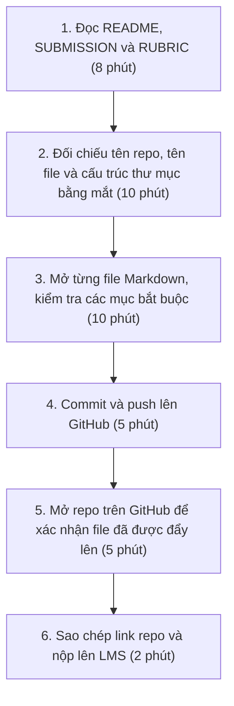
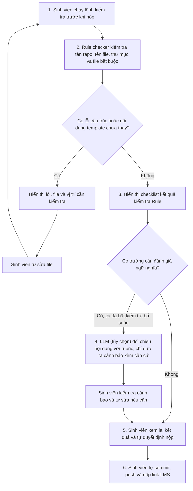

# Báo cáo nhóm — Day 02 Discovery & Problem Framing

> Bản chung của nhóm, viết trên repo do nhóm trưởng fork. Không copy file này sang repo cá nhân.
> Template chi tiết và prompt mẫu: [docs/01-worksheet.md](../../docs/01-worksheet.md). Bài mẫu: [docs/02-deliverable-example.md](../../docs/02-deliverable-example.md).

## 1. Thông tin nhóm

- Tên nhóm: NhomBVH
- Thành viên: xem `TEAM.md` (Nguyễn Thế Bảo, Phạm Đức Vinh, Vũ Xuân Hiếu)
- Candidate problem được chọn (1 câu): Khi chuẩn bị nộp bài tập lớn/bài lab môn học trước hạn chót 23h59, sinh viên muốn tự động đối chiếu cấu trúc thư mục, quy tắc đặt tên file và nội dung các trường bắt buộc với rubric của đề bài, để không bị trừ điểm oan vì sai format nộp bài.
- Quyết định cuối: **Go (phạm vi nhỏ: Workflow có AI ở một bước hẹp — Rule checker làm phần chính, một bước LLM cảnh báo tùy chọn, chỉ bật khi đạt bộ eval)**

---

## 2. Hội tụ nhóm (CP3)

### 2.1. Pitch

Mỗi thành viên pitch top 3 Problem Card trong báo cáo cá nhân (`report/individual/`). Không dùng AI ở bước này.

| # | Người đưa ra | Candidate (Job Story ngắn) | Actor | Bottleneck | Câu hỏi phản biện nhận được (ai hỏi) |
|---:|---|---|---|---|---|
| 1 | Vũ Xuân Hiếu | Khi chuẩn bị nộp bài lab trước 23h59, tôi muốn đối chiếu cấu trúc thư mục, tên file và các trường bắt buộc với rubric, để không bị trừ điểm oan vì sai format. | Sinh viên làm lab | Bước 2–3: dò tay tên file/thư mục và trường bắt buộc (~20 phút, lúc đêm muộn). | "Viết shell script hay Python regex là kiểm tra được, sao cần AI?" (Thế Bảo hỏi) · "Con số 6 bạn bị trừ điểm ở Day 01 lấy từ đâu, có bảng điểm không?" (Đức Vinh hỏi) |
| 2 | Vũ Xuân Hiếu | Khi đến hạn sprint, tôi muốn kiểm tra nhanh docstring, commit message và style code, để không bị tech lead reject PR vì lỗi định dạng vụn vặt. | Lập trình viên | Bước 2: tự đọc soát git diff (10 phút) và bước 5: sửa lại khi bị reject (10 phút). | "Pre-commit hook với Flake8/Black đã chặn được lỗi format, phần còn lại là gì?" (Đức Vinh hỏi) |
| 3 | Vũ Xuân Hiếu | Khi chuẩn bị seminar lab hàng tuần, tôi muốn trích xuất đóng góp chính và bảng benchmark/ablation từ paper 10–15 trang, để làm dàn ý trong 45 phút. | Sinh viên nghiên cứu | Bước 4: dò và chép số liệu từ bảng benchmark/ablation trong PDF 2 cột (75 phút). | "Tỷ lệ sai 25% đo từ 4 buổi seminar, mẫu có quá nhỏ không? Kiểm chứng trong một buổi lab bằng cách nào?" (Thế Bảo hỏi) |
| 4 | Phạm Đức Vinh | Khi đã tải danh sách hóa đơn từ cổng hoadondientu, tôi muốn đối chiếu với số liệu trong phần mềm kế toán, để biết hóa đơn nào chưa hạch toán hoặc sai số tiền. | Kế toán dịch vụ (~6 MST) | Bước 3: dò từng dòng hóa đơn mua vào giữa 2 file bằng mắt (~60 phút/tháng cho 6 MST). | "Số liệu 6 MST và 14 hóa đơn sót là thật hay giả định? Nếu XLOOKUP là đủ thì bài còn đáng đào sâu không?" (Xuân Hiếu hỏi) |
| 5 | Phạm Đức Vinh | Khi tới kỳ kê khai, tôi muốn tải đủ hóa đơn mua vào/bán ra của tháng từ cổng hoadondientu, để có bộ chứng từ đầy đủ trước khi lập tờ khai. | Kế toán dịch vụ (~6 MST) | Bước 3: tải XML từng hóa đơn (~20 giây × 450 hóa đơn ≈ 150 phút/tháng). | "Phần mềm kế toán đang dùng đã có chức năng lấy hóa đơn hàng loạt từ cơ quan thuế chưa?" (Thế Bảo hỏi) |
| 6 | Phạm Đức Vinh | Khi lấy hóa đơn mua vào từ cổng, tôi muốn biết hóa đơn còn hợp lệ không (trạng thái hóa đơn, người bán còn hoạt động), để không bị loại thuế được khấu trừ. | Kế toán dịch vụ, giám đốc | Bước 3: tra MST người bán ở trang tra cứu riêng (~1,5 phút/hóa đơn). | "Bao nhiêu % nhà cung cấp lặp lại hằng tháng? Nếu cao thì chỉ cần tra nhà cung cấp mới." (Xuân Hiếu hỏi) |
| 7 | Nguyễn Thế Bảo | Khi nhận yêu cầu chỉnh sửa từ khách hàng nhiều lần, tôi muốn theo dõi các thay đổi, để tránh bỏ sót yêu cầu. | Dev, BA | Bước 3–4: đọc lại nhiều nguồn và cập nhật thủ công (10–20 phút/lần thay đổi). | "Lần gần nhất bỏ sót yêu cầu là khi nào, mất bao lâu sửa? Con số 2–3 lần/tuần có ghi chép không?" (Đức Vinh hỏi) |
| 8 | Nguyễn Thế Bảo | Khi khách hàng thay đổi yêu cầu qua nhiều cuộc họp, tôi muốn đối chiếu yêu cầu ban đầu và yêu cầu mới, để xác định chính xác điểm thay đổi. | BA | Bước 5: so sánh thủ công nội dung tài liệu cũ và mới (30–60 phút/lần). | "Word Compare đã làm được việc này, AI thêm được gì? Tài liệu khách hàng có được phép đưa lên AI không?" (Xuân Hiếu hỏi) |
| 9 | Nguyễn Thế Bảo | Khi Tester phát hiện lỗi nhưng mô tả chưa đủ thông tin, tôi muốn có đủ dữ liệu tái hiện lỗi, để xử lý chính xác. | Tester, Dev | Bước 6: Dev hỏi lại Tester để bổ sung thông tin (10–15 phút/bug). | "Chỉ cần template bug report bắt buộc các trường thì đã giảm được một nửa thời gian chưa?" (Đức Vinh hỏi) |

### 2.2. Cluster

| Cluster | Các candidate | Pattern chung |
|---|---|---|
| **A: Kiểm tra sản phẩm theo bộ tiêu chí trước khi bàn giao** | #1 (quy cách bài nộp), #2 (PR checklist), #9 (bug report thiếu thông tin) | Có sẵn một bộ tiêu chí cố định (rubric, quy ước code, mẫu bug report); người làm tự dò tay trước khi bàn giao nên sót lỗi nhỏ và bị trả về. |
| **B: Đối chiếu hai nguồn để tìm chênh lệch** | #4 (hóa đơn cổng – phần mềm kế toán), #7 (theo dõi yêu cầu chỉnh sửa), #8 (đối chiếu yêu cầu qua nhiều cuộc họp) | Cùng một thông tin nằm ở hai nơi (hai file, hai phiên bản tài liệu); so khớp bằng mắt nên bỏ sót điểm khác nhau. |
| **C: Thu thập và xác minh lặp lại trên hệ thống bên ngoài** | #5 (tải hóa đơn từ cổng), #6 (kiểm tra hóa đơn hợp lệ) | Thao tác tra cứu/tải lặp lại cho từng chứng từ trên cổng của cơ quan khác (đăng nhập, captcha), nên chỉ làm được một phần. |
| **D: Trích xuất số liệu từ tài liệu dài, phi cấu trúc** | #3 (bảng benchmark/ablation trong paper) | Số liệu nằm trong bảng PDF phức tạp; đọc dò dễ nhầm dòng, nhầm cột. |

### 2.3. Opportunity Solution Tree rút gọn

Gốc là **1 outcome**. Nhánh là **opportunity** (nhu cầu, pain), không phải tính năng hay công cụ.

```text
OUTCOME: Giảm số lần sản phẩm bị trả về, bị trừ điểm hoặc phải làm lại
         vì những lỗi lẽ ra phát hiện được trước khi bàn giao (đếm số lần/tháng)
├── Opportunity A: Bộ tiêu chí dài, người làm dò tay lúc sát hạn nên sót lỗi nhỏ
│   ├── Phải đọc lại rubric/quy chuẩn mỗi lần nộp vì yêu cầu đổi theo từng bài
│   └── Dò tên file, thư mục và trường bắt buộc khi mệt dễ sót ký tự (`_` thành `-`, quên sửa MSSV)
├── Opportunity B: Hai nguồn dữ liệu sắp xếp khác nhau, so khớp bằng mắt bỏ sót chênh lệch
├── Opportunity C: Tra cứu lặp lại trên cổng bên ngoài cho từng chứng từ nên chỉ kiểm được một phần
└── Opportunity D: Số liệu trong bảng của tài liệu dài dễ đọc nhầm dòng, nhầm cột
```

Những ý đã gạch bỏ vì là solution đội lốt opportunity:

- ~~"Bot Discord tự chạy script kiểm tra format bài nộp"~~ → là công cụ; pain thật là *dò tay tên file và trường bắt buộc khi mệt dễ sót* (Opportunity A).
- ~~"LLM đọc rubric tự sinh checklist"~~ → là giải pháp; pain thật là *phải đọc lại rubric mỗi lần nộp* (Opportunity A).
- ~~"Macro Excel/XLOOKUP so khớp hóa đơn"~~ → là giải pháp; pain thật là *so khớp hai nguồn bằng mắt bỏ sót chênh lệch* (Opportunity B).
- ~~"Trợ lý AI đọc paper sinh slide"~~ → là giải pháp; pain thật là *số liệu trong bảng dễ đọc nhầm* (Opportunity D).

### 2.4. Chấm điểm shortlist (1–5)

Shortlist lấy card mạnh nhất của mỗi thành viên.

| Candidate | Actor rõ | Quy trình rõ | Pain có bằng chứng | Impact đo được | Vừa sức lab | So sánh được No AI/Rule/Workflow/Agent | Nhóm hiểu domain | Tổng |
|---|---:|---:|---:|---:|---:|---:|---:|---:|
| **#1 Rà soát quy cách bài nộp theo rubric** (Hiếu) | 5 | 4 | 4 | 3 | 5 | 5 | 5 | **31/35** |
| **#4 Đối chiếu hóa đơn cổng – phần mềm kế toán** (Vinh) | 5 | 5 | 3 | 5 | 3 | 4 | 2 | **27/35** |
| **#9 Bug report thiếu thông tin** (Bảo) | 4 | 4 | 2 | 3 | 4 | 5 | 3 | **25/35** |

Lý do các điểm thấp:

- **#1:** Quy trình 4/5 vì bước 4–5 (push, nộp LMS) chưa đo thực tế. Pain 4/5: có sự kiện thật (≥6 bạn bị trừ điểm ở Day 01) nhưng tỷ lệ "sót lỗi 15%" chưa có nguồn. Impact 3/5: "trừ 5–10% điểm" chưa trích từ rubric thật, target "0% lỗi" là tuyệt đối → cần sửa ở CP4–CP5.
- **#4:** Pain 3/5 vì số liệu (6 MST, 14 hóa đơn sót, 18 triệu khấu trừ chậm) là giả định minh họa. Vừa sức lab 3/5 và domain 2/5: cả nhóm là sinh viên, không phỏng vấn được kế toán thật trong buổi lab.
- **#9:** Pain 2/5 và impact 3/5: thời gian 10–15 phút/bug và tỷ lệ bug thiếu thông tin đều là ước tính, chưa có baseline.

**Candidate được chọn:**
Candidate #1: *Rà soát quy cách bài nộp theo rubric trước deadline.*

**Vì sao chọn:**

1. **Pain có sự kiện thật và kiểm chứng được ngay:** ở bài lab Day 01 có ít nhất 6 bạn trong lớp bị trừ điểm vì sai tên repo hoặc file con; nhóm có thể hỏi/survey bạn cùng lớp ngay trong buổi lab (CP4).
2. **Bottleneck cụ thể:** bước 2–3, dò tay tên file/thư mục và các trường bắt buộc, ~20 phút, làm lúc đêm muộn sát 23h59.
3. **Cả nhóm hiểu domain:** cả 3 thành viên đều là người nộp bài, đầu vào có sẵn trong repo (`RUBRIC.md`, `SUBMISSION.md`, cây thư mục bài làm).
4. **Ép nhóm so sánh đủ 4 mức can thiệp:** phần kiểm tra tên file, cấu trúc thư mục là Rule thuần; chỉ phần kiểm tra nội dung trường bắt buộc có thực sự được điền (không còn template) mới có thể cần LLM. Bài toán này tránh được bẫy "lạm dụng AI".

**Vì sao loại các candidate còn lại:**

- *Loại #4 (đối chiếu hóa đơn, Vinh):* card viết chặt chẽ nhất, metric rõ nhất, nhưng số liệu là giả định minh họa và nhóm không tiếp cận được kế toán thật để kiểm chứng trong buổi lab. Chính card đã tự kết luận mức **Rule** (XLOOKUP/Power Query), nên không còn nhiều điều để so sánh giữa các mức.
- *Loại #9 (bug report, Bảo):* toàn bộ số liệu là ước tính, chưa có baseline; phương án No AI (template bug report bắt buộc các trường) nhiều khả năng đã giải phần lớn bài toán.
- *Loại #2 (PR checklist, Hiếu):* linter và pre-commit hook (Flake8, Black, ESLint) đã giải gần hết bằng Rule.
- *Loại #3 (trích xuất paper, Hiếu):* rủi ro Feasibility cao (PDF 2 cột, bảng xoay, ký hiệu toán học), tỷ lệ sai 25% chỉ đo trên 4 buổi seminar, không kiểm chứng và ra quyết định được trong một buổi lab.
- *Loại #5, #6, #7, #8:* #5 có thể đã có chức năng tải hàng loạt trong phần mềm kế toán (No AI); #6 giải được bằng danh sách nhà cung cấp đã tra; #7, #8 thiếu bằng chứng thật và #8 vướng bảo mật tài liệu khách hàng.

**Xử lý bất đồng:**

- Thế Bảo cho rằng Candidate #1 chỉ cần một script Bash/Python, không cần AI. Nhóm thống nhất: script kiểm tra được *sự tồn tại và tên file* (phần vỏ), nhưng không kiểm tra được *nội dung trường bắt buộc có thực sự được điền hay vẫn là template* (ví dụ mục Success Metric có baseline và target không). Vì vậy giữ hướng **Rule (cấu trúc) trước, chỉ thêm AI (nội dung) nếu Rule không đủ** và để CP6 quyết định.
- Đức Vinh cho rằng #4 có bằng chứng và metric tốt hơn. Nhóm đồng ý về chất lượng card, nhưng chọn #1 vì tiêu chí "kiểm chứng được trong buổi lab" và "nhóm hiểu domain" quan trọng hơn ở giai đoạn Define.

---

## 3. Kiểm chứng + research giải pháp đã có (CP4)

### 3.1. Assumption Map

| # | Giả định | Loại (Value / Usability / Feasibility / Viability) | Quan trọng (1–5) | Đã có bằng chứng (1–5) | Kiểm chứng trước? |
|---:|---|---|---:|---:|---|
| 1 | Sinh viên trong lớp thực sự bị trừ điểm hoặc bị nhắc vì sai quy cách nộp bài (tên file, cấu trúc thư mục, thiếu file, mục bắt buộc để trống) ở các bài lab gần đây. | Value | 5 | 3 | **Có — kiểm trước** (mới có sự kiện Day 01 "≥6 bạn bị trừ điểm", chưa có bảng điểm hay feedback làm bằng chứng) |
| 2 | Bước tự dò tên file và các mục bắt buộc mất ≥15 phút mỗi lần nộp và thường làm sát hạn 23h59. | Value | 4 | 2 | **Có** (mới có ước tính 20 phút của người đưa card) |
| 3 | Phần lớn lỗi quy cách bắt được bằng Rule (script kiểm tên file, cấu trúc thư mục, tìm chữ template chưa sửa); chỉ phần nhỏ cần đọc hiểu nội dung. | Feasibility | 5 | 2 | **Có** — giả định này quyết định mức can thiệp ở CP6 |
| 4 | Sinh viên sẽ tự chạy một bước kiểm tra trước khi nộp nếu bước đó mất dưới 3 phút. | Usability | 4 | 1 | Có (hỏi về hành vi đã có: đã từng tự kiểm bằng checklist/script nào chưa) |
| 5 | Giảng viên/TA đồng ý cho sinh viên dùng bộ kiểm tra quy cách trước khi nộp. | Viability | 3 | 1 | Không — để CP6 |
| 6 | LLM đọc rubric và liệt kê đúng các file, mục bắt buộc mà không bịa thêm yêu cầu. | Feasibility | 4 | 1 | Không — chỉ cần kiểm nếu giả định #3 sai |

Giả định nhóm kiểm chứng trong buổi này (quan trọng cao, bằng chứng thấp):

- **#1 và #2 (Value):** pain có thật và đủ lớn không? Hỏi về lần nộp bài gần nhất, số phút, lần bị trừ điểm gần nhất.
- **#3 (Feasibility):** lỗi thật sự gặp là loại nào? Nếu đa số là sai tên file/thiếu file thì Rule là đủ; chỉ khi có nhiều lỗi kiểu "mục có chữ nhưng không đạt yêu cầu" mới cần cân nhắc AI.

### 3.2. Kiểm chứng

Cách đã dùng: **Phỏng vấn** theo The Mom Test, 5 người (4 sinh viên, 1 trợ giảng); không phỏng vấn thành viên nhóm.

Kịch bản phỏng vấn và bộ câu hỏi survey: [report/assets/cp4-interview-script.md](../assets/cp4-interview-script.md).

#### Interview Snapshot 1
| Trường | Nội dung |
|---|---|
| Người được hỏi (vai trò, không ghi tên thật) | Sinh viên năm 3 ngành CNTT, học viên lớp L3B |
| Câu nói đáng nhớ nhất (nguyên văn) | *"Hôm nọ nộp bài lúc 23h50, mắt hoa lên nên nhìn tên file 20241234-VuVanAn.md cứ tưởng đúng, hôm sau bị trừ 5 điểm mới biết mình gõ nhầm dấu gạch dưới thành gạch nối, cay cú cả tuần."* |
| Lần gần nhất gặp vấn đề này: chuyện gì đã xảy ra? | Bài lab Day 01 tuần trước: mất 35 phút để mở từng folder đối chiếu với file README hướng dẫn trước khi push Git. |
| Hiện đang xử lý bằng cách nào (workaround)? | Tự mở 2 cửa sổ cạnh nhau (1 bên mở đề, 1 bên mở VS Code) rồi dùng mắt dò từng dòng checklist. |
| Mất bao lâu, bao lần? | Mất 25–35 phút mỗi bài lab lớn; trung bình 2 tuần làm 1 lần. |
| Insight / opportunity rút ra | Nỗi sợ bị trừ điểm oan vì lỗi chính tả ngớ ngẩn sát deadline là có thật và gây ức chế tâm lý rất lớn. |

#### Interview Snapshot 2
| Trường | Nội dung |
|---|---|
| Người được hỏi (vai trò, không ghi tên thật) | Trợ giảng (Teaching Assistant) hỗ trợ chấm bài lab |
| Câu nói đáng nhớ nhất (nguyên văn) | *"Bọn anh chấm bài ghét nhất là sinh viên đặt sai tên file hoặc để trống template, mở bài ra chấm mất thời gian tìm file gấp đôi bình thường."* |
| Lần gần nhất gặp vấn đề này: chuyện gì đã xảy ra? | Đợt chấm bài lab Day 01 vừa rồi: trong 30 bài nộp có 6 bài sai quy chuẩn đặt tên file, phải chấm bằng tay và đối chiếu MSSV thủ công. |
| Hiện đang xử lý bằng cách nào (workaround)? | Dùng file script bash chấm tự động, bài nào đặt sai tên file thì script báo lỗi đỏ và gán điểm 0 phần format theo đúng rubric. |
| Mất bao lâu, bao lần? | Mỗi đợt chấm mất thêm 1 tiếng chỉ để xử lý các bài nộp sai format. |
| Insight / opportunity rút ra | Quy tắc kiểm tra format của giảng viên/TA hoàn toàn dựa trên quy chuẩn định sẵn, hoàn toàn có thể cấp bộ kiểm tra này cho sinh viên tự chạy trước khi nộp. |

#### Interview Snapshot 3
| Trường | Nội dung |
|---|---|
| Người được hỏi (vai trò, không ghi tên thật) | Nhóm trưởng nhóm 4 người trong môn học thực hành AI |
| Câu nói đáng nhớ nhất (nguyên văn) | *"Sợ nhất là các bạn trong nhóm nộp file mà chỉ copy template rồi quên không điền mục reflection cá nhân, cả nhóm bị vạ lây."* |
| Lần gần nhất gặp vấn đề này: chuyện gì đã xảy ra? | Đêm nộp bài đồ án giữa kỳ kỳ trước: 23h45 mở file của một bạn thành viên ra thấy mục câu hỏi mở vẫn nguyên văn bản mẫu của thầy, phải cuống cuồng gọi bạn dậy viết lại. |
| Hiện đang xử lý bằng cách nào (workaround)? | Nhóm trưởng phải mở từng file của từng thành viên đọc lướt để kiểm tra xem đã điền chữ vào chưa. |
| Mất bao lâu, bao lần? | Mất 20 phút rà soát bài của cả nhóm trước khi tạo pull request cuối cùng. |
| Insight / opportunity rút ra | Cần một công cụ không chỉ kiểm tra file có tồn tại hay không, mà phải kiểm tra xem các mục bắt buộc đã được điền nội dung thực tế chưa (phát hiện template rỗng). |

#### Interview Snapshot 4
| Trường | Nội dung |
|---|---|
| Người được hỏi (vai trò, không ghi tên thật) | Sinh viên năm 4 chuẩn bị nộp khóa luận tốt nghiệp *(ngoài actor chính "sinh viên nộp bài lab"; chỉ dùng insight về ranh giới augment/automate, không tính vào số người xác nhận pain)* |
| Câu nói đáng nhớ nhất (nguyên văn) | *"Tôi không muốn AI tự động sửa bài của tôi, nó mà sửa nhầm format thì còn tai họa hơn. Tôi chỉ cần nó chỉ ra đúng dòng nào, file nào đang sai để tôi tự sửa."* |
| Lần gần nhất gặp vấn đề này: chuyện gì đã xảy ra? | Nộp đề cương khóa luận tuần trước: mất 45 phút kiểm tra quy chuẩn trích dẫn và mục lục theo quy định của phòng đào tạo. |
| Hiện đang xử lý bằng cách nào (workaround)? | In ra giấy hoặc dùng tính năng checklist trong Notion. |
| Mất bao lâu, bao lần? | 40–50 phút mỗi lần nộp báo cáo lớn. |
| Insight / opportunity rút ra | **Người dùng muốn hỗ trợ (Augment - chỉ ra lỗi), không muốn công cụ tự động sửa file (Automate)** vì sợ làm hỏng nội dung gốc. |

#### Interview Snapshot 5
| Trường | Nội dung |
|---|---|
| Người được hỏi (vai trò, không ghi tên thật) | Sinh viên năm 2 mới học môn thực hành lập trình |
| Câu nói đáng nhớ nhất (nguyên văn) | *"Rubric viết dài quá, nhiều khi đọc không hết các quy định ẩn trong các file tài liệu con nên cứ nghĩ là mình nộp đủ rồi."* |
| Lần gần nhất gặp vấn đề này: chuyện gì đã xảy ra? | Bài tập nhóm tuần trước: nộp đủ file code nhưng thiếu file `TEAM.md` phân công công việc vì không để ý yêu cầu trong file phụ. |
| Hiện đang xử lý bằng cách nào (workaround)? | Nhắn tin hỏi các nhóm khác xem họ nộp những file gì. |
| Mất bao lâu, bao lần? | 15–20 phút chat hỏi han qua lại trước giờ nộp. |
| Insight / opportunity rút ra | Công cụ cần tự động phân tích rubric để tạo ra danh sách kiểm tra (checklist) tóm tắt các file và trường bắt buộc phải có. |

Tổng hợp:

| Nguồn | Số người / số mẫu | Tín hiệu xác nhận | Tín hiệu phản bác |
|---|---:|---|---|
| Phỏng vấn The Mom Test | 5 người (3 sinh viên đúng actor, 1 TA, 1 sinh viên khóa luận ngoài actor) | 3/3 sinh viên đúng actor kể lại việc tự rà soát quy cách mất 15–35 phút mỗi lần nộp; TA xác nhận 6/30 bài Day 01 sai quy chuẩn đặt tên file. Lỗi được kể: sai tên file (SV1, TA), mục còn nguyên template (SV3), thiếu file `TEAM.md` (SV5). | **Phản bác 1 (TA):** TA *đã có sẵn bash script* kiểm tên file và gán điểm format → phần kiểm tên file/cấu trúc đã giải được bằng Rule, pain chỉ nằm ở chỗ sinh viên không được chạy script đó trước khi nộp. Điều này làm yếu giả định "Rule không đủ". **Phản bác 2:** 2/3 lỗi sinh viên kể (sai tên, thiếu file) là lỗi Rule bắt được; chỉ lỗi "mục còn nguyên template" là gần ranh giới, và vẫn có thể bắt bằng Rule (tìm chuỗi mẫu của template). **Ranh giới từ SV năm 4:** không muốn công cụ tự sửa file, chỉ cần chỉ ra chỗ sai. |

**Nhóm đã sửa problem thế nào sau kiểm chứng:**

1. **Thu hẹp ranh giới (Boundary):** công cụ **chỉ đọc và báo lỗi (read-only report)**, không ghi đè hay sửa nội dung file của sinh viên.
2. **Rule trước, AI sau:** vì TA đã kiểm quy cách bằng script và đa số lỗi sinh viên kể là lỗi Rule bắt được, nhóm đặt mặc định là:
   - *Rule-based (script):* kiểm tên repo, tên file, cấu trúc thư mục, file bắt buộc, và tìm chuỗi template chưa sửa (ví dụ `MSSV_HoTen`, dòng trống sau tiêu đề mục).
   - *AI (LLM):* chỉ cân nhắc cho phần Rule không bắt được, ví dụ mục Success Metric có chữ nhưng thiếu baseline/target. Có cần mức này hay không để CP6 quyết định, không mặc định là có.
3. **Sửa metric của card cho thực tế:** bỏ target "0% lỗi" tuyệt đối, đổi thành "số bài nộp bị trừ điểm vì quy cách giảm từ 6/30 (Day 01, theo TA) xuống ≤ 1/30"; bỏ con số "sót lỗi 15%" vì chưa có nguồn; mức "trừ 5–10% điểm" cần trích lại từ `RUBRIC.md` trước CP5.

### 3.3. Research giải pháp đã có

| Công cụ / case / pattern | Link | Giải bước nào trong quy trình? | Điểm mạnh | Khoảng trống / rủi ro | Bài học cho nhóm |
|---|---|---|---|---|---|
| **pre-commit** (sinh viên tự chạy trên máy) | [pre-commit.com](https://pre-commit.com/) | Bước 2 (phần vỏ) và một phần bước 3: hook `fail` chặn file theo tên (*"forbid files by filename"*), hook `pygrep` chặn commit khi nội dung khớp regex (bắt chuỗi template chưa sửa như `MSSV_HoTen`); `pre-commit run --all-files` chạy toàn bộ bằng 1 lệnh | Sinh viên tự chạy **trước khi nộp**, không cần giảng viên; miễn phí, mã nguồn mở; cấu hình viết 1 lần dùng cho cả lớp | Không có sẵn quy tắc "file bắt buộc phải tồn tại", phải tự viết hook cục bộ; không biết mục có chữ đã đạt yêu cầu chưa; mỗi người phải cài Python + pre-commit | Bước 2–3 phần lớn làm được bằng Rule với công cụ có sẵn → mức can thiệp mặc định là Rule, không phải AI |
| **GitHub Classroom – Autograding** | [docs.github.com – Use autograding](https://docs.github.com/en/education/manage-coursework-with-github-classroom/teach-with-github-classroom/use-autograding) | Bước 2–3 (kiểm quy cách): giảng viên cấu hình test, test chạy bằng GitHub Actions **mỗi lần sinh viên push**; sinh viên xem kết quả, sửa rồi push lại | Gần nhất với bài toán: sinh viên thấy lỗi *trước hạn nộp*, không phải sau khi bị chấm; có test preset, không cần biết GitHub Actions | Chỉ chạy khi giảng viên dùng GitHub Classroom và tự viết test; lớp mình nộp bằng repo fork nên hiện không có | Pattern "kiểm tra tự động mỗi lần push" đã có sẵn và chỉ cần Rule → giải pháp hợp lý là một workflow/script kiểm quy cách sinh viên tự chạy, không nhất thiết cần AI |
| **Gradescope Autograder** | [gradescope.com](https://www.gradescope.com) | Chấm bài nộp dạng giấy, file số và code; có autograder cho bài lập trình | Dùng rộng ở các trường đại học, chấm theo rubric của giảng viên | Do giảng viên cấu hình; phục vụ việc chấm, không phải để sinh viên tự rà soát quy cách trước khi nộp | Công cụ phía giảng viên không giải được bước 2–3 của sinh viên; khoảng trống nằm ở phía người nộp |
| **markdownlint-cli** | [github.com/igorshubovych/markdownlint-cli](https://github.com/igorshubovych/markdownlint-cli) | Kiểm định dạng file Markdown bằng dòng lệnh | Nhẹ, chạy nhanh, dễ tích hợp vào pre-commit | Chỉ bắt lỗi trình bày Markdown (tiêu đề sai cấp, khoảng trắng), không biết mục bắt buộc nào còn để trống | Tham khảo cách chạy cục bộ bằng một lệnh cho phần Rule |

Link đã được nhóm mở và kiểm ngày 09/11/2026 (cả 4 link mở được, nội dung trích khớp với trang).

**Bước 2–3 làm được đến đâu bằng Rule:**

| Việc kiểm | Rule thuần? | Cách làm |
|---|---|---|
| Tên file đúng dạng `MSSV_HoTen.md`, cấu trúc thư mục, file bắt buộc (`TEAM.md`, `report/individual/`) | Có | Regex tên file, script kiểm file tồn tại |
| Tiêu đề/ô thông tin còn nguyên template, ô bảng còn trống | Có | `pygrep`/grep theo chuỗi mẫu, regex ô trống |
| Mục bắt buộc có tồn tại và không rỗng; Reflection đủ 200 từ | Có | Tách theo tiêu đề `##`, đếm từ |
| Success Metric có baseline và target thật | Một phần | Regex dạng "số → số" bắt được phần lớn; đánh giá chất lượng cần người đọc |
| Câu trả lời có đúng câu hỏi hay viết qua loa | Không | Cần đọc hiểu (người hoặc LLM) — đây là chấm nội dung, ngoài phạm vi "quy cách" |

**Kết luận research:** công cụ có sẵn (pre-commit, pattern autograding mỗi lần push) cộng vài script Rule đã giải phần lớn bước 2–3. Khoảng trống còn lại là: (1) lớp không dùng GitHub Classroom nên sinh viên không có sẵn bộ kiểm tra để tự chạy trước khi nộp, và (2) đánh giá chất lượng nội dung của mục bắt buộc. Khoảng trống (2) nằm ngoài phạm vi "quy cách", nên nhóm giữ hướng **Rule trước** và để CP6 quyết định có cần thêm AI hay không.

---

## 4. Quy trình trước/sau (CP5)

### 4.1. Quy trình hiện tại

Quy trình hiện tại được tổng hợp từ Problem Card và phỏng vấn CP4. Sinh viên tự đọc yêu cầu, tự kiểm tra bài nộp bằng mắt rồi mới đẩy lên GitHub và nộp link trên LMS.

Sơ đồ quy trình hiện tại:



| Bước | Actor | Input | Output | Thời gian / tần suất | Handoff (chuyển cho ai) | Vấn đề quan sát được |
|---:|---|---|---|---|---|---|
| 1 | Sinh viên | `README.md`, `SUBMISSION.md`, `RUBRIC.md` | Danh sách yêu cầu cần nộp | 8 phút / mỗi bài lab | Chính sinh viên (bước 2) | Yêu cầu có thể nằm ở nhiều file; đọc lướt dễ bỏ sót |
| 2 | Sinh viên | Cây thư mục bài làm, tên repo và tên file | Xác nhận cấu trúc và tên file | 10 phút / mỗi bài lab | Chính sinh viên (bước 3) | Dễ nhầm dấu `-` với `_`, sai thứ tự MSSV hoặc thiếu file |
| 3 | Sinh viên | Các file Markdown trong `report/` | Xác nhận các mục bắt buộc đã được điền | 10 phút / mỗi bài lab | Chính sinh viên (bước 4) | Có thể bỏ trống mục hoặc giữ nguyên nội dung template |
| 4 | Sinh viên | Mã nguồn và báo cáo đã rà soát | Commit và push lên remote | 5 phút / mỗi bài lab | GitHub (repo nhóm) | Thao tác Git; không trực tiếp kiểm tra chất lượng quy cách |
| 5 | Sinh viên | Repo trên GitHub | Xác nhận nội dung đã xuất hiện trên remote | 5 phút / mỗi bài lab | Chính sinh viên (bước 6) | Phải mở trình duyệt và kiểm tra lại thủ công |
| 6 | Sinh viên | URL repository | Hoàn tất nộp bài trên LMS | 2 phút / mỗi bài lab | TA/giảng viên chấm bài | Sao chép và dán link |

**Tổng thời gian ước tính:** 40 phút/lần nộp (8 + 10 + 10 + 5 + 5 + 2). Trong đó, hai bước rà soát thủ công (bước 2 và 3) chiếm khoảng 20 phút. Đây là bottleneck chính cần cải thiện.

**Bằng chứng và giới hạn của dữ liệu:** Trong CP4, 3/3 sinh viên được phỏng vấn đúng actor kể rằng họ mất khoảng 15–35 phút để tự rà soát quy cách ở lần nộp gần nhất. Trợ giảng cho biết có 6/30 bài Day 01 sai quy chuẩn đặt tên file. Đây là tín hiệu ban đầu từ một đợt chấm, chưa đủ để khẳng định tỷ lệ lỗi chung của mọi bài lab hoặc mọi lớp.

### 4.2. Quy trình tương lai

Quy trình tương lai ưu tiên **Rule-based trước**, chỉ cân nhắc LLM đối với nội dung mà quy tắc cố định không thể đánh giá đáng tin cậy. Công cụ chỉ đọc và báo lỗi; sinh viên tự quyết định sửa file và tự thực hiện thao tác nộp bài.



| Bước | Actor / thành phần | Input | Output | Thời gian mục tiêu | Ghi chú |
|---:|---|---|---|---|---|
| 1 | Sinh viên | Repository bài làm và bộ hướng dẫn | Yêu cầu chạy kiểm tra | Dưới 1 phút thao tác | Chạy một lệnh CLI; không tự động sửa hoặc push |
| 2 | Rule checker | Tên repo, cây thư mục, tên file, nội dung Markdown và các quy tắc đã cấu hình | Danh sách lỗi xác định được bằng quy tắc | Dưới 1 phút (vài giây chạy máy), cần đo khi prototype | Kiểm tra file bắt buộc, regex tên file, mục rỗng và chuỗi template |
| 3 | Rule checker | Kết quả kiểm tra | Checklist đạt/chưa đạt, kèm đường dẫn và lý do | Dưới 1 phút (đọc lướt checklist) | Không dùng AI cho các điều kiện đúng/sai rõ ràng |
| 4 | LLM validator (tùy chọn) | Rubric và những trường nội dung cần đánh giá ngữ nghĩa | Cảnh báo có trích dẫn tiêu chí liên quan | Mục tiêu dưới 15 giây, cần kiểm thử | Chỉ bật nếu Rule không đủ; không tự kết luận thay người học |
| 5 | Sinh viên | Checklist và cảnh báo (nếu có) | Quyết định sửa hoặc chấp nhận cảnh báo | Mục tiêu 2–3 phút, cần đo thực tế | HITL: sinh viên tự kiểm tra và tự sửa |
| 6 | Sinh viên | Bài làm đã được rà soát | Commit, push và nộp link LMS | 12 phút (commit/push 5' + kiểm tra repo online 5' + nộp LMS 2') | Không tự động commit, push hoặc nộp bài |

**Phương án quay về:**
- **LLM không phản hồi (quá 15 giây) hoặc mất mạng:** công cụ vẫn trả về kết quả Rule-based cục bộ. Người học tự kiểm tra các mục cần đọc hiểu bằng checklist; không được coi việc LLM lỗi là bằng chứng bài làm đã đạt.
- **LLM cảnh báo nhầm:** sinh viên đối chiếu với tiêu chí rubric được trích kèm cảnh báo; nếu thấy mình đúng thì bỏ qua cảnh báo đó và ghi lại để chỉnh prompt/quy tắc.
- **Rule checker lỗi, không chạy được hoặc thiếu quy tắc cho bài mới:** quay về checklist Markdown thủ công (sinh từ cùng bộ quy tắc) và tự dò như quy trình hiện tại (bước 2–3, khoảng 20 phút); người viết bộ quy tắc bổ sung quy tắc còn thiếu.

**Boundary và HITL:**
- Rule checker được phép đọc tên file, cấu trúc thư mục và nội dung các file thuộc phạm vi bài nộp; không ghi đè hoặc xóa file.
- LLM (nếu được bật) chỉ phân tích các trường nội dung được chỉ định và phải nêu tiêu chí rubric làm căn cứ cho từng cảnh báo.
- Sinh viên là người quyết định có sửa nội dung hay không, tự thực hiện commit/push và tự nộp bài.
- Công cụ không tự động sửa bài, commit, push hoặc thao tác trên LMS.


### 4.3. Before / after

| Chỉ số | Trước | Sau (mục tiêu thiết kế, chưa phải kết quả đo) | Cách kiểm chứng |
|---|---:|---:|---|
| Số bước | 6 | 5 (6 nếu bật bước LLM tùy chọn) | Đếm theo sơ đồ 4.1 và 4.2: bỏ bước đọc rubric để nhớ quy cách và bước dò tay, thêm bước chạy lệnh kiểm tra |
| Số bước thủ công | 6/6 | 3/5 (chạy lệnh, xem kết quả và sửa, commit/push/nộp) | Rule checker và LLM (nếu bật) là bước tự động; sinh viên vẫn tự sửa và tự nộp |
| Tổng thời gian quy trình | Khoảng 40 phút theo ước tính từng bước | Mục tiêu dưới 25 phút, trong đó rà soát checklist dưới 5 phút | Bấm giờ trên cùng một bài nộp trước và sau khi dùng prototype |
| Thời gian rà soát tên file, thư mục và nội dung | Khoảng 20 phút tự dò bằng mắt | Mục tiêu dưới 5 phút để chạy và xem kết quả | Ghi thời điểm bắt đầu chạy lệnh và kết thúc xem checklist |
| Cách phát hiện lỗi | Sinh viên tự mở từng file để dò | Rule báo lỗi xác định được; LLM chỉ cảnh báo phần ngữ nghĩa nếu cần | Đối chiếu cảnh báo với bộ test có lỗi đã biết |
| Quyền sửa và nộp bài | Sinh viên tự sửa, commit, push và nộp | Sinh viên tiếp tục tự sửa, commit, push và nộp | Kiểm tra công cụ không ghi file hoặc thao tác Git/LMS |
| Rủi ro chính | Bỏ sót lỗi do dò thủ công sát deadline | Rule có thể thiếu quy tắc; LLM có thể cảnh báo nhầm hoặc bỏ sót | Ghi nhận false positive/false negative và cho người học quyền kiểm tra lại |

Các con số ở cột “Sau” là **mục tiêu để thử nghiệm**, không phải kết quả đã đạt. Mốc 40 phút là tổng ước tính của quy trình trong bảng; dữ liệu phỏng vấn CP4 mới xác nhận thời gian rà soát của 3 sinh viên đúng actor nằm trong khoảng 15–35 phút, chưa xác nhận toàn bộ quy trình mất đúng 40 phút.

---

## 5. Problem Statement v0 (CP5)

| Trường | Nội dung |
|---|---|
| **Actor** | Sinh viên hoặc nhóm sinh viên thực hiện bài lab/bài tập lớn thuộc các môn công nghệ và AI, trước mỗi hạn nộp bài. |
| **Bối cảnh / thời điểm** | Trước khi commit, push repository và gửi đường dẫn bài làm lên LMS; thường cần rà soát khi thời hạn nộp đã gần đến. |
| **Quy trình hiện tại** | Sinh viên đọc `README.md`, `SUBMISSION.md` và `RUBRIC.md` → tự đối chiếu tên repo, tên file và cấu trúc thư mục → mở từng file Markdown để kiểm tra mục bắt buộc → commit/push Git → kiểm tra repo trên GitHub → nộp link trên LMS. |
| **Nhu cầu / vấn đề** | Sinh viên cần biết sớm bài nộp có sai tên file, thiếu file/thư mục hoặc còn mục template chưa điền hay không, thay vì phải tự dò từng thành phần bằng mắt sát deadline. |
| **Bottleneck** | Hai bước tự kiểm tra tên file/cấu trúc và đọc từng file báo cáo mất khoảng 20 phút theo ước tính ban đầu. Phỏng vấn CP4 ghi nhận 3/3 sinh viên đúng actor mất 15–35 phút rà soát ở lần nộp gần nhất. |
| **Bằng chứng hiện có** | CP4 phỏng vấn 5 người, trong đó 3 sinh viên đúng actor đều kể lại tình huống rà soát quy cách; trợ giảng cho biết 6/30 bài Day 01 sai quy chuẩn đặt tên file. Các dữ liệu này là tín hiệu ban đầu, chưa đủ để suy rộng thành tỷ lệ lỗi ổn định cho mọi đợt nộp. |
| **Impact** | Theo `RUBRIC.md`, sai tên repo hoặc sai tên file báo cáo bị **trừ 5 điểm** (giữ nguyên tên template `MSSV_HoTen.md` cũng tính là sai). CP4 ghi nhận 6/30 bài Day 01 sai quy chuẩn đặt tên file theo lời trợ giảng, và trợ giảng mất thêm khoảng 1 giờ mỗi đợt chấm để xử lý các bài này. Thiệt hại thực tế trên bảng điểm của từng bài chưa được đối chiếu. |
| **Success Metric** (baseline → target, cách đo) | **Baseline:** 6/30 bài Day 01 sai quy chuẩn đặt tên file theo thông tin trợ giảng; thời gian tự rà soát của 3 sinh viên đúng actor được phỏng vấn là 15–35 phút/lần. **Target pilot:** giảm số bài sai quy cách từ mốc tham chiếu 6/30 xuống không quá 1/30; giảm thời gian rà soát checklist xuống dưới 5 phút. **Cách đo:** dùng cùng checklist và tiêu chí rubric cho các bài pilot; ghi nhận số bài có lỗi quy cách qua kết quả kiểm tra/chấm bài, đồng thời bấm giờ thời gian rà soát. Vì mẫu ban đầu nhỏ và khác nhau về nguồn đo, cần thu thập baseline trên cùng nhóm/lớp trước khi kết luận mức cải thiện. |
| **Boundary / HITL** | Công cụ chỉ đọc và báo cáo (read-only), không tự sửa, ghi đè hoặc xóa file; không tự commit, push hay nộp bài lên LMS. Mọi cảnh báo phải nêu file/vị trí và căn cứ kiểm tra. Sinh viên tự xác minh, quyết định sửa và thực hiện nộp bài. |

**Phản biện nhận được** (nhờ AI đóng vai PM hoài nghi, prompt "chỉ ra lỗ hổng, không viết lại"; nhóm tự quyết định đồng ý hay không):

- **Phản biện 1: Phần lớn lỗi đã có thể phát hiện bằng script, vậy có cần AI không?**  
  **Nhóm đồng ý một phần.** Trợ giảng đã có script Bash để kiểm tra tên file; các lỗi được kể trong phỏng vấn như sai tên file, thiếu file và chuỗi template chưa thay phần lớn có thể kiểm tra bằng Rule. Vì vậy, Problem Statement v0 đặt Rule làm phương án mặc định; LLM chỉ là giả thuyết bổ sung cho trường hợp cần đọc hiểu ngữ nghĩa, chưa phải yêu cầu bắt buộc.

- **Phản biện 2: Công cụ có nên tự sửa file hoặc tự nộp bài để tiết kiệm thời gian?**  
  **Nhóm không đồng ý.** Insight từ phỏng vấn CP4 cho thấy người học muốn được chỉ ra lỗi để tự sửa, không muốn công cụ tự thay đổi file. Do đó, công cụ chỉ hoạt động read-only; sinh viên giữ quyền quyết định và thực hiện thao tác nộp.

- **Phản biện 3: Các số liệu 6/30, 15–35 phút và mức trừ điểm có đủ đại diện không?**  
  **Nhóm đồng ý cần thận trọng.** 6/30 là số bài sai tên file trong một đợt Day 01 theo lời trợ giảng; 15–35 phút là thời gian do 3 sinh viên đúng actor kể lại. Con số "trừ 5–10% điểm môn" không có nguồn nên đã bỏ; thay bằng quy định trong `RUBRIC.md` (sai tên repo hoặc tên file báo cáo bị trừ 5 điểm). Các mục tiêu pilot cần được đo lại trên cùng một nhóm và cùng tiêu chí.

---

## 6. Mức can thiệp AI (CP6)

### 6.1. Ma trận độ mơ hồ × độ phức tạp

Bài của nhóm nằm ở ô: **Độ mơ hồ thấp × Độ phức tạp thấp**, với một phần nhỏ có độ mơ hồ trung bình.

- *Độ mơ hồ thấp:* phần lớn yêu cầu quy cách có đúng/sai rõ ràng (tên repo, tên file `MSSV_HoTen.md`, file bắt buộc, mục còn để trống hoặc còn nguyên template, số từ tối thiểu).
- *Phần mơ hồ trung bình:* một số mục bắt buộc có chữ nhưng chưa chắc đạt yêu cầu, ví dụ Success Metric có đủ baseline, target và cách đo chưa, hay Job Story có đang lẫn giải pháp không. Nhiều cách viết khác nhau đều có thể đạt, nên quy tắc cố định khó bắt hết.
- *Độ phức tạp thấp:* các bước cố định (chạy kiểm tra → xem kết quả → tự sửa → tự nộp), một nguồn dữ liệu (repo bài làm và bộ hướng dẫn của đề), không rẽ nhánh theo quyết định của AI.

→ Theo ma trận: Rule là chính; nếu cần thì Workflow có AI ở **một** bước cho phần mơ hồ.

### 6.2. So sánh 4 mức

| Mức | Phương án cho bài của nhóm | Đủ khi nào | Rủi ro | Chọn? |
|---|---|---|---|---|
| **No AI** | Checklist Markdown sinh từ `SUBMISSION.md`/`RUBRIC.md`, sinh viên tự tích trước khi nộp | Sinh viên còn tỉnh táo và tự dò kỹ | Vẫn là dò bằng mắt sát deadline — đúng bottleneck đang muốn bỏ | Dùng làm phương án quay về |
| **Rule** | Script kiểm tên repo, tên file, thư mục, file bắt buộc, mục rỗng, chuỗi template còn sót, số từ tối thiểu (pre-commit/pygrep hoặc script riêng) | Các yêu cầu có đúng/sai rõ — phần lớn lỗi sinh viên kể ở CP4 (sai tên file, thiếu `TEAM.md`, mục còn template) | Thiếu quy tắc khi đề bài đổi; không đánh giá được mục có chữ nhưng chưa đạt | **Chọn — làm phần chính** |
| **Workflow** | Rule chạy trước; sau đó **một** bước LLM chỉ đọc các mục được chỉ định (Success Metric, Boundary, Job Story, câu hỏi phỏng vấn, Problem Statement) và đưa cảnh báo kèm tiêu chí trích từ hướng dẫn của đề; sinh viên tự quyết định | Các bước cố định, AI chỉ làm phần đọc hiểu mà Rule không làm được | LLM báo nhầm, bỏ sót hoặc trích tiêu chí không có trong đề | **Chọn — bước LLM là tùy chọn, chỉ bật khi đạt bộ eval ở mục 7** |
| **Agent** | AI tự đọc đề, tự sửa file, tự commit, push và nộp | Khi bước tiếp theo không đoán trước được | Tự sửa bài làm sai, mất quyền kiểm soát của sinh viên; trái boundary read-only | Không chọn |

**Mức chọn:** **Workflow có AI ở một bước hẹp** — Rule checker làm phần chính, một bước LLM cảnh báo (tùy chọn) cho các mục cần đọc hiểu, sinh viên kiểm tra và tự nộp.

**Vì sao không chọn mức đơn giản hơn (chỉ Rule):** research ở mục 3.3 cho thấy Rule bắt được tên file, cấu trúc thư mục, file bắt buộc, mục rỗng, chuỗi template và số từ, nhưng còn hai khoảng trống: (1) mục Success Metric có chữ nhưng thiếu baseline, target hoặc cách đo; (2) câu trả lời lẫn giải pháp (ví dụ Job Story "tôi muốn có một công cụ tự động…" không chứa từ khóa "AI", "chatbot"). Đây đều là yêu cầu có trong hướng dẫn của đề (CHECKPOINTS CP1, CP5; RUBRIC C1, C9 có mức trừ điểm riêng), và có nhiều cách viết nên regex không bắt hết. **Giới hạn của lập luận này:** phỏng vấn CP4 chưa có ai kể bị trừ điểm vì lỗi loại này, nên giá trị của bước LLM là giả định cần kiểm trong pilot (rủi ro Value, mục 8.1). Nếu pilot cho thấy loại lỗi này hầu như không xảy ra, nhóm tắt bước LLM và giữ mức Rule.

**Vì sao không chọn mức cao hơn (Agent):** các bước đã cố định; quyết định sửa và nộp bài thuộc về sinh viên (boundary read-only ở mục 5); không có bước nào cần AI tự lập kế hoạch.

### 6.3. AI Canvas rút gọn

| Thành phần | Nội dung |
|---|---|
| **Prediction** — AI dự đoán / tạo ra gì? | Với mỗi mục được chỉ định (Success Metric, Boundary, Job Story, câu hỏi phỏng vấn, Problem Statement): "có vẻ chưa đạt" hoặc "không có cảnh báo", kèm **tiêu chí trích nguyên văn** từ `CHECKPOINTS.md`/`RUBRIC.md`/worksheet và vị trí (file, mục). |
| **Judgment** — con người cân nhắc, quyết định gì? | Sinh viên đọc cảnh báo, đối chiếu với tiêu chí được trích và quyết định: sửa, hay bỏ qua vì cảnh báo nhầm. |
| **Action** — hành động cuối cùng là gì, ai làm? | Sinh viên tự sửa file, chạy lại kiểm tra, rồi tự commit, push và nộp link LMS. |
| **Outcome** — đo kết quả bằng gì? | Số bài bị trừ điểm vì quy cách (6/30 → ≤ 1/30); thời gian rà soát (15–35 phút → dưới 5 phút); tỷ lệ cảnh báo nhầm của bước LLM (≤ 2/10 cảnh báo bị sinh viên đánh dấu nhầm). |
| **Input** — AI cần dữ liệu đầu vào gì mỗi lần chạy? Có sẵn không? | Nội dung các mục được chỉ định (Rule checker đã tách sẵn theo tiêu đề) và các file hướng dẫn của đề (`CHECKPOINTS.md`, `RUBRIC.md`, `docs/01-worksheet.md`). Đều có sẵn trong repo, không có dữ liệu cá nhân. |
| **Feedback** — lấy phản hồi ở đâu để cải thiện? | Cảnh báo bị sinh viên đánh dấu "nhầm"; feedback của TA sau khi chấm (lỗi nào lọt qua cả Rule và LLM). |

### 6.4. Hai câu hỏi của Google PAIR

- **Augment hay automate?** *Augment.* Người được phỏng vấn ở Snapshot 4 nói muốn được chỉ ra đúng dòng, đúng file sai để tự sửa, không muốn công cụ tự sửa file. Đây là ý kiến của 1 người (ngoài actor chính), nhưng khớp với workaround của 3/3 sinh viên đúng actor (tự mở file, tự dò, tự sửa). Vì vậy công cụ chỉ đọc và cảnh báo; sinh viên giữ quyền sửa và nộp.
- **Sai kiểu nào tệ hơn?**
  - *Ở phần Rule:* **bỏ sót tệ hơn** — lọt một lỗi tên file là bị trừ 5 điểm theo `RUBRIC.md`. Vì vậy Rule được viết chặt và mọi lỗi TA phát hiện mà Rule bỏ sót đều là điều kiện dừng pilot (mục 8.2).
  - *Ở bước LLM:* **báo nhầm có chi phí thấp nhưng không được nhiều** — mỗi cảnh báo nhầm chỉ tốn vài giây đọc lại vì có trích tiêu chí, nhưng báo nhầm quá nhiều thì sinh viên sẽ bỏ qua cả cảnh báo đúng. Thiết kế: ưu tiên không bỏ sót, bắt buộc trích tiêu chí cho từng cảnh báo, và đặt ngưỡng cảnh báo nhầm ≤ 2/10.

---

## 7. Problem Statement v1 + tiêu chí đánh giá (CP6)

| Trường | Nội dung |
|---|---|
| **Actor** | Sinh viên hoặc nhóm sinh viên thực hiện bài lab/bài tập lớn thuộc các môn công nghệ và AI, nộp bài qua repo GitHub, trước mỗi hạn nộp bài. |
| **Bối cảnh / thời điểm** | Trước khi commit, push repository và gửi đường dẫn bài làm lên LMS; thường cần rà soát khi thời hạn nộp đã gần đến. |
| **Quy trình hiện tại** | Đọc `README.md`, `SUBMISSION.md`, `RUBRIC.md` → tự đối chiếu tên repo, tên file, cấu trúc thư mục → mở từng file Markdown kiểm tra mục bắt buộc → commit/push → kiểm tra repo trên GitHub → nộp link LMS. |
| **Bottleneck** | Hai bước tự kiểm tra tên file/cấu trúc và đọc từng file báo cáo, khoảng 20 phút theo ước tính; 3/3 sinh viên đúng actor kể mất 15–35 phút. **Trong đó có phần không kiểm được bằng quy tắc cố định:** mục bắt buộc có chữ nhưng chưa đạt yêu cầu của đề (ví dụ Success Metric thiếu baseline/target/cách đo). |
| **Impact** | Theo `RUBRIC.md`, sai tên repo hoặc tên file báo cáo bị trừ 5 điểm; 6/30 bài Day 01 sai quy chuẩn đặt tên file (trợ giảng); trợ giảng mất thêm khoảng 1 giờ mỗi đợt chấm. |
| **Success Metric** (baseline → target, cách đo) | (1) Số bài sai quy cách: 6/30 (Day 01) → ≤ 1/30, đếm qua kết quả chấm của TA trong 2 bài lab pilot.<br>(2) Thời gian rà soát: 15–35 phút → dưới 5 phút, sinh viên pilot tự bấm giờ.<br>(3) **Chất lượng phần Rule:** 0 lỗi tên file/file bắt buộc lọt tới TA mà Rule không báo.<br>(4) **Chất lượng bước LLM:** đạt ≥ 8/10 test case ở bộ eval và 0 cảnh báo trích tiêu chí không có trong đề; trong pilot, ≤ 2/10 cảnh báo bị sinh viên đánh dấu nhầm. |
| **Boundary / HITL** | Công cụ chỉ đọc và báo cáo, không tự sửa, ghi đè hoặc xóa file; không tự commit, push hay nộp bài. Mọi cảnh báo phải nêu file/vị trí và căn cứ. **Bước LLM** chỉ đọc các mục được chỉ định, chỉ cảnh báo chứ không chặn nộp, không chấm điểm nội dung, không đưa ra tiêu chí không có trong hướng dẫn của đề. Sinh viên tự xác minh, quyết định sửa và tự nộp. |
| **AI intervention point** | Sau khi Rule checker chạy xong và đã tách nội dung các mục được chỉ định; trước bước sinh viên xem kết quả và tự sửa. Chỉ áp dụng cho các mục cần đọc hiểu, không áp dụng cho tên file, thư mục, file bắt buộc, mục rỗng (đã do Rule làm). |
| **Mức chọn** | Workflow có AI ở một bước hẹp (bước LLM tùy chọn, chỉ bật khi đạt bộ eval). |
| **Rủi ro & người kiểm tra** | Rule thiếu quy tắc khi đề đổi → người viết bộ quy tắc kiểm lại theo `SUBMISSION.md` của từng bài. LLM báo nhầm, bỏ sót hoặc bịa tiêu chí → sinh viên đối chiếu từng cảnh báo với tiêu chí được trích; nhóm theo dõi tỷ lệ báo nhầm trong pilot. |

**Thay đổi so với v0 và lý do:**

| Trường | v0 | v1 | Vì sao đổi |
|---|---|---|---|
| Bottleneck | Hai bước tự kiểm tra, 15–35 phút | Thêm: phần mục có chữ nhưng chưa đạt không kiểm được bằng quy tắc cố định | Kết luận research mục 3.3 và so sánh 4 mức ở 6.2: đây là điểm duy nhất cần đọc hiểu |
| Success Metric | (1) số bài sai quy cách, (2) thời gian rà soát | Thêm (3) chất lượng Rule và (4) chất lượng bước LLM | Câu hỏi PAIR: bỏ sót ở phần Rule tệ hơn; báo nhầm quá nhiều ở bước LLM làm sinh viên bỏ qua cảnh báo |
| Boundary | Read-only, không tự commit/push/nộp | Thêm giới hạn riêng cho bước LLM: chỉ cảnh báo, không chặn nộp, không chấm nội dung, không bịa tiêu chí | Rủi ro mới khi thêm bước LLM |
| AI intervention point, Mức chọn, Rủi ro & người kiểm tra | Chưa có | Như bảng trên | Yêu cầu của Problem Statement v1 |

**Tiêu chí đánh giá đầu ra của bước LLM:**

| # | Tiêu chí | Đạt khi | Không đạt khi |
|---:|---|---|---|
| 1 | Có căn cứ | Mỗi cảnh báo trích đúng một yêu cầu có trong `CHECKPOINTS.md`, `RUBRIC.md` hoặc worksheet, kèm file và mục bị cảnh báo | Cảnh báo không kèm căn cứ hoặc không chỉ ra vị trí |
| 2 | Không bịa tiêu chí | Mọi tiêu chí được trích đều tìm thấy nguyên văn trong các file hướng dẫn | Có tiêu chí không có trong file hướng dẫn |
| 3 | Bắt được mục chưa đạt | Cảnh báo khi Success Metric thiếu baseline/target/cách đo, Boundary không nêu việc AI không được làm, Job Story hoặc Problem Statement lẫn giải pháp, câu hỏi phỏng vấn dạng "bạn có muốn…" | Bỏ qua một trong các lỗi trên |
| 4 | Không báo nhầm mục đã đạt | Không cảnh báo mục đã đủ yêu cầu | Cảnh báo một mục đã đủ yêu cầu |
| 5 | Giữ đúng phạm vi | Không chấm điểm, không nhận xét chất lượng nội dung ngoài các yêu cầu quy cách của đề | Nhận xét kiểu "phần reflection còn hời hợt", "nên viết hay hơn" |

### Bộ dữ liệu Eval mẫu (10 cặp input / đầu ra mong đợi cho bước LLM)

**Đã chạy thật ngày 09/11/2026** với một prompt cố định, chấm từng ca theo 5 tiêu chí ở bảng trên. Kết quả: **10/10 đạt, không ca nào trượt tiêu chí 2 (bịa tiêu chí)** → điều kiện bật bước LLM ở mục 8.2 đã thỏa về mặt eval. Một lần chạy nháp với prompt chưa giới hạn phạm vi bị báo nhầm ở TC-02 và TC-10 (nhận xét chất lượng ngoài phạm vi); đã bổ sung quy tắc giới hạn phạm vi vào prompt rồi chạy lại. Đầu ra thật từng ca, prompt chốt và cách chấm: [report/assets/cp6-eval-run.md](../assets/cp6-eval-run.md). Giới hạn: 10 ca là dữ liệu mẫu tự soạn; tỷ lệ cảnh báo nhầm trên bài nộp thật vẫn đo trong pilot.

| Test # | Đầu vào (mục được chỉ định) | Đầu ra mong đợi | Tiêu chí chấm | Kết quả |
|---:|---|---|---|---|
| TC-01 | Success Metric: *"Giúp sinh viên làm bài nhanh hơn và tiện hơn"* | Cảnh báo: thiếu baseline, target và cách đo; trích yêu cầu Success Metric trong `CHECKPOINTS.md` (CP5) | 1, 3 | **Đạt** — cảnh báo đúng cả 3 phần thiếu, trích nguyên văn [CP5-1] |
| TC-02 | Success Metric: *"Thời gian rà soát từ 20 phút xuống dưới 5 phút, đo bằng bấm giờ 2 bài lab"* | Không cảnh báo | 4 | **Đạt** — không cảnh báo, nêu đủ 3 phần thỏa |
| TC-03 | Success Metric: *"Giảm từ 6/30 bài lỗi xuống 1/30"* (không có cách đo) | Cảnh báo: thiếu cách đo | 1, 3 | **Đạt** — cảnh báo đúng thiếu cách đo |
| TC-04 | Job Story: *"Khi làm bài lab, tôi muốn có chatbot AI để làm hộ bài"* | Cảnh báo: Job Story chứa giải pháp; trích yêu cầu CP1 trong `CHECKPOINTS.md` | 1, 3 | **Đạt** — cảnh báo đúng chứa "AI", "chatbot", trích [CP1-2] |
| TC-05 | Job Story: *"Khi chuẩn bị báo cáo, tôi muốn có một công cụ tự động tóm tắt tài liệu, để tiết kiệm thời gian"* (không có từ "AI", "chatbot") | Cảnh báo: Job Story mô tả giải pháp ("công cụ tự động tóm tắt") thay vì việc khó | 3 | **Đạt** — bắt được giải pháp dù không có từ khóa AI, trích [WS-1] (ca khó nhất) |
| TC-06 | Boundary: *"AI sẽ hỗ trợ người dùng một cách tốt nhất"* | Cảnh báo: chưa nêu AI không được làm gì và khi nào con người kiểm tra; trích yêu cầu CP5 | 1, 3 | **Đạt** — cảnh báo đúng thiếu 2 phần, trích [CP5-2] |
| TC-07 | Boundary: *"AI không tự gửi, không tự sửa số liệu; PM duyệt trước khi gửi"* | Không cảnh báo | 4 | **Đạt** — không cảnh báo |
| TC-08 | Problem Statement v0 có dòng *"Giải pháp: dùng LLM đọc rubric và chấm bài"* | Cảnh báo: Problem Statement chứa giải pháp; trích hướng dẫn Problem Statement trong worksheet | 1, 3 | **Đạt** — cảnh báo đúng chứa giải pháp, trích [WS-2] |
| TC-09 | Câu hỏi phỏng vấn: *"Bạn có muốn dùng một công cụ kiểm tra tự động không?"* | Cảnh báo: câu hỏi dạng "Bạn có muốn…"; trích RUBRIC C7 (trừ 3 điểm) | 1, 2, 3 | **Đạt** — cảnh báo đúng dạng "Bạn có muốn…", trích [R-C7] nguyên văn |
| TC-10 | Reflection 6.1 dài 250 từ, viết đúng trải nghiệm nhưng khá chung chung | Không cảnh báo (ngoài phạm vi quy cách; số từ đã do Rule kiểm) | 5 | **Đạt** — không cảnh báo, không nhận xét ngoài phạm vi (trượt ở lần chạy nháp, đã sửa prompt) |

---

## 8. Quyết định (CP6)

### 8.1. Bốn rủi ro

| Rủi ro | Câu hỏi | Mức độ rủi ro (Thấp = an toàn / TB / Cao = nguy hiểm) | Lý do / bằng chứng |
|---|---|---|---|
| **Value** | Người dùng có thật sự cần và sẽ dùng không? | **Trung bình** | Phần Rule có bằng chứng: 6/30 bài Day 01 sai tên file (TA), 3/3 sinh viên đúng actor mất 15–35 phút tự rà soát. Phần LLM chưa có bằng chứng: CP4 chưa có ai kể bị trừ điểm vì mục có chữ nhưng chưa đạt. Mẫu phỏng vấn nhỏ (5 người). |
| **Usability** | Người dùng có dùng được, có hiểu và sửa được đầu ra của AI không? | **Thấp** | Đầu ra là danh sách lỗi kèm file, vị trí và tiêu chí trích nguyên văn; sinh viên vốn đã tự mở file và tự sửa (workaround ở CP4). Rủi ro còn lại: phải chạy một lệnh dòng lệnh. |
| **Feasibility** | Có đủ dữ liệu, công cụ, kỹ năng để làm không? | **Trung bình** | Phần Rule dễ: công cụ có sẵn (pre-commit/pygrep) và quy tắc lấy từ `SUBMISSION.md`. Phần LLM: bộ eval 10 ca đã chạy đạt 10/10 với prompt cố định ngày 09/11/2026 (mục 7, file `cp6-eval-run.md`), nhưng là dữ liệu mẫu tự soạn — tỷ lệ báo nhầm trên bài nộp thật chưa biết, phải đo trong pilot. |
| **Viability** | Có hợp chi phí, pháp lý, quy định tổ chức không? Ai vận hành? | **Trung bình** | Chưa hỏi giảng viên/TA có cho sinh viên dùng công cụ kiểm tra trước khi nộp không; chưa đo chi phí gọi LLM; chưa rõ ai cập nhật bộ quy tắc khi mỗi bài lab đổi yêu cầu. Dữ liệu là bài làm của sinh viên, không có thông tin cá nhân nhạy cảm ngoài MSSV và họ tên. |

### 8.2. Kết luận

**Quyết định:** **GO — phạm vi nhỏ**

**Lý do:** không có rủi ro ở mức Cao. Ba rủi ro Trung bình đều kiểm được ngay trong pilot mà không cần xây hệ thống lớn: Value của bước LLM và Feasibility của bước LLM được kiểm bằng bộ eval và pilot; Viability được kiểm bằng một câu hỏi với giảng viên/TA trước pilot.

**Pilot nhỏ nhất (2 bài lab tiếp theo):**

1. **Trước pilot:** hỏi giảng viên/TA có đồng ý cho sinh viên dùng công cụ kiểm tra quy cách trước khi nộp không (Viability).
2. **Phần Rule:** viết bộ quy tắc từ `SUBMISSION.md` của bài lab đó (tên repo, tên file, thư mục, file bắt buộc, chuỗi template, mục rỗng, số từ), cho 3–5 nhóm tự nguyện chạy trước khi nộp.
3. **Phần LLM:** chạy bộ 10 test case ở mục 7 với một prompt cố định. **Chỉ bật bước LLM trong pilot nếu đạt ≥ 8/10 và không ca nào trượt tiêu chí 2 (bịa tiêu chí).** Nếu không đạt, pilot chạy với Rule thuần. *(Đã chạy 09/11/2026: 10/10 đạt, 0 ca trượt tiêu chí 2 — `report/assets/cp6-eval-run.md`. Điều kiện bật bước LLM đã thỏa; giữ nguyên prompt chốt khi chạy pilot.)*
4. **Đo:** số bài sai quy cách (theo kết quả chấm của TA), thời gian rà soát (sinh viên tự bấm giờ), số cảnh báo LLM bị sinh viên đánh dấu nhầm, số lỗi TA phát hiện mà công cụ bỏ sót.

**Nếu Not Yet — cần kiểm chứng gì trước:** *(không áp dụng — các điều kiện kiểm chứng đã nằm trong bước 1 và 3 của pilot).*

**Nếu No-Go — nên làm gì thay:** dùng checklist Markdown sinh từ `SUBMISSION.md` (No AI).

**Ngưỡng dừng (Stop condition — bắt buộc):**

> - *Nếu sau 2 bài lab pilot, bước LLM có hơn 2/10 cảnh báo bị sinh viên đánh dấu nhầm, hoặc có 1 cảnh báo trích tiêu chí không có trong hướng dẫn của đề → tắt bước LLM, giữ mức **Rule**.*
> - *Nếu có lỗi tên file hoặc file bắt buộc mà TA phát hiện nhưng Rule không báo → dừng pilot, sửa bộ quy tắc trước khi dùng tiếp.*
> - *Nếu sau 2 bài lab số bài sai quy cách của các nhóm pilot không giảm, hoặc thời gian rà soát vẫn trên 10 phút → quay về **No AI** (checklist Markdown).*
> - *Nếu giảng viên/TA không đồng ý cho dùng công cụ → **No-Go**, dùng checklist Markdown.*

---

## 9. Hạn chế và hướng tiếp theo

- **Hạn chế:**
  - Mẫu kiểm chứng nhỏ: 5 người phỏng vấn, 1 đợt chấm Day 01; chưa đủ để suy ra tỷ lệ lỗi ổn định.
  - Giá trị của bước LLM chưa có bằng chứng từ người dùng; bộ eval 10 ca do nhóm tự soạn (đã chạy đạt 10/10 ngày 09/11/2026) chưa đo được hành vi trên bài nộp thật — phần này để pilot.
  - Bộ quy tắc Rule phải viết lại cho từng bài lab khi `SUBMISSION.md` đổi yêu cầu.
  - Chỉ áp dụng cho bài nộp dạng repo GitHub và file Markdown.
- **Hướng tiếp theo:**
  - Chạy pilot 2 bài lab theo mục 8.2 (bộ eval đã đạt 10/10, còn lại đo tỷ lệ cảnh báo nhầm trên bài nộp thật), rồi quyết định giữ hay tắt bước LLM.
  - Nếu pilot tốt: chạy cùng bộ kiểm tra bằng GitHub Actions mỗi lần push vào repo nhóm, theo pattern autograding ở mục 3.3.

---

## 10. Tài liệu tham khảo

1. Design Council (UK), *Framework for Innovation: The Double Diamond design process*.
2. Rob Fitzpatrick, *The Mom Test: How to talk to customers & learn if your business is a good idea when everyone is lying to you*.
3. Marty Cagan (Silicon Valley Product Group), *Inspired: How to Create Tech Products Customers Love* (The Four Big Risks framework).
4. Anthropic Research, *Building Effective Agents* (Workflows vs Agents).
5. Google PAIR, *People + AI Guidebook: User Needs + Defining Success*.
6. Teresa Torres, *Continuous Discovery Habits: Discover Products that Create Customer Value and Business Value* (Opportunity Solution Trees).
7. Jeff Gothelf & Josh Seiden, *Lean UX: Designing Great Products with Agile Teams*.